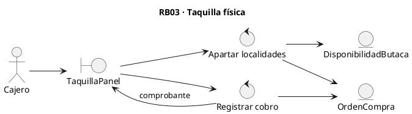

# Diagramas de robustez (ICONIX) en PlantUML

El diagrama de robustez es el **puente entre el caso de uso (qué) y el diagrama de secuencia (cómo)**. Usa los estereotipos de análisis `«boundary»`, `«control»` y `«entity»` (perfil UML de Jacobson, adoptado por ICONIX) sobre una vista de objetos. No es uno de los 14 diagramas normativos de UML 2.5.1: es una vista de análisis que reutiliza su notación de estereotipos. Sirve para detectar pasos faltantes, nombres ambiguos y objetos del dominio que el caso de uso olvidó.

## 1. Fuentes y ubicación

| Qué | Dónde |
| :-- | :-- |
| Casos de uso a analizar | `docs/diagramas-uml/diagramas-de-caso-uso/NN_*.puml` |
| Entidades (nombres exactos) | `docs/diagramas-uml/diagrama-clases-dominio.puml`, `docs/modelo-datos.md` |
| Interfaces (páginas React) | `docs/arquitectura.md` → "Responsabilidades de cada bloque (Frontend)" |
| Controladores (servicios) | `docs/arquitectura.md` → módulos y `services.py`; rutas en `docs/contrato-api.md` |
| Reglas, plazos y estados | `docs/alcance.md`, `docs/maquinas-de-estado.md` |
| Salida | `docs/diagramas-uml/diagramas-de-robustez/RBNN_<tema>.puml` con `@startuml RBNN_<tema>` |

- `NN` coincide con el diagrama de casos de uso de origen. Dibuja primero el de robustez y después el de secuencia (`SDNN`), que reutiliza los mismos nombres.
- **No inventes** entidades: usa solo clases del diagrama de dominio. Si falta una, repórtala como laguna.
- Solo se versiona el `.puml`.

## 2. Elementos

| Elemento | Representa | Gramática | PlantUML | Nombres en este proyecto |
| :-- | :-- | :-- | :-- | :-- |
| Actor | Rol externo humano o sistema | — | `actor "Cajero" as C` | Visitante, Usuario estándar, Cajero, Verificador, Administrador, Stripe, Celery Beat |
| Boundary | Interfaz entre actor y sistema (pantalla, endpoint externo) | Sustantivo | `boundary "TaquillaPanel" as B1` | Páginas `*Page.tsx`/`*Panel.tsx`, `Endpoint webhook Stripe`, `Correo SMTP` |
| Control | Lógica que coordina un paso del caso de uso | **Verbo** | `control "Apartar localidades" as K1` | Verbo + complemento; mapea a una operación de `services.py` |
| Entity | Objeto persistente del dominio | Sustantivo | `entity "OrdenCompra" as E1` | Clases del modelo de dominio |

## 3. Reglas de conexión (sustantivo–verbo)

1. **Sustantivo ↔ sustantivo: prohibido.** Boundary–boundary, boundary–entity y entity–entity no se conectan.
2. **Sustantivo ↔ verbo: permitido.** Boundary–control y entity–control.
3. **Verbo ↔ verbo: permitido.** Control–control.
4. **Actor ↔ boundary únicamente.** Un actor nunca toca un control ni una entidad.

| Desde \ Hacia | Actor | Boundary | Control | Entity |
| :-- | :-: | :-: | :-: | :-: |
| **Actor** | ✗ | ✓ | ✗ | ✗ |
| **Boundary** | ✓ | ✗ | ✓ | ✗ |
| **Control** | ✗ | ✓ | ✓ | ✓ |
| **Entity** | ✗ | ✗ | ✓ | ✗ |

Pautas ICONIX:
- Un **control por cada verbo** relevante del flujo básico y de los alternos (validar, calcular, apartar, cobrar, emitir, notificar). Entre 2 y 12 controles por caso de uso; más indica que el caso de uso debe dividirse.
- Cubre los **cursos alternos** (errores `409`, vencimientos, rechazos) con controles propios o anotaciones en la flecha.
- La dirección de la flecha indica el sentido del flujo; etiqueta solo si aporta (`: 409 ASIENTO_NO_DISPONIBLE`).
- Los efectos asíncronos (correo, Celery, auditoría) son controles enlazados a su boundary/entidad (`Notificar por correo` → `Correo SMTP`).
- Las tareas programadas entran por el actor `Celery Beat` → boundary `Tarea programada <nombre>` → control.
- Los webhooks entran por el actor `Stripe` → boundary `Endpoint webhook Stripe` → control `Verificar firma y registrar evento`.

## 4. Plantilla base



- Separa varios casos de uso del mismo diagrama con `package "UCn · Nombre" { ... }` (elementos compartidos fuera de los paquetes) o crea un archivo por caso de uso si supera ~25 elementos.
- Usa `left to right direction`: actores a la izquierda, boundaries, controles, entidades a la derecha.

## 5. Verificación

```powershell
# Reglas sustantivo–verbo, actores, elementos huérfanos y declaraciones
python .agents/skills/plantuml-diagrama-robustez/scripts/check_robustness.py docs/diagramas-uml/diagramas-de-robustez/*.puml
# Renderizado (requiere Graphviz; reutiliza el script de la skill de clases)
powershell -File .agents/skills/plantuml-diagrama-clases/scripts/render_puml.ps1 docs/diagramas-uml/diagramas-de-robustez/RB03_taquilla_fisica.puml -Format png
```

`check_robustness.py` falla si una conexión viola la matriz, un enlace usa un alias no declarado, un elemento queda huérfano o una boundary no tiene ningún control. Después abre el PNG y revisa legibilidad.

## 6. Lista de verificación

- [ ] Cada caso de uso del diagrama `NN` aparece (paquete o archivo propio).
- [ ] Entidades con nombres exactos del modelo de dominio; boundaries con nombres de páginas reales.
- [ ] Controles nombrados con verbo; cursos alternos cubiertos.
- [ ] Ninguna conexión sustantivo–sustantivo ni actor–control/entidad.
- [ ] `check_robustness.py` → `OK` y PlantUML renderiza sin errores.
- [ ] Los nombres se reutilizan como lifelines en `SDNN`.
