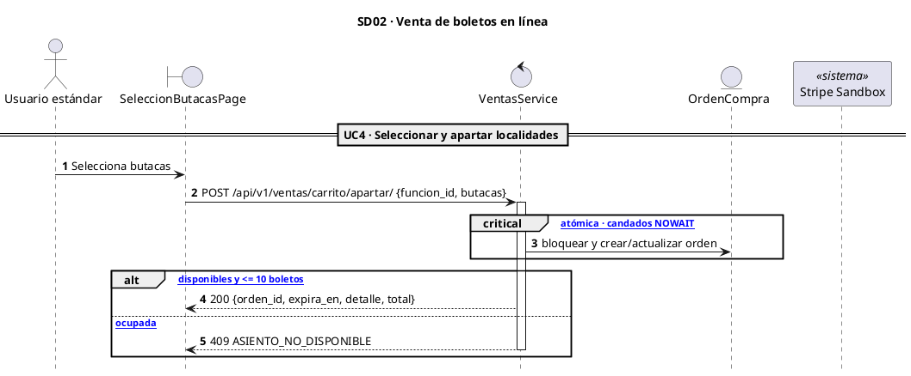

# Diagramas de secuencia UML 2.5.1 en PlantUML

Un diagrama de secuencia muestra **quién envía qué mensaje a quién y en qué orden** para cumplir un caso de uso. En este proyecto es el paso posterior al diagrama de robustez (proceso ICONIX): cada objeto del diagrama de robustez se convierte en una *lifeline* y cada controlador en uno o más mensajes. Nunca contradice las fuentes de verdad.

## 1. Fuentes y ubicación

| Qué | Dónde |
| :-- | :-- |
| Casos de uso (qué se modela) | `docs/diagramas-uml/diagramas-de-caso-uso/NN_*.puml` |
| Objetos participantes | `docs/diagramas-uml/diagramas-de-robustez/RBNN_*.puml` (mismo `NN`) |
| Rutas, cuerpos, códigos HTTP y `code` de error | `docs/contrato-api.md` |
| Servicios, candados, Celery, Stripe, páginas React | `docs/arquitectura.md` |
| Estados y transiciones (`T-x.y`) | `docs/maquinas-de-estado.md` |
| Plazos y reglas de negocio | `docs/alcance.md` y skill `teatro-reglas-negocio` |
| Salida | `docs/diagramas-uml/diagramas-de-secuencia/SDNN_<tema>.puml` con `@startuml SDNN_<tema>` |

- `NN` coincide con el diagrama de casos de uso de origen (`01` → `SD01_portal_publico_y_cuentas.puml`).
- **No inventes** rutas, campos, estados ni códigos: si el caso de uso no tiene endpoint en el contrato, modela hasta donde llegue la fuente y deja una `note` con la laguna.
- Solo se versiona el `.puml`; los PNG/SVG de verificación van a `$env:TEMP\puml-out`.

## 2. Participantes (de izquierda a derecha)

Ordena las *lifelines* según el flujo, para que las flechas avancen a la derecha y regresen a la izquierda:

| Orden | Tipo | PlantUML | En este proyecto |
| :-- | :-- | :-- | :-- |
| 1 | Actor primario | `actor "Usuario estándar" as U` | Visitante, Usuario estándar, Cajero, Verificador, Administrador |
| 2 | Interfaz | `boundary "SeleccionButacasPage" as UI` | Página o panel React (`/` o `/gestion/`) |
| 3 | Control | `control "VentasService" as CTL` | Vista DRF + `services.py` del módulo; servicios base (`AgendaService`, `AuditoriaService`, `ConfiguracionService`) |
| 4 | Entidades | `entity "OrdenCompra" as OC` | Modelos de `docs/diagramas-uml/diagrama-clases-dominio.puml` |
| 5 | Sistemas externos / asíncronos | `participant "Stripe Sandbox" as ST <<sistema>>`, `queue "Celery" as Q`, `participant "SMTP" as MAIL <<sistema>>` | Siempre a la derecha |

- Usa los **mismos nombres** que el diagrama de robustez del mismo `NN`.
- Un actor solo intercambia mensajes con una **boundary** (nunca con control o entidades). Los sistemas externos que llaman al servidor (webhook de Stripe, Celery Beat) entran también por una boundary/endpoint o control de tarea.
- Agrupa por frontera con `box "Portal público /" #FFFFFF ... end box` y `box "Operación interna /gestion/"` cuando el diagrama mezcla ambos.

## 3. Mensajes (notación UML 2.5.1)

| Mensaje | Notación UML | PlantUML | Uso |
| :-- | :-- | :-- | :-- |
| Síncrono | Línea continua, punta rellena | `A -> B : op()` | Petición HTTP, llamada a servicio, consulta ORM |
| Asíncrono | Línea continua, punta abierta | `A ->> B : evento` | Encolar en Celery (`on_commit`), correo SMTP, webhook entrante |
| Respuesta | Línea discontinua, punta abierta | `B --> A : 200 {...}` | Resultado HTTP con código y `code` del contrato |
| Creación | Mensaje a la cabecera de la nueva lifeline | `A -> B ** : create` | Objeto creado durante la interacción (opcional) |
| Destrucción | X al final de la lifeline | `destroy B` | Raro; solo si la fuente lo describe |
| Mensaje a sí mismo | Bucle sobre la lifeline | `CTL -> CTL : verificar firma` | Validación interna |

Reglas:
- Etiqueta peticiones como `POST /api/v1/ventas/checkout/ {orden_id}` y respuestas como `200 {orden_id, estado}` o `409 ORDEN_EXPIRADA`.
- Usa `autonumber` siempre. Activa con `++` al enviar y desactiva con `--` al responder; no actives cada micro-paso.
- Importes como cadenas decimales MXN; instantes en `America/Mexico_City` y persistencia UTC (anótalo, no lo repitas en cada mensaje).

## 4. Fragmentos combinados

| Operador | Semántica UML 2.5.1 | PlantUML |
| :-- | :-- | :-- |
| `alt` | Alternativas excluyentes; cada operando con guarda | `alt [butacas disponibles]` … `else [ocupada]` … `end` |
| `opt` | Se ejecuta solo si la guarda es verdadera | `opt [con póster]` … `end` |
| `loop` | Repetición con guarda o límites | `loop [cada 10–15 s mientras la vista está activa]` … `end` |
| `break` | Termina el fragmento envolvente (error temprano) | `break [orden vencida]` … `end` |
| `par` | Operandos concurrentes | `par` … `else` … `end` |
| `critical` | Región atómica (transacción con candados) | `critical [transacción atómica]` … `end` |
| `ref` | Uso de interacción definida en otro diagrama | `ref over UI, CTL : SD01 · Iniciar sesión` |

- **Guardas obligatorias** entre corchetes en `alt`, `else`, `opt`, `break` y `loop`.
- Usa `critical` para las transacciones con `select_for_update(nowait=True)` y anota el **orden de candados**: `Usuario → OrdenCompra → DisponibilidadButaca (funcion_id, butaca_id ASC) → OrdenCompraDetalle → Boleto`.
- Usa `break` para los errores que abortan el caso (`409`, `403`, `422`) y `alt` cuando ambas ramas continúan.
- Si un diagrama supera ~40 mensajes, separa el caso secundario en su propia sección o archivo y referencíalo con `ref`.
- Separa cada caso de uso dentro del mismo archivo con `== UCn · Nombre del caso de uso ==`.

## 5. Plantilla base



## 6. Verificación

```powershell
# Reglas de esta skill (participantes, mensajes, guardas y fragmentos balanceados)
python .agents/skills/plantuml-diagrama-secuencia/scripts/check_sequence.py docs/diagramas-uml/diagramas-de-secuencia/*.puml
# Renderizado (reutiliza el script de la skill de clases)
powershell -File .agents/skills/plantuml-diagrama-clases/scripts/render_puml.ps1 docs/diagramas-uml/diagramas-de-secuencia/SD02_venta_boletos_en_linea.puml -Format png
```

`check_sequence.py` falla si: falta `autonumber`; un mensaje usa una lifeline no declarada; un actor se comunica con algo distinto de una boundary; una boundary habla directo con una entidad; dos entidades se envían mensajes; un `alt/else/opt/break/loop` no tiene guarda `[...]`; o los fragmentos no cierran con `end`. Después abre el PNG y revisa legibilidad.

## 7. Lista de verificación

- [ ] Cada caso de uso del diagrama `NN` de casos de uso tiene su sección `== UCn ==` o un `ref` justificado.
- [ ] Lifelines iguales a las del diagrama de robustez `RBNN`; actores solo hablan con boundaries.
- [ ] Rutas, cuerpos, códigos y estados salen de `contrato-api.md` y `maquinas-de-estado.md`.
- [ ] Mensajes síncronos/asíncronos/respuesta con la punta correcta; `autonumber` activo.
- [ ] Guardas en todos los operandos; `critical` en transacciones con candados en el orden oficial.
- [ ] Efectos secundarios (correo, Celery, auditoría) como asíncronos tras `on_commit`.
- [ ] `check_sequence.py` → `OK` y PlantUML renderiza sin errores.
