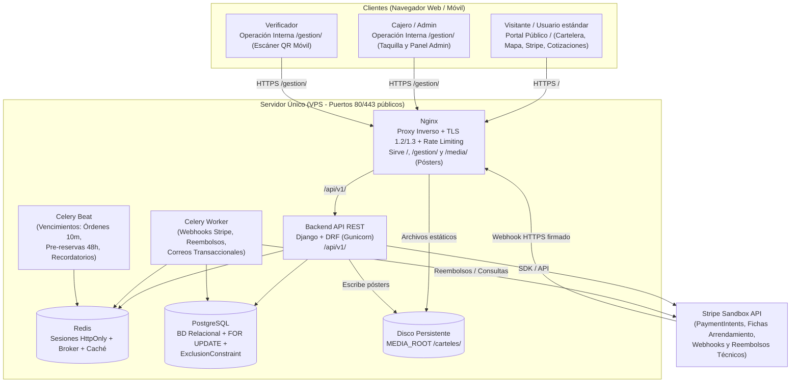
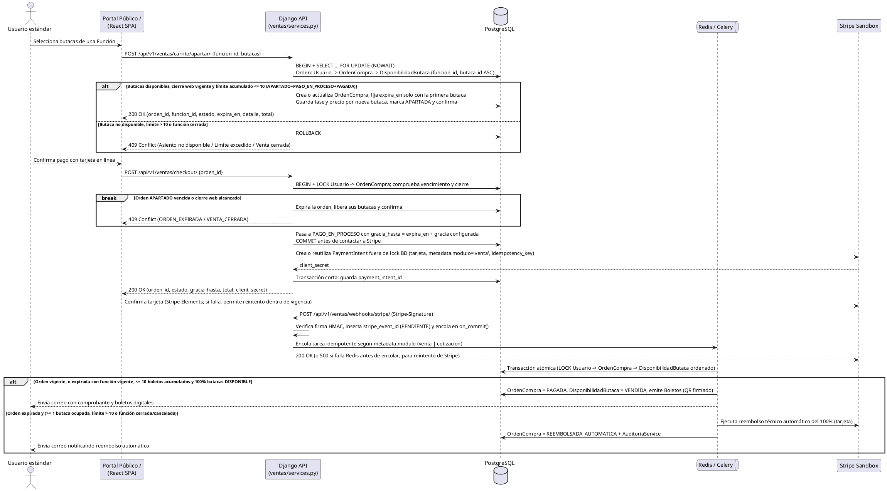
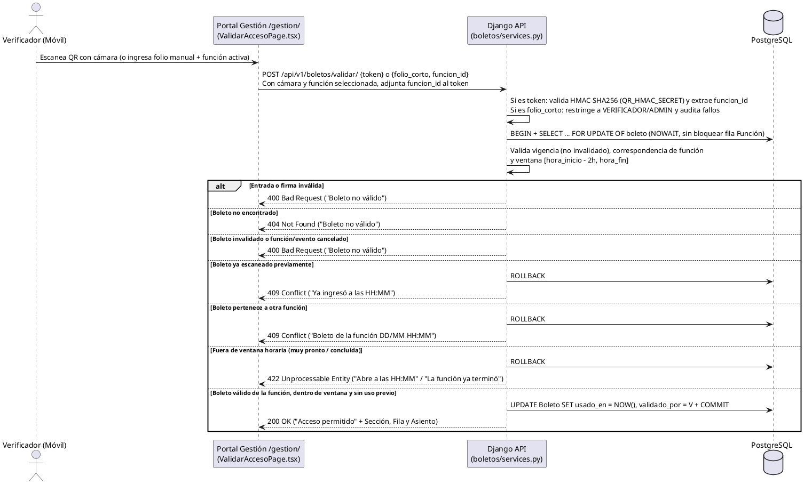
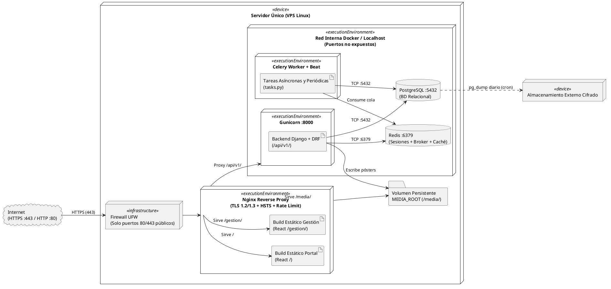

# **Arquitectura de Software y Estructura del Proyecto**

Plataforma de boletaje y cotización de renta del Teatro de la Ciudad de Coatzacoalcos

Se propone un **monolito modular organizado en tres capas lógicas, con comunicación cliente-servidor mediante una API REST pura desplegada en un servidor único (VPS con Nginx). La capa de presentación se separa en dos aplicaciones frontend independientes en React y TypeScript servidas bajo el mismo dominio en Nginx: `/` para el Portal Público y de Clientes y `/gestion/` para la Operación Interna (taquilla presencial, validador web móvil online y panel administrativo ligero), ambas estilizadas con Tailwind CSS e iconografía lucide-react. El backend opera en Django con Django REST Framework (sin Django Admin), procesamiento asíncrono y colas de tareas con Celery y Redis, y persistencia en PostgreSQL.**

Esta organización permite repartir el trabajo de seis integrantes por funcionalidad y completar una primera entrega en cuatro semanas. Los módulos del servidor se desplegarán como una sola aplicación Django (acompañada de sus trabajadores asíncronos de Celery) y compartirán una base de datos bajo la zona horaria oficial **America/Mexico_City** (almacenando marcas temporales en UTC).

## **Las tres capas**

| Capa | Tecnología | Responsabilidad |
| :---- | :---- | :---- |
| **Presentación** | React 18 + TypeScript + Tailwind CSS + lucide-react (2 *frontends* bajo el mismo origen: `/` y `/gestion/`) | **Portal público (`/`):** mostrar cartelera (eventos comerciales y públicos), mapa interactivo de 1,728 butacas con secciones del evento y fases de venta (sincronizado vía *polling* REST ligero), registro/login y recuperación de contraseña de `USUARIO`, `OrdenCompra` por función única, boletos digitales y cotizador multi-día/panel de seguimiento. **Operación interna (`/gestion/`):** taquilla presencial (`CAJERO`), validación web móvil online de QR (`VERIFICADOR`) y panel administrativo ligero (`ADMIN` para eventos directos/arrendados, agenda maestra, configuración de tarifas/parámetros, cortesías/bloqueos, contingencia, auditoría/ventas globales y cuentas internas), evitando descargar código interno en dispositivos de visitantes públicos. |
| **Negocio y Procesamiento Asíncrono** | Django + Django REST Framework (django-filter) + Celery + Redis | Exponer la API REST pura (/api/v1/), comprobar permisos RBAC y de propiedad, gestionar sesiones en Redis, aplicar reglas *snapshot* de tarifas y esquemas de cobro, apartar butacas por función única (`OrdenCompra` / `DisponibilidadButaca`), procesar pagos inmediatos con tarjeta (boletos) y tarjetas/fichas de pago (arrendamientos) en **Stripe Sandbox**, generar PDFs en memoria (reportlab) y CSV (csv), gestionar agenda y configuración en módulos transversales desacoplados, ejecutar reembolsos técnicos automáticos fuera de ventana y correr tareas periódicas/asíncronas (vencimientos, *webhooks* y notificaciones transaccionales vía SMTP nativo). |
| **Datos** | PostgreSQL (btree_gist) + ORM de Django | Guardar registros y proteger relaciones, secciones del evento, fases de venta y precios (≥ $100.00 MXN), no empalme de agenda (ExclusionConstraint) e integridad contable. Ejecutar transacciones atómicas de venta, acceso QR, ocupación del teatro y bitácora inmutable de auditoría. |

**Nota sobre dependencias y versiones:** El catálogo detallado de librerías, ramas compatibles aprobadas para el equipo, herramientas operativas y exclusiones tecnológicas se documenta en `docs/stack-tecnologico.md`, mientras que las versiones bloqueadas/aproximadas del entorno residen en `backend/requirements.txt`, `frontend/package.json` y `frontend/package-lock.json`.

# **Vistas Gráficas de la Arquitectura**

## **1. Diagrama de Contenedores (Vista C4 — Mermaid)**



## **2. Diagrama de Componentes General (3 Capas — UML 2.5 / PlantUML)**

```plantuml
@startuml
skinparam componentStyle uml2
top to bottom direction

package "Capa de Presentación (2 Frontends React + TypeScript bajo mismo dominio)" as L1 {
    package "Portal Público /" as FE_A {
        component "Router y Guards (/)" as RTR_P
        component "Features Portal y Clientes\n(cartelera, inventario, ventas,\nMisBoletos, cotizaciones, auth USUARIO)" as FE_PUB
        RTR_P --> FE_PUB
    }
    package "Operación Interna /gestion/" as FE_B {
        component "Router y Guards (/gestion/)" as RTR_G
        component "Features Operación Interna\n(Panel Admin, Configuración, Taquilla,\nValidador QR Online, Contingencia, Auditoría)" as FE_INT
        RTR_G --> FE_INT
    }
    package "Núcleo Compartido en Compilación (shared/)" as FE_S {
        component "UI Compartida\n(MapaAsientos, Button)" as FE_UI
        component "Cliente HTTP\n(api/client.ts - Cookies + CSRF)" as FE_API
    }

    FE_PUB --> FE_UI
    FE_INT --> FE_UI
    FE_PUB --> FE_API
    FE_INT --> FE_API
}

component "Nginx Reverse Proxy\n(VPS - TLS 1.2/1.3, /, /gestion/, /api/v1/, /media/)" as NGX

package "Capa de Negocio (Backend - Monolito Modular Django + DRF)" as L2 {
    component "DRF API Router (/api/v1/)\n+ Auth Sesiones Redis y RBAC (permissions.py)" as DRF

    package "Módulos de Dominio (backend/apps/)" as DOM {
        component "usuarios\n(Auth, Recuperación, Cuentas)" as USR
        component "ventas\n(OrdenCompra Función Única,\nVentasService y Taquilla)" as VTA
        component "cotizaciones\n(CotizacionesService,\nSnapshot y Parcialidades)" as COT
        component "cartelera\n(CarteleraService, Eventos Directos,\nFunciones, Secciones y Fases)" as CAR
        component "inventario\n(InventarioService, DisponibilidadButaca,\nBloqueos y Cortesías)" as INV
        component "boletos\n(BoletosService, QR por Función\ny Modo Contingencia)" as BOL
    }

    package "Módulos Transversales e Integración (Sin imports hacia arriba)" as CORE {
        component "agenda\nAgendaService y BloqueoAgenda" as AGD
        component "configuracion\nConfiguracionService, Turnos y Extras" as CFG
        component "auditoria\nAuditoriaService" as AUD
        interface "PaymentGateway" as IPay
        component "StripeAdapter" as PAY
        component "Celery Workers y Beat\n(Vencimientos 10m/48h/15d,\nwebhooks, reembolsos, correos)" as CEL

        PAY .up.|> IPay
    }

    DRF --> USR
    DRF --> VTA
    DRF --> COT
    DRF --> CAR
    DRF --> INV
    DRF --> BOL
    DRF --> CFG
    DRF --> AGD
    DRF --> AUD

    VTA --> INV : reserva / confirma butacas
    VTA --> BOL : emite boletos y QR
    VTA --> CFG : lee cierres y tiempos (snapshot)
    VTA --> IPay : cobro tarjeta / reembolso técnico
    VTA --> AUD : registra taquilla / reembolso
    VTA ..> CEL : enfila tareas post-pago

    COT --> AGD : retiene / pre-reserva / confirma
    COT --> CFG : lee tarifas, extras y plazos (snapshot)
    COT --> IPay : tarjeta o ficha Stripe
    COT --> AUD : registra aprobación / cancelación
    COT ..> CEL : enfila notificaciones / alertas

    CAR --> AGD : valida / bloquea / reprograma
    CAR --> CFG : lee parámetros de publicación / piso
    CAR --> AUD : registra publicación / cancelación
    INV --> CAR : consulta función y tarifas
    INV --> BOL : emite QR de cortesía ($0)
    INV --> AUD : registra bloqueo / cortesía
    BOL --> CAR : consulta ventana de función
    BOL --> AUD : registra contingencia
}

package "Capa de Datos e Infraestructura" as L3 {
    database "PostgreSQL\nORM Django, ACID,\nselect_for_update(),\nExclusionConstraint" as PG
    database "Redis\nSesiones Django,\nBroker Celery,\nCaché y Rate Limiting" as RED
    folder "Almacenamiento Local VPS\nMEDIA_ROOT (/media/)" as MED
    component "Stripe Sandbox API y Webhooks\n(Pasarela Externa)" as STR

    FE_API --> NGX : HTTPS JSON
    NGX --> DRF : Proxy WSGI (Gunicorn)
    NGX ..> MED : Sirve pósters estáticos

    USR --> PG
    VTA --> PG
    COT --> PG
    CAR --> PG
    INV --> PG
    BOL --> PG
    AGD --> PG
    CFG --> PG
    AUD --> PG

    CAR --> MED : escribe pósters
    DRF --> RED
    CEL --> RED
    PAY --> STR : HTTPS
    STR ..> NGX : Webhook firmado
}
@enduml
```



## **3. Diagrama de Secuencia: Compra Concurrente en Línea (Stripe + QR — UML 2.5 / PlantUML)**



## **4. Diagrama de Secuencia: Validación 100% Online de QR en Puerta (UML 2.5 / PlantUML)**



# **Modelo de Datos y Persistencia**

La persistencia se realizará en PostgreSQL utilizando **Django ORM y sus migraciones como única fuente de verdad del esquema de base de datos**. Todos los modelos en models.py definen las tablas, relaciones, índices y restricciones del dominio, garantizando compatibilidad total con Django, DRF y la creación automática de bases de datos temporales durante las pruebas (TestCase / TransactionTestCase).

Al prescindir de Django Admin, la carga inicial del aforo oficial (1,728 butacas en 6 secciones, incluyendo butacas accesibles), los catálogos base (turnos, servicios extra e infraestructura escénica), los parámetros operativos por defecto y los datos de demostración se gestionará mediante **comandos personalizados de Django (manage.py seed_teatro, manage.py seed_catalogos, manage.py seed_demo) y/o *fixtures* JSON (loaddata)**, reutilizables tanto en despliegue como en entornos de pruebas. La carpeta database/ se conservará únicamente como respaldo documental y referencia SQL:

```text
database/
├── 01_esquema.sql        Referencia documental DDL exportada del dominio
├── 02_inserts_teatro.sql Respaldo SQL del aforo oficial (1,728 butacas en 6 secciones)
└── 03_inserts_demo.sql   Respaldo SQL de datos de muestra para referencia local
```

### **Responsabilidades de los archivos SQL de referencia (database/)**

| Archivo SQL | Contenido y Propósito |
| :---- | :---- |
| 01_esquema.sql | Script DDL (*Data Definition Language*) de referencia documental del esquema del dominio (no reemplaza a las migraciones de Django). |
| 02_inserts_teatro.sql | Respaldo SQL del catálogo oficial del aforo (1,728 butacas distribuidas en 6 secciones), equivalente al comando seed_teatro. |
| 03_inserts_demo.sql | Respaldo SQL de datos de prueba de referencia, equivalente al comando seed_demo. |

Dado que el modelo relacional detallado se especificará en docs/modelo-datos.md, la arquitectura establece las siguientes **entidades nucleares de dominio** obligatorias, derivadas directamente de docs/alcance.md:

## **1. Entidades Nucleares**

| Entidad | Descripción |
| :---- | :---- |
| **Usuario / Perfil** | Almacena cuentas registradas, credenciales seguras (Argon2), aceptación obligatoria de Aviso de Privacidad y Términos (LFPDPPP — Ley Federal de Protección de Datos Personales en Posesión de los Particulares), tokens de recuperación de contraseña y un campo de rol cerrado (`TextChoices`: `ADMIN`, `CAJERO`, `VERIFICADOR`, `USUARIO`). No existe un rol separado de organizador: el Usuario estándar ejerce tanto el perfil funcional de Comprador en línea como el de Solicitante de arrendamientos con su misma cuenta. |
| **ConfiguracionSistema y Catálogos Base** | Entidades pertenecientes al módulo transversal **`configuracion`** (administradas por Admin) que almacenan los parámetros operativos editables con valores por defecto (apartado de `OrdenCompra` 10 min, gracia 5 min, cierres web 30 min y taquilla 0 min, pre-reserva 48 h, propuesta alternativa 48 h, revisión extemporánea 72 h, fecha límite de publicación 15 d, recordatorios cada 7 d, corte de saldo `D-21` (21 d) + margen 50/50 de 9 d (umbral `> 30 d`: todo evento `<= 30 d` liquida 100%), retención 50%, umbral de reprogramación/reembolso 21 d y Acuerdo de Nivel de Servicio / SLA 3/5 días hábiles), además de los turnos oficiales (Matutino, Vespertino, Día Completo con tarifas netas y horarios) y el catálogo editable de servicios extra e infraestructura escénica con unidad de cobro configurable por ítem (`POR_EVENTO`, `POR_DIA`, `POR_TURNO`, `POR_UNIDAD`). Aplica política *snapshot* para no alterar registros previos. |
| **BloqueoAgenda** | Entidad transversal perteneciente al módulo `agenda` que centraliza los intervalos físicos de ocupación del inmueble frente a terceros (montaje, ensayos, función y desmontaje) en formato `TSTZRANGE` (tipo nativo de rango con zona horaria en PostgreSQL), clasificándolos por origen operativo (`FUNCION`, `RENTA`, `MANTENIMIENTO`), etiqueta breve y estado (`PROPUESTA_RETENIDA`, `PRE_RESERVADO`, `CONFIRMADO`, `LIBERADO`), sin importar modelos de negocio externos. En arrendamientos, la Cotización crea los bloques (`RENTA`) de los días/turnos contratados; en eventos propios o mantenimientos, el Evento Directo crea sus bloques operativos (`FUNCION` / `MANTENIMIENTO`). |
| **Evento y Función** | Clasificados por modalidad (Comercial, Público, Privado) y origen (ARRENDAMIENTO vinculado a Cotización, o DIRECTO creado por Admin sin cotización ni pago de renta). Evento almacena metadatos, categoría fija sembrada en catálogo (`Teatro`, `Música`, `Danza`, `Infantil y Familiar`, `Comedia / Stand-up`, `Conferencia / Institucional`, `Festival / Otros`), póster (ImageField, obligatorio en Comercial y Público), fecha límite de publicación (`min(inicio_primer_bloque, max(primera_fecha - 15d, fecha_pago + 3d))`), aprobación final obligatoria del `ADMIN` antes de publicar tanto en Comerciales como en Públicos, y estado de ciclo de vida (`PENDIENTE_PUBLICACION`, `PUBLICADO`, `VENCIDO_SIN_PUBLICAR`, `OPERACION_SIN_CARTELERA` —asignado directo a eventos `Privado` y a la resolución #3 de vencimiento—, `CANCELADO_POR_ARRENDATARIO`, `CANCELADO_POR_TEATRO`, `FINALIZADO` al concluir sus funciones). Al confirmarse el pago inicial (`CONFIRMADO`) se crean el Evento y sus **Funciones** iniciales derivadas de los bloques de función contratados (no de montaje/ensayos), cada una con `fecha` operativa, `hora_inicio`, `hora_fin` e intervalos completos `inicio_en`/`fin_en` en UTC (soportando cruce de medianoche cuando `hora_fin <= hora_inicio`, asignando `fin_en` al día siguiente), registro histórico de reprogramación (`REPROGRAMADO` a nivel Función, sin retirar al Evento de `PUBLICADO`) y referencia FK al `BloqueoAgenda` padre (`RENTA` en arrendamientos, validando contención en `AgendaService` sin duplicar bloques; `FUNCION` en Eventos Directos). |
| **Sala** | Espacio físico del recinto con plano de butacas y agenda propios. La primera entrega opera una sola sala (el Teatro de la Ciudad con aforo oficial de 1,728 butacas); la arquitectura y el modelo de persistencia registran la entidad para admitir anexar salas o salones futuros con venta de boletos sin rediseñar la base de datos ni alterar la agenda centralizada. |
| **Sección y Butaca / Asiento** | Catálogo físico, oficial y fijo de las 1,728 butacas de la Sala oficial distribuidas en 6 secciones oficiales (Luneta, Platea, Mezzanine, Primer Piso, Segundo Piso y Palcos), con su ubicación, numeración permanente y bandera de accesibilidad (`es_accesible` para silla de ruedas y acompañante). |
| **Sección del Evento (`SeccionEvento`), Fase de Venta (`FaseVenta`) y Precio (`PrecioSeccion`)** | Entidades de configuración tarifaria y calendario comercial por Evento: (1) **`SeccionEvento`** modela las zonas de precio definidas para el evento, ofreciendo 4 modalidades (conservación estándar de las 6 secciones oficiales, sección única tipo "General", agrupación de secciones oficiales completas, o subdivisión estructurada de hasta ≤ 6 por sección oficial en graderías `(fila_inicio, fila_fin, col_inicio, col_fin)` y cabinas completas en Palcos), con nombre único no vacío por evento; (2) **`FaseVenta`** divide el periodo de venta en una o más fases consecutivas (ej. "Preventa", "Venta general") con fecha y hora de inicio para todas las funciones del evento; y (3) **`PrecioSeccion`** fija la tarifa oficial neta ≥ `$100.00 MXN` para cada combinación de sección del evento y fase de venta. Toda la configuración tarifaria y de fases queda congelada al publicarse el evento. |
| **DisponibilidadButaca** | Entidad asociativa transaccional (exclusiva de eventos Comerciales) creada en bloque mediante `bulk_create(..., batch_size=1728)` **en la transición del Evento a `PUBLICADO`** (o al agregar una Función a un evento ya publicado) para vincular cada Función con las 1,728 butacas físicas del catálogo y con la **`OrdenCompra`** activa que la retiene o adquiere, vinculando la sección del evento correspondiente y almacenando el precio congelado (*snapshot*) de la fase de venta vigente al momento del apartado, junto con su estado en tiempo real (`DISPONIBLE`, `APARTADA`, `VENDIDA`, `BLOQUEO_TECNICO`, `CORTESIA`). |
| **OrdenCompra** | Entidad unificada que modela todo el ciclo de vida de la compra de boletos al 100% de liquidación (solo eventos Comerciales): inicia como apartado temporal activo (**una sola Función comercial por transacción** y `1` orden en curso por usuario con `expira_en = +10 min` desde la primera selección y `gracia_hasta = +5 min` por pago en proceso), registra canal (`LINEA` con tarjeta inmediata en Stripe o `TAQUILLA` presencial con Efectivo o Tarjeta cobrada en terminal bancaria externa / Hardware POS sin integración), folio de orden y estados explícitos (`APARTADO`, `PAGO_EN_PROCESO`, `PAGADA`, `EXPIRADA`, `REEMBOLSADA_AUTOMATICA`). En línea exige cuenta de `USUARIO`; en taquilla se vincula al `CAJERO` sin exigir cuenta al comprador. Nunca se borra físicamente. |
| **Cotización** | Almacena las solicitudes de arrendamiento enviadas por un Usuario estándar (Solicitante) con soporte de un día o múltiples días/turnos (incluyendo bloques de ensayo/montaje incluidos en precio al rentar más de un día o más de una función el mismo día), conceptos extra e infraestructura seleccionados con cobro configurable por ítem, subtotal estimado informativo neto en MXN (sin IVA adicional) y monto oficial confirmado por Admin (*snapshot*), *snapshot* del esquema de cobro (`50/50` si faltan `> 30` días naturales a la primera fecha reservada —`D-21` + margen de `9` días— o `100%` obligatorio si faltan `<= 30` días; en `50/50`, anticipo redondeado a 2 decimales y `saldo = total - anticipo`), propuestas estructuradas de hasta 3 fechas alternativas (`PROPUESTA_RETENIDA` por 48 h), referencia hacia `BloqueoAgenda`, estados oficiales de ciclo de vida (`EN_REVISION`, `PROPUESTA_RETENIDA`, `PROPUESTA_EXPIRADA`, `PRE_RESERVADO`, `CONFIRMADO`, `EXPIRADA_SIN_PAGO`, `EXPIRADA_POR_FECHA`, `PAGO_EXTEMPORANEO_EN_REVISION`, `RECHAZADA`, `CANCELADO_POR_ARRENDATARIO`, `CANCELADO_POR_TEATRO`, `FINALIZADO`) y sub-estado financiero (`ANTICIPO_50_PAGADO`, `LIQUIDADO_100`, `REEMBOLSO_BANCARIO_PENDIENTE`). |
| **Pago de Arrendamiento / Reserva** | Entidad financiera del módulo `cotizaciones` derivada de una Cotización aprobada que controla el anticipo (50%) o liquidación total (100%), el saldo restante acreditable hasta las 23:59:59 del día `D-21` (restringiendo emisión de fichas en las últimas 48 h previas al corte), sus estados oficiales (`PENDIENTE`, `ACREDITADO`, `EN_REVISION_EXTEMPORANEA`, `VENCIDO`, `REEMBOLSADO`, `REEMBOLSO_BANCARIO_PENDIENTE`) y la resolución de pagos extemporáneos (`PAGO_EXTEMPORANEO_EN_REVISION`). |
| **Transacción / Pasarela de Pagos (Stripe)** | Entidad del módulo `ventas` (junto con el endpoint `/api/v1/ventas/webhooks/stripe/` y `StripeAdapter`) que registra el detalle técnico y financiero de **Stripe Sandbox** con estados oficiales (`PENDIENTE`, `ACREDITADA`, `FALLIDA`, `CANCELADA`, `REEMBOLSADA`): `PaymentIntent` con tarjeta en línea para boletaje y arrendamientos (creados fuera de bloqueos de BD y reutilizables en reintentos fallidos dentro de vigencia), **fichas de pago con línea de captura (transferencia interbancaria SPEI o depósito en efectivo) restringidas exclusivamente a arrendamientos**, procesamiento idempotente de *webhooks* firmados (`stripe_webhook_events` con `stripe_event_id` y estado `PENDIENTE`/`PROCESADO`/`FALLIDO`, encolado en `on_commit` y enrutado por `metadata.modulo`), reembolso técnico automático del 100% vía API para **tarjeta** y estado `REEMBOLSO_BANCARIO_PENDIENTE` con alerta prioritaria al Admin para devolución bancaria externa de fichas SPEI/efectivo fuera de ventana. |
| **Boleto** | Entidad derivada de una `OrdenCompra` pagada o de una **emisión de cortesía por Admin** (`$0.00 MXN`, sin cuenta de invitado y con beneficiario/motivo opcional) asociada a una **`DisponibilidadButaca`**. Incluye `folio_corto` aleatorio no secuencial (≥ 8 caracteres Base32 sin `0/O/1/I`, generado con `secrets`), límite de ≤ 10 boletos acumulados (`APARTADO + PAGO_EN_PROCESO + PAGADA`) por cuenta y función (exentas las cortesías), token no secuencial firmado (`UUID v4` + `HMAC-SHA256` con variable dedicada `QR_HMAC_SECRET` independiente de `SECRET_KEY`) ligado a su Función para validación 100% online en puerta (`usado_en`, `validado_por`), sección oficial y sección del evento (cuando difiera de la oficial), bandera de invalidación y soporte de exportación PDF/CSV y reconciliación en lote para **modo contingencia**. |
| **RegistroAuditoria** | Bitácora inmutable perteneciente al módulo transversal auditoria que registra acciones administrativas y operativas sensibles (ventas en taquilla, aprobaciones/reprogramaciones/cancelaciones, resoluciones de VENCIDO_SIN_PUBLICAR y pagos extemporáneos, bloqueos técnicos y cortesías, reembolsos automáticos, activación/exportación/reconciliación de modo contingencia, cambios en configuración y gestión de cuentas internas). |

## **2. Reglas de Consistencia, Concurrencia, Integridad y Negocio**

* **Zona Horaria Oficial (America/Mexico_City) y Resolución Horaria Determinista en Servidor:** El VPS sincronizado por NTP y PostgreSQL (persistiendo todos los *timestamps* en **UTC**) actúan como **única fuente de verdad horaria**, sin consultar APIs externas de hora ni depender del reloj del dispositivo cliente. Django evalúa de forma determinista todas las reglas de negocio (cierres de venta por función a los 30 min / 0 min respecto a `inicio_en`, corte de liquidación a las 23:59:59 del día `D-21`, ventanas QR `[inicio_en - 2h, fin_en]` soportando cruce de medianoche, días naturales y SLA de **días hábiles contados de lunes a viernes excluyendo fines de semana**) bajo **America/Mexico_City** mediante `zoneinfo` + `tzdata`, intercambiando fechas en formato **ISO 8601** por `/api/v1/` para su presentación en frontend mediante `Intl.DateTimeFormat`.
* **Sincronización del Mapa de 1,728 Butacas bajo WSGI (Sin WebSockets):** Al operar sobre Gunicorn (WSGI) y API REST pura sin WebSockets/ASGI, la actualización visual en tiempo real del plano de asientos en `SeleccionButacasPage.tsx` y `TaquillaPanel.tsx` se implementa mediante ***polling* HTTP ligero** (cada 10–15 s mientras la vista esté activa, pausado automáticamente al perder foco mediante `document.visibilityState` y optimizado con `React.memo` sobre cada asiento). Para sostener 150–250 usuarios en `< 300 ms (p95)`, el endpoint de disponibilidad consulta con `.values_list('butaca_id', 'estado')` (sin serializadores DRF pesados), usa caché breve en Redis (`2–3 s`, invalidada en `transaction.on_commit()`) y cabecera `ETag` (`304 Not Modified`). La consistencia fuerte ante selecciones simultáneas recae siempre en el candado atómico `SELECT ... FOR UPDATE` en PostgreSQL, devolviendo `409 Conflict` cuando una localidad fue ocupada milisegundos antes.
* **Compra en Línea con Cuenta Obligatoria vs. Taquilla Física:**
  * **Canal en línea:** Obliga a iniciar sesión (Usuario estándar); si un Visitante selecciona un asiento en el mapa, el frontend preserva la funcion_id y localidades elegidas tras autenticarse. El carrito opera sobre **una sola Función** a la vez, con reloj único de 10 min desde el primer asiento y pago exclusivo con tarjeta inmediata vía Stripe.
  * **Taquilla física:** El Cajero autenticado opera sin exigir cuenta al asistente, compartiendo el mismo bloqueo temporal de 10 min e inventario en tiempo real con la web, y registrando cobros en Efectivo o Tarjeta en terminal externa.
* **Integridad de Agenda y Prevención de Empalmes (ExclusionConstraint + btree_gist):** Todos los bloqueos del recinto en BloqueoAgenda se representan como intervalos semiabiertos `[inicio, fin)` (`TSTZRANGE`) en UTC (permitiendo turnos consecutivos exactos, como Matutino seguido de Vespertino, sin falsas colisiones). La migración inicial del módulo agenda habilita explícitamente `BtreeGistExtension()` en PostgreSQL. La no superposición de bloques vigentes frente a terceros se garantiza con doble candado: transacciones atómicas en `AgendaService` respaldadas físicamente por una `ExclusionConstraint` sobre `(rango_tiempo WITH &&)` para todo bloqueo con `estado != 'LIBERADO'` (PROPUESTA_RETENIDA, PRE_RESERVADO, CONFIRMADO), traduciendo cualquier choque concurrente a HTTP 409 Conflict. Para evitar auto-colisiones en la misma entidad: (1) las Funciones de un arrendamiento validan en `AgendaService` estar contenidas dentro del BloqueoAgenda `RENTA` padre y no traslaparse entre funciones hermanas del mismo evento, sin insertar bloques duplicados; (2) las hasta 3 opciones de `PROPUESTA_RETENIDA` deben ser disjuntas entre sí; (3) `reprogramar_bloque()` bloquea el registro origen con `select_for_update()` y lo cambia a `LIBERADO` antes de insertar el nuevo bloque dentro de la misma transacción (o usa `Deferrable.DEFERRED`); y (4) antes de validar disponibilidad o insertar, `AgendaService` ejecuta liberación *lazy* de bloques expirados para evitar falsos choques por retrasos de Celery Beat.
* **Integridad Contable y Trazabilidad (*Soft Delete*):** Ningún rol (incluyendo Admin) puede eliminar físicamente registros confirmados de `OrdenCompra`, Pago, Pago de Arrendamiento, `Boleto`, `Cotización` ni `BloqueoAgenda`. Toda cancelación (`CANCELADO_POR_ARRENDATARIO`, `CANCELADO_POR_TEATRO`), invalidación de QR o liberación de agenda se gestiona mediante cambios de estado auditados en `RegistroAuditoria`.
* **Procesamiento Asíncrono, Vencimientos por Timestamp e Idempotencia (Redis + Celery):**
  * **Celery Beat** ejecuta tareas periódicas limpias consultando marcas temporales explícitas (`expira_en`, `gracia_hasta`, `fecha_limite_publicacion`, `proximo_recordatorio_en`) para liberar `OrdenCompra` vencidas, expirar propuestas/pre-reservas de 48 h, cerrar solicitudes cuya fecha estimada ya pasó (`EXPIRADA_POR_FECHA`) y disparar recordatorios (3 d y cada 7 d) y alertas de publicación (15 d).
  * **Celery Worker** procesa de forma **idempotente** (`acks_late=True`) los *webhooks* firmados de Stripe (`stripe_event_id` con estado `PENDIENTE`/`PROCESADO`/`FALLIDO`, encolado tras `transaction.on_commit()` y despacho por `metadata.modulo` hacia `ventas` o `cotizaciones`, incluyendo `payment_intent.payment_failed`), ejecuta **reembolsos técnicos automáticos del** 100% vía Stripe API cuando un pago con **tarjeta** llega fuera de ventana y la localidad/fecha ya fue ocupada —o cuando una reasignación excedería el límite de ≤ 10 boletos— (o registra `REEMBOLSO_BANCARIO_PENDIENTE` para fichas SPEI/efectivo), y envía las notificaciones transaccionales por correo electrónico vía `django.core.mail` (SMTP).
* **Transacciones Atómicas, Jerarquía Global de Candados y Límite Anti-Reventa (≤ 10):** Para impedir interbloqueos (*deadlocks*), sobreventas y evasión del límite en pestañas paralelas (ej. apartar `6 + 6 = 12` en dos solicitudes simultáneas), toda operación crítica aplica el orden estricto global de bloqueos **`Usuario` → `OrdenCompra` → `DisponibilidadButaca` (ordenada determinísticamente por `(funcion_id, butaca_id) ASC`) → `Boleto`**, acotado siempre al subconjunto mínimo necesario:
  * **Control atómico del límite ≤ 10 boletos:** En compras en línea, el servicio bloquea la fila de `Usuario` (`select_for_update()`) y suma las localidades activas/pagadas para `(usuario_id, funcion_id)` en los estados **`APARTADO + PAGO_EN_PROCESO + PAGADA`** antes de emitir o confirmar el apartado; en reasignación por *webhook* tardío sobre una orden `EXPIRADA`, vuelve a adquirir esta jerarquía y **re-verifica el límite ≤ 10** (si el usuario compró otros boletos en paralelo y la suma superaría 10, cancela la reasignación y reembolsa al 100%). En taquilla física (`CAJERO` sin cuenta de comprador), el límite ≤ 10 se valida por `OrdenCompra`.
  * **`NOWAIT` vs. `SKIP LOCKED`:** Las peticiones HTTP de usuario y taquilla (`apartar`, `checkout`, reservas de `AgendaService`, validación QR sobre `of=('self',)` de `Boleto`) utilizan `select_for_update(nowait=True)` traduciendo colisiones concurrentes inmediatamente a `409 Conflict` sin saturar hilos de Gunicorn; las tareas periódicas de limpieza en Celery Beat usan `select_for_update(skip_locked=True)` para no bloquearse frente a transacciones HTTP en curso.
* **Fuente Única de Verdad y Estrategia de Migraciones:** Django es la **única fuente de verdad** del esquema de base de datos mediante makemigrations y migrate, apoyado por los comandos de sembrado seed_teatro, seed_catalogos y seed_demo.

## **3. Almacenamiento de Imágenes y Pósters de Eventos (VPS / Nginx)**

La carpeta frontend/public/carteles/ se reservará **exclusivamente para activos estáticos empaquetados en el build** (como el logo del teatro o sin-poster.jpg). Los pósters dinámicos de eventos comerciales y públicos (ImageField) se almacenarán de forma persistente directamente en el VPS:

* **Directorio Persistente (MEDIA_ROOT):** Django guarda las imágenes cargadas en un volumen persistente fuera del código compilado (ej. /var/www/teatro/media/carteles/) con nombres aleatorios UUID, re-codificándolas previamente con Pillow (limitando `Image.MAX_IMAGE_PIXELS` para mitigar bombas de descompresión y eliminando metadatos EXIF/payloads incrustados) y eliminando el archivo previo al reemplazar un póster.
* **Entrega Directa por Nginx:** Nginx configura `client_max_body_size 6m;` en las rutas de subida para admitir pósters válidos (≤ 5 MB, JPG/PNG/WebP) y expone directamente /media/ con cabeceras `X-Content-Type-Options: nosniff` y `Content-Security-Policy: default-src 'none'`.

# **Módulos, Control de Acceso (RBAC) y Comunicación (API REST)**

Los módulos del backend se organizarán en **seis módulos de dominio** orientados a las funciones del teatro y **tres módulos transversales internos** (`agenda`, `configuracion` y `auditoria`) que evitan dependencias circulares y duplicación de lógica. Cada aplicación Django mantendrá sus modelos, servicios, filtros declarativos, pruebas y, cuando exponga endpoints, sus permisos (permissions.py) y rutas.

| Módulo | Tipo | Responsabilidad |
| :---- | :---- | :---- |
| usuarios | Dominio | Registro (con aceptación LFPDPPP), autenticación mediante sesiones en Redis, recuperación de contraseña por correo SMTP, cierre de sesión/revocación, gestión de perfil propio y CRUD de cuentas internas (ADMIN, CAJERO, VERIFICADOR, USUARIO). |
| cartelera | Dominio | Categorías, eventos (Comercial, Público, Privado; origen arrendamiento o Evento Directo), funciones (fecha, hora_inicio, hora_fin), pósters, configurador de secciones del evento (conservación 6 secciones, sección única, agrupación o subdivisión ≤ 6), fases de venta y precios (≥ `$100.00 MXN`, congelamiento al publicar), gestión de fecha límite de publicación (VENCIDO_SIN_PUBLICAR) y cancelaciones/reprogramaciones. |
| inventario | Dominio | Catálogo físico de salas (sala única Teatro de la Ciudad con aforo oficial de 1,728 butacas en 6 secciones oficiales, incluyendo accesibles), consulta ligera para *polling* de disponibilidad en tiempo real por Función (`DisponibilidadButaca`), bloqueos técnicos sin QR y emisión de cortesías (`$0.00 MXN` con QR, sin cuenta de invitado). |
| ventas | Dominio | Ciclo unificado de `OrdenCompra` por **función única** (10 min + 5 min gracia), límite ≤ 10 boletos con bloqueo en `Usuario`, apartado compartido con taquilla física, cierres independientes por función (30 min web / 0 min taquilla), cobros inmediatos con tarjeta en **Stripe Sandbox**, ventas presenciales de Cajero, procesamiento idempotente de *webhooks* y reembolsos técnicos automáticos fuera de ventana. |
| boletos | Dominio | Emisión de folios cortos y códigos QR firmados por Función (`usado_en`, `validado_por`), generación binaria en memoria de **PDFs de boletos digitales, cortesías y reimpresiones de taquilla** (reportlab + QrCodeWidget), validación 100% online en tiempo real contra la ventana determinista de su propia función (`[hora_inicio - 2h, hora_fin]`) y **modo contingencia** (exportación auditada en PDF con reportlab y CSV con csv estándar desde 24 h antes, más reconciliación en lote). |
| cotizaciones | Dominio | Solicitudes de arrendamiento enviadas por Usuario estándar (un día o multi-día/turnos, con ensayos incluidos cuando hay más de un día o más de una función), cálculo de subtotal estimado informativo neto en MXN y monto oficial confirmado por Admin (*snapshot*), generación de **comprobantes de cotización en PDF** (reportlab), flujo estructurado de hasta 3 fechas alternativas (PROPUESTA_RETENIDA 48 h), pre-reserva estricta (PRE_RESERVADO 48 h), esquema 50/50 vs 100% (umbral `> 30 d` y corte `D-21`), pagos con tarjeta o ficha Stripe y resolución de pagos extemporáneos (72 h). |
| agenda | Transversal | Control centralizado y neutral de ocupación del inmueble (`BloqueoAgenda` y `AgendaService`) para validar, retener propuestas, pre-reservar, confirmar, reprogramar atómicamente y liberar intervalos sin acoplar `cartelera` con `cotizaciones`. |
| configuracion | Transversal | Módulo neutral que centraliza `ConfiguracionSistema`, turnos oficiales (Matutino, Vespertino, Día Completo con tarifas netas y horarios) y el catálogo editable de servicios extra e infraestructura escénica (`POR_EVENTO`, `POR_DIA`, `POR_TURNO`, `POR_UNIDAD`) mediante `ConfiguracionService`, evitando dependencias circulares entre `cartelera`, `ventas` y `cotizaciones`. |
| auditoria | Transversal | Registro inmutable de acciones sensibles (`RegistroAuditoria` y `AuditoriaService`) consumido por la capa de servicios de todos los módulos operativos. |

## **1. Matriz Oficial de Roles y Permisos (RBAC)**

El control de acceso (*Role-Based Access Control*, RBAC) diferencia entre **Visitantes anónimos** (sin sesión) y **4 roles cerrados** implementados mediante TextChoices en el modelo de usuario, aplicando el principio de menor privilegio. Los módulos transversales `agenda`, `configuracion` y `auditoria` no importan módulos de dominio y restringen las mutaciones operativas (configuración, mantenimientos, auditoría global) al rol `ADMIN`.

| Módulo | Visitante (Sin sesión) | Usuario estándar (USUARIO) | Cajero (CAJERO) | Verificador (VERIFICADOR) | Admin (ADMIN) |
| :---- | :---- | :---- | :---- | :---- | :---- |
| **cartelera** | Leer eventos comerciales/públicos publicados y funciones. | Leer eventos publicados, configurar secciones del evento/fases/precios y subir póster de **sus** arrendamientos pagados. | Leer funciones comerciales activas para venta en taquilla. | Leer funciones activas para referencia operativa. | **CRUD completo** (eventos directos/arrendados, funciones, pósters, publicación, VENCIDO_SIN_PUBLICAR, cancelaciones y reprogramaciones). |
| **configuracion** | Sin acceso. | Leer tarifas de turnos y catálogo de extras vigentes al cotizar (solo lectura). | Sin acceso. | Sin acceso. | **CRUD completo** de `ConfiguracionSistema`, turnos oficiales y catálogo editable de extras e infraestructura. |
| **inventario** | Ver mapa de 1,728 butacas, secciones del evento y disponibilidad (lectura). | Ver mapa y apartar temporalmente localidades de una función. | Ver mapa, apartar (10 min) y vender localidades en taquilla física. | Sin acceso. | **Control total** (consulta, bloqueos técnicos sin QR y emisión/descarga de cortesías `$0.00 MXN`). |
| **ventas** | Sin acceso (al elegir asiento redirige a login conservando selección). | Crear `OrdenCompra` (**1 función**), pagar en línea con tarjeta vía Stripe y ver **sus** órdenes. | Registrar ventas y cobros presenciales en taquilla (Efectivo / Tarjeta externa). | Sin acceso. | Ver historial global de `OrdenCompra`/pagos, conciliación, reembolsos técnicos y anulaciones auditadas. |
| **boletos** | Sin acceso. | Consultar y descargar **únicamente sus** boletos y QR (web y PDF). | Emitir y reimprimir excepcionalmente boletos vendidos en taquilla (PDF). | Escanear QR / folio manual y registrar ingreso único. | Consulta global, descarga PDF de cortesías, soporte de acceso y **modo contingencia** (exportación PDF/CSV y reconciliación en lote). |
| **cotizaciones** | Sin acceso. | Crear solicitudes de renta, descargar comprobante PDF, responder fechas alternativas, pagar (tarjeta/ficha) y solicitar cancelación/reprogramación de **las suyas**. | Sin acceso. | Sin acceso. | **Gestión completa**: revisar (SLA), ajustar monto oficial, aprobar/rechazar, proponer hasta 3 fechas alternativas, resolver pagos extemporáneos y cancelaciones. |
| **usuarios** | Registro (LFPDPPP), login y recuperación de contraseña. | Editar **su propio** perfil y cerrar sesión. | Gestionar su propia sesión. | Gestionar su propia sesión. | **CRUD de cuentas internas** (Cajero, Verificador, Admin) y suspensión de cuentas. |

### **Reglas de implementación RBAC**

* **Autorización en el backend como única fuente de verdad:** Todas las restricciones se aplican en permissions.py de cada módulo DRF. Los *Route Guards* en React (`/` y `/gestion/`, mediante ProtectedRoute.tsx) sirven únicamente para experiencia de usuario.
* **Permisos a nivel de objeto (Anti-IDOR / BOLA):** En cartelera (edición de póster/secciones del evento/fases del arrendatario), ventas, boletos y cotizaciones, toda consulta o acción de un Usuario estándar valida estrictamente la propiedad del recurso (`recurso.usuario_id == request.user.id`), impidiendo vulnerabilidades de tipo IDOR / BOLA (*Insecure Direct Object Reference* / *Broken Object Level Authorization*) mediante manipulación de identificadores en la URL.

## **2. Reglas entre módulos**

Ventas coordina la compra de eventos **Comerciales** usando `OrdenCompra` y los servicios de inventario (`DisponibilidadButaca`), `configuracion` (tiempos y cierres) y boletos: en compras en línea exige cuenta registrada (Usuario estándar), acota la orden a **una sola Función**, valida atómicamente con bloqueo en `Usuario` el límite de ≤ 10 boletos acumulados (`APARTADO + PAGO_EN_PROCESO + PAGADA`) por cuenta/función y el horario de cierre web (30 min antes por defecto; a partir del cierre se prohíbe iniciar nuevos `checkout` sobre órdenes en `APARTADO` —que expiran al vencer su reloj—, concluyendo únicamente las ya iniciadas en `PAGO_EN_PROCESO`) y procesa cobros inmediatos con tarjeta mediante **Stripe Sandbox** (ejecutando reembolsos técnicos automáticos si una confirmación llega fuera de ventana y las localidades ya fueron tomadas o superaría 10 boletos). En taquilla física permite al Cajero autenticado apartar temporalmente localidades (10 min) y registrar ventas presenciales hasta el cierre de taquilla (0 min antes por defecto) sin solicitar cuenta al comprador.

Cotizaciones permite a cualquier Usuario estándar enviar solicitudes de renta (un día o multi-día, con ensayos incluidos cuando hay más de un día o más de una función) consultando tarifas y catálogo en `configuracion` y mostrando un subtotal estimado informativo neto en MXN. Tanto la propuesta de hasta 3 fechas alternativas (PROPUESTA_RETENIDA por 48 h), la aprobación con pre-reserva (PRE_RESERVADO por 48 h), la confirmación de pago (CONFIRMADO) como la programación de funciones o mantenimientos en cartelera validan y bloquean el intervalo completo exclusivamente a través del módulo transversal agenda. Los eventos de modalidad **Público** (sin boletaje ni QR) y **Privado** (ocultos en cartelera pública y sin póster) bloquean la agenda con las mismas reglas.

### **Reglas arquitectónicas obligatorias para los módulos transversales (`agenda`, `configuracion` y `auditoria`)**

Para preservar el **Principio de Dependencias Acíclicas (ADP)** y evitar dependencias circulares entre `cartelera`, `ventas` y `cotizaciones`:

1. **Dependencia estrictamente unidireccional (Cero imports inversos):** Los módulos de dominio (`cartelera`, `cotizaciones`, `ventas`, `inventario`, `boletos`) dependen de `apps/agenda/`, `apps/configuracion/` y `apps/auditoria/`. Queda estrictamente prohibido que cualquier archivo dentro de estos tres módulos transversales importe modelos, servicios o serializadores de módulos de dominio.
2. **Puerta única de acceso (`AgendaService` y `ConfiguracionService`):** Ningún módulo externo puede crear, modificar ni eliminar registros de `BloqueoAgenda` directamente vía ORM; toda interacción de agenda debe pasar por la interfaz pública de `apps/agenda/services.py` (`verificar_disponibilidad`, `retener_propuestas`, `pre_reservar_bloque`, `confirmar_bloque`, `reprogramar_bloque` y `liberar_bloque`). Las lecturas/actualizaciones de parámetros, turnos y catálogo de extras pasan por `apps/configuracion/services.py` con política *snapshot* en el módulo consumidor.
3. **Neutralidad semántica (SoC):** `agenda` no contiene lógica de precios, eventos, pósters ni cotizaciones (gestiona intervalos, origen, estado `PROPUESTA_RETENIDA | PRE_RESERVADO | CONFIRMADO | LIBERADO` y etiqueta); `configuracion` no conoce órdenes, eventos ni cotizaciones.
4. **Doble candado ante concurrencia:** Las retenciones, reservas y reprogramaciones atómicas se ejecutan dentro de transacciones de base de datos (`select_for_update(nowait=True)`) combinadas con `ExclusionConstraint` en PostgreSQL (`BtreeGistExtension()`, `estado != 'LIBERADO'`). Las funciones de un arrendamiento validan contención dentro de su bloque `RENTA` padre sin duplicar registros en `BloqueoAgenda`; las opciones de `PROPUESTA_RETENIDA` deben ser no traslapadas entre sí; `reprogramar_bloque()` bloquea con `select_for_update()` y pasa a `LIBERADO` el bloque previo antes de insertar el nuevo (o usa `Deferrable.DEFERRED`); y `AgendaService` libera en forma *lazy* bloques ya expirados antes de evaluar disponibilidad.
5. **Ciclo de vida controlado:** Una solicitud de cotización en estado EN_REVISION no bloquea fechas; el BloqueoAgenda se genera al retener fechas propuestas (PROPUESTA_RETENIDA), al aprobar una cotización (PRE_RESERVADO) o al confirmar un evento directo/mantenimiento (CONFIRMADO), y pasa a LIBERADO al expirar, cancelarse o rechazarse (sin borrado físico).
6. **Verificación automatizada en CI:** La suite de pruebas incluye una verificación arquitectónica automatizada (import-linter) que impide importaciones inversas desde `apps/agenda/`, `apps/configuracion/` y `apps/auditoria/` hacia módulos de dominio.

**Eliminación de Django Admin (API REST pura):** Se elimina django.contrib.admin del proyecto para reducir la superficie de ataque, unificar la experiencia de autenticación y evitar modificaciones directas en base de datos fuera de la lógica de negocio. Toda la operación interna se realiza exclusivamente desde **React** consumiendo la API REST, garantizando que el 100% de las operaciones pasen por services.py, permissions.py y AuditoriaService.

## **3. Validación de Acceso QR (100% Online) y Modo Contingencia**

La validación de boletos en puerta para eventos **Comerciales** (incluyendo cortesías emitidas por Admin) es **oficialmente 100% online en tiempo real** mediante la vista web responsiva ValidarAccesoPage.tsx, accesible directamente desde navegadores móviles modernos (Safari en iOS y Chrome en Android) **sin requerir PWA, Service Workers ni instalación de aplicaciones nativas**. Para operar con fiabilidad ante aforos de hasta 1,728 personas, se establecen las siguientes reglas técnicas y operativas:

1. **Acceso a cámara por API web estándar:** Uso de MediaDevices.getUserMedia() mediante una librería ligera de lectura QR (html5-qrcode).
2. **HTTPS estrictamente obligatorio:** En producción se garantiza mediante TLS 1.2/1.3 configurado en **Nginx** (certificados automatizados con Certbot); en pruebas móviles locales se utilizará un túnel HTTPS (cloudflared / ngrok) o el plugin @vitejs/plugin-basic-ssl en Vite.
3. **Bloqueo atómico anti-duplicados:** El endpoint `POST /api/v1/boletos/validar/` ejecuta una transacción atómica con `select_for_update(of=('self',), nowait=True)` **únicamente sobre el registro de `Boleto`** (nunca sobre la fila `Función`, evitando serializar todas las puertas del recinto), verificando que `usado_en` sea nulo y el boleto no esté invalidado antes de marcar el ingreso. Ante dos escaneos simultáneos del mismo QR en distintas puertas, el segundo recibirá inmediatamente `409 Conflict` indicando la hora de uso previo.
4. **Validación determinista contra su propia función:** El código QR contiene un identificador no secuencial y firmado (`UUID v4` + firma `HMAC-SHA256` generada con la variable dedicada `QR_HMAC_SECRET`, independiente de `SECRET_KEY`) vinculado a su Función específica. Al validar, el servidor evalúa **exclusivamente la ventana horaria determinista de esa función** (desde 2 horas antes de hora_inicio hasta hora_fin, bajo America/Mexico_City), permitiendo que funciones consecutivas traslapen sus horarios de acceso sin conflicto y devolviendo mensajes estructurados (*"Acceso permitido"* + sección, fila y asiento, *Abre a las HH:MM*, *La función ya terminó*, *Boleto de la función DD/MM HH:MM*, *Ya ingresó a las HH:MM*, *Boleto no válido*). El reingreso temporal durante intermedios se gestiona físicamente en puerta (sello o brazalete).
5. **Resiliencia y Modo Contingencia Auditado:**
   * Payload ligero de validación buscando respuestas en < 200 ms y operación sobre red Wi-Fi privada dedicada del teatro con respaldo en datos móviles 4G/5G.
   * Campo manual de respaldo por `folio_corto` (≥ 8 caracteres Base32 generados con `secrets`, acompañado de `funcion_id` activa) integrado debajo del visor de cámara en ValidarAccesoPage.tsx, restringido a `VERIFICADOR` / `ADMIN` y auditando intentos fallidos en `RegistroAuditoria`.
   * **Modo contingencia y reconciliación en lote:** Desde 24 horas antes de cada función comercial, el `ADMIN` puede exportar desde el servidor (`/gestion/`) el **listado de control de folios emitidos** en **PDF (`reportlab`, paginado con encabezados repetidos)** o **CSV (`csv` estándar)** con columnas `folio_corto, seccion_subseccion, fila, asiento`, quedando cada descarga registrada en `AuditoriaService`. Ante una caída total de conectividad en puerta, el `ADMIN` activa explícitamente (`modo_contingencia_activo = True`, auditado en `RegistroAuditoria`) para operar con tache impreso y sello/brazalete físico; al restablecerse la conexión, ejecuta la **reconciliación en lote** cargando un archivo CSV con columna única `folio_corto` (o lista de folios pegada separada por línea/coma), lo que en una transacción atómica valida los folios pertenecientes a esa función, marca `usado_en`, `validado_por = admin` y bandera de contingencia en los boletos aún no utilizados, reporta de forma idempotente los ya ingresados o rechazados (`aplicados`, `ya_usados`, `rechazados`) y cierra/audita el modo contingencia.

## **4. Convenciones Transversales de la API REST**

La comunicación entre React y Django se realiza mediante **API REST JSON** bajo el mismo dominio servido por Nginx (excluyendo deliberadamente django-cors-headers para proteger las cookies de sesión y CSRF). Para mantener uniformidad entre los seis integrantes del equipo, todos los módulos cumplirán las siguientes convenciones:

* **Versionado y rutas:** Prefijo obligatorio /api/v1/<modulo>/ en minúsculas y plurales (ej. /api/v1/cartelera/eventos/, /api/v1/boletos/validar/).
* **Formato uniforme de errores JSON:** Todas las respuestas 4xx/5xx devolverán una estructura consistente mediante un *custom exception handler* en DRF:

```json
{
  "code": "ASIENTO_NO_DISPONIBLE",
  "message": "La butaca seleccionada ya fue apartada o vendida.",
  "details": { "butaca_id": 412 }
}
```

*
  **Códigos HTTP estándar clave:** 200 OK / 201 Created (éxito), 400 Bad Request (validación y parámetros de filtro inválidos), 401 Unauthorized (sin sesión), 403 Forbidden (rol o propiedad insuficiente), 404 Not Found, 409 Conflict (butaca ocupada, cruce de agenda, función cerrada o boleto QR ya utilizado), 422 Unprocessable Entity (ventana horaria QR fuera de rango) y 429 Too Many Requests (límite de peticiones excedido).
* **Fechas, horarios y moneda:** Almacenamiento en **UTC** en PostgreSQL e intercambio en formato **ISO 8601** bajo la zona horaria oficial `America/Mexico_City` (evaluada determinísticamente en backend con `zoneinfo` + `tzdata`, y presentada en cliente con `Intl.DateTimeFormat`). Importes monetarios en `Decimal(10, 2)` (MXN), formateados en frontend con `Intl.NumberFormat` y nunca procesados en punto flotante (`float`).
* **Paginación y filtrado:** Paginación estándar en listados (PageNumberPagination, tamaño por defecto de 20 elementos) combinada con **filtrado declarativo en backend mediante django-filter (FilterSet)** y los filtros nativos **SearchFilter y OrderingFilter** de DRF. Todos los parámetros de consulta (*query params*) de cartelera (fecha, categoría), cotizaciones, ventas y auditoría se validan antes de consultar PostgreSQL, devolviendo 400 Bad Request bajo el formato uniforme de errores ante valores inválidos y manteniendo views.py libre de parseos manuales repetitivos (**DRY** y **SoC**).

## **5. Endpoints principales por módulo**

| Endpoint base | Descripción |
| :---- | :---- |
| **/api/v1/usuarios/** | Registro (con aceptación LFPDPPP), inicio/cierre de sesión en Redis (cookies HttpOnly + CSRF), recuperación de contraseña por correo SMTP, consulta/edición de perfil propio y CRUD de cuentas internas (Admin). |
| **/api/v1/cartelera/** | Consulta pública paginada y filtrable (django-filter por categoría y fecha) de eventos comerciales/públicos publicados, funciones y pósters (excluyendo privados y no publicados), gestión y publicación por Admin, carga de póster y edición previa a publicación por el Solicitante de su arrendamiento pagado o por Admin, con configurador de secciones del evento, fases de venta y tarifas (≥ `$100.00 MXN`), resolución de VENCIDO_SIN_PUBLICAR y cancelaciones/reprogramaciones. |
| **/api/v1/configuracion/** | Administración por `ADMIN` (y lectura de catálogos vigentes para usuarios autenticados en cotizador) de `ConfiguracionSistema`, tarifas/horarios de turnos oficiales y catálogo editable de servicios extra e infraestructura. |
| **/api/v1/inventario/** | Consulta del mapa de 1,728 asientos (incluyendo accesibles), endpoint ligero para *polling* de disponibilidad en tiempo real por función, bloqueos técnicos sin QR y emisión/descarga de cortesías (`$0.00 MXN` con QR) por Admin. |
| **/api/v1/ventas/** | Gestión unificada de `OrdenCompra` por **función única** (apartado 10 min + 5 min gracia), creación de PaymentIntent con tarjeta en **Stripe Sandbox**, recepción idempotente de *webhooks* firmados (con reembolsos técnicos automáticos fuera de ventana), endpoint protegido de venta presencial en taquilla para Cajero y consulta global para Admin. |
| **/api/v1/boletos/** | Consulta y descarga en PDF (reportlab + QrCodeWidget) de boletos digitales del usuario y cortesías, reimpresión excepcional en taquilla, endpoint atómico `POST /api/v1/boletos/validar/` para Verificador y endpoints auditados de **modo contingencia** (exportación PDF/CSV de folios y reconciliación en lote para Admin). |
| **/api/v1/cotizaciones/** | Envío de solicitudes de arrendamiento (un día o multi-día) con cálculo estimado informativo, descarga de comprobante PDF (reportlab), revisión y ajuste de monto oficial (*snapshot*) por Admin, envío y aceptación/rechazo de hasta 3 fechas alternativas (PROPUESTA_RETENIDA 48 h), pagos de arrendamiento (tarjeta o ficha Stripe dentro de PRE_RESERVADO 48 h y corte `D-21`), resolución de pagos extemporáneos (72 h) y solicitudes de cancelación/reprogramación. |
| **/api/v1/agenda/** | Consulta de solo lectura del calendario maestro de ocupación (retenciones, pre-reservas, funciones, rentas y mantenimientos) y registro de bloqueos de mantenimiento restringida a Admin. |

### **5.1. Carrito, cobro y taquilla**

Las rutas de las tablas siguientes son relativas a `/api/v1/`. En las operaciones de sesión, React envía la cookie de sesión y `X-CSRFToken` en las peticiones de escritura. Django determina usuario, rol, hora y precios. Los importes JSON son cadenas decimales en MXN con dos posiciones; las fechas y vencimientos se entregan en ISO 8601 con desplazamiento horario.

| Método y ruta | Actor y entrada | Respuesta y reglas |
| :---- | :---- | :---- |
| `POST ventas/carrito/apartar/` | `USUARIO`; `funcion_id` y `butacas` (lista de identificadores que desea agregar). | `200` con la orden completa. El primer asiento fija `expira_en`; añadir localidades conserva ese vencimiento. Cada nueva butaca toma la fase y el precio vigentes al apartarla. Repetir una butaca ya presente en la misma orden conserva su precio y cantidad. |
| `POST ventas/checkout/` | `USUARIO`; `orden_id` propia, de canal `LINEA`, con al menos una butaca. | `200` con `orden_id, estado, gracia_hasta, total, client_secret`. Suma los precios del detalle. Desde `APARTADO` requiere `now() <= expira_en` y venta web abierta. El reintento de una orden ya en `PAGO_EN_PROCESO` reutiliza el intento vigente y conserva `gracia_hasta`. La confirmación firmada de Stripe acredita el pago. |
| `POST ventas/taquilla/apartar/` | `CAJERO`; `funcion_id, butacas`; cuenta del cajero en sesión. | `200` con el mismo detalle del apartado web. Comparte inventario y temporizador con el portal; aplica el límite de 10 por operación. |
| `POST ventas/taquilla/cobrar/` | `CAJERO`; `orden_id` de su operación y `metodo_pago` (`EFECTIVO` o `TARJETA_TERMINAL`). | `200` con `orden_id, estado: PAGADA, folio, total, boletos`. Requiere apartado vigente y taquilla abierta. Un cobro repetido sobre la misma orden ya pagada devuelve el comprobante existente. |

**Consulta y liberación.** `GET ventas/ordenes/{id}/` devuelve `200` con la orden propia y su estado actualizado, también después del webhook. El Cajero consulta sus operaciones de taquilla y el Admin dispone de consulta global. `POST ventas/ordenes/{id}/liberar/` recibe `butacas` de una orden propia en `APARTADO` (Comprador o Cajero); devuelve `200` con el detalle restante y el vencimiento original. Al retirar la última localidad expira la orden. Un intento de modificar una orden en cobro devuelve `409 PAGO_EN_PROCESO`. Cancelar la operación o cerrar la sesión en taquilla libera el apartado del Cajero.

**Respuesta de apartado.** El detalle incluye todas las localidades de la orden. Por ejemplo, una segunda butaca agregada al iniciar la venta general conserva el mismo vencimiento que la primera y toma el nuevo precio:

```json
{
  "orden_id": 81,
  "funcion_id": 12,
  "estado": "APARTADO",
  "expira_en": "2026-11-28T12:09:00-06:00",
  "detalle": [
    { "butaca_id": 412, "seccion_evento_id": 4, "fase_venta_id": 1, "precio_unitario": "150.00" },
    { "butaca_id": 413, "seccion_evento_id": 4, "fase_venta_id": 2, "precio_unitario": "200.00" }
  ],
  "total": "350.00"
}
```

* **Conflictos del apartado:** La selección se procesa completa. Una butaca ocupada devuelve `409 ASIENTO_NO_DISPONIBLE`; superar los 10 boletos acumulados por cuenta y función (`APARTADO + PAGO_EN_PROCESO + PAGADA`) devuelve `409 LIMITE_BOLETOS`. Un conflicto deja intacto el apartado vigente.
* **Cambio de función:** Si hay otra orden `APARTADO`, la API devuelve `409 CAMBIO_FUNCION` con su `orden_id` en `details`. Tras advertir al comprador, el cliente repite la petición con `reemplazar_orden_id`. El servidor comprueba que siga siendo la misma orden activa y, en una transacción, libera la anterior y crea la nueva. Una orden con cobro en curso devuelve `409 PAGO_EN_PROCESO`.
* **Vencimiento y cierre por función:** Los valores por defecto son 10 min desde el primer apartado, 5 min adicionales desde `expira_en` para el cobro web iniciado a tiempo, cierre web 30 min antes y cierre de taquilla al inicio. Se usan los parámetros vigentes de Configuración. Al intentar cobrar una orden `APARTADO` vencida se devuelve `409 ORDEN_EXPIRADA`; al alcanzar el cierre del canal se devuelve `409 VENTA_CERRADA` y se liberan los apartados pendientes de ese canal. Una orden web que ya inició el cobro puede concluir hasta `gracia_hasta`. Los pagos confirmados después de expirar siguen las transiciones T-3.7 y T-3.8 de ME-03.

### **5.2. Cartelera e inventario por función**

| Método y ruta | Actor y entrada | Respuesta y reglas |
| :---- | :---- | :---- |
| `GET cartelera/eventos/` | Consulta pública; filtros opcionales de fecha y categoría. | `200` paginado con los eventos publicados comerciales o públicos y sus funciones. Un filtro inválido devuelve `400`. |
| `PUT cartelera/eventos/{id}/tarifario/` | Solicitante de su arrendamiento comercial pagado o `ADMIN`; configuración completa de `secciones_evento`, `fases_venta` y `precios`. | `200` con la configuración guardada. Cada butaca habilitada pertenece a una zona; cada par sección/fase tiene un precio ≥ $100.00. Se validan nombres únicos por evento, fases consecutivas, cobertura sin traslapes y geometría según alcance §2.3. Una configuración inválida devuelve `400`, una cuenta sin permiso `403` y un tarifario ya publicado `409 TARIFARIO_CONGELADO`. |
| `PUT cartelera/eventos/{id}/poster/` | Solicitante de su arrendamiento pagado o `ADMIN` antes de publicar; archivo `poster` en `multipart/form-data`. | `200` con `poster_url`. Admite JPG, PNG o WebP de hasta 5 MB. |
| `POST cartelera/eventos/{id}/publicar/` | `ADMIN`; evento comercial o público. | `200` con el evento en `PUBLICADO`. Requiere póster, pago inicial acreditado si es arrendamiento y tarifario completo si es comercial; ante requisitos pendientes devuelve `409` con el detalle. Congela zonas, fases y precios del evento comercial. |
| `GET inventario/funciones/{id}/mapa/` | Lectura de una función comercial publicada. | `200` con `butacas` (id, sección física, fila, asiento, accesibilidad, habilitación y sección del evento), `fase_venta_id` y `precios` por sección del evento para esa fase. |
| `GET inventario/funciones/{id}/disponibilidad/` | Misma función; sondeo cada 10–15 s con la vista activa y `If-None-Match` tras la primera consulta. | `200` con `fase_venta_id` y pares `butaca_id, estado`; `304` sin cuerpo cuando coincide el `ETag`. El identificador incluye fase y disponibilidad. Al cambiar de fase, aun con las mismas butacas libres, se devuelve `200` y el cliente recarga los precios del mapa. |

En el tarifario, cada zona indica su nombre y delimitación (secciones oficiales completas, rangos rectangulares o cabinas completas según la modalidad). Cada fase indica su nombre e inicio; la primera cubre la apertura de venta. Cada entrada de precios vincula una zona y una fase con un importe. El guardado es atómico: si falta un precio o dos zonas se traslapan, se conserva la última configuración válida.

El servidor limita la caché de la respuesta al menor plazo entre los 2–3 s previstos y el inicio de la siguiente fase, e invalida la disponibilidad al confirmar una modificación del inventario. El importe exigible es el devuelto por el apartado.

### **5.3. Validación de boletos y contingencia**

`POST boletos/validar/` admite sesión de `VERIFICADOR` o de `ADMIN` en soporte. Con cámara se envía `token`; si el operador seleccionó una función en la pantalla, se añade `funcion_id` como contexto de puerta. Con captura manual se envían `folio_corto` y `funcion_id` obligatoriamente. Se acepta una sola credencial por petición. La ventana de acceso siempre se calcula con el horario de la función del boleto. El orden de evaluación sigue ME-04, §5.2.

| Resultado | HTTP y `code` | Mensaje en pantalla |
| :---- | :---- | :---- |
| Entrada o firma inválida | `400 BOLETO_INVALIDO` | Boleto no válido |
| Boleto o folio inexistente | `404 BOLETO_NO_ENCONTRADO` | Boleto no válido |
| Boleto invalidado o función/evento cancelado | `400 BOLETO_INVALIDO` | Boleto no válido |
| Boleto usado previamente | `409 BOLETO_YA_USADO` | Ya ingresó a las HH:MM |
| Función de puerta distinta a la del boleto | `409 OTRA_FUNCION` | Boleto de la función DD/MM HH:MM |
| Antes de la ventana / después del fin | `422 ACCESO_ANTICIPADO` / `422 FUNCION_CONCLUIDA` | Abre a las HH:MM / La función ya terminó |
| Boleto válido dentro de su ventana | `200 ACCESO_PERMITIDO` | Acceso permitido + sección, fila y asiento |

Solo el último resultado registra el ingreso. Su JSON contiene `code, message, seccion, fila, asiento`; los errores usan el formato de §4. En contingencia, las siguientes operaciones son exclusivas de `ADMIN` y quedan auditadas:

| Método y ruta | Entrada | Respuesta |
| :---- | :---- | :---- |
| `GET boletos/funciones/{id}/contingencia/listado/` | `formato=pdf` o `csv`, desde 24 h antes de la función. | `200` con PDF o CSV de boletos y cortesías vigentes. Las columnas son `folio_corto, seccion_subseccion, fila, asiento`; `seccion_subseccion` muestra la sección física y, cuando difiere, la zona comercial entre paréntesis, p. ej. **Luneta (General)**. Formato inválido: `400`; descarga anticipada: `409`. |
| `POST boletos/funciones/{id}/contingencia/activar/` | Función comercial indicada en la ruta. | `200` con `modo_contingencia_activo: true`. |
| `POST boletos/funciones/{id}/contingencia/reconciliar/` | Archivo CSV con columna única `folio_corto` o JSON con lista `folios`. | `200` con `aplicados, ya_usados, rechazados`. Procesa exclusivamente esa función, conserva los ingresos previos y cierra la contingencia en la misma transacción. |

### **5.4. Usuarios, cotizaciones, agenda y configuración**

| Método y ruta | Actor y entrada | Respuesta y reglas |
| :---- | :---- | :---- |
| `GET usuarios/csrf/` | Portal público o de gestión al iniciar. | `200` con cookie `csrftoken`; el cliente envía su valor en `X-CSRFToken` para escritura. |
| `POST usuarios/registro/` | Visitante; `nombre, apellidos, correo, password` y aceptación del aviso y términos vigentes. | `201` con los datos de la cuenta creada y rol `USUARIO`. Datos o aceptación inválidos: `400`. |
| `POST usuarios/login/` / `POST usuarios/logout/` | Inicio con `correo, password`; cierre con sesión activa. | Inicio: `200` con identidad y rol, y cookie de sesión `HttpOnly`; credenciales inválidas: `401`. Cierre: `200` y sesión revocada. |
| `POST usuarios/recuperar-password/` | Visitante; `correo`. | `200` con el mismo mensaje de recepción para cualquier correo válido. Si corresponde a una cuenta, se envía el enlace de recuperación por SMTP. |
| `GET usuarios/perfil/` / `PATCH usuarios/perfil/` | `USUARIO`; en edición, los campos propios que cambian (`nombre, apellidos, telefono`). | `200` con el perfil de la sesión. El rol y el propietario los determina el servidor. |
| `GET configuracion/catalogos/` | Usuario autenticado que cotiza o `ADMIN`. | `200` con turnos, tarifas y servicios extra vigentes para el cálculo estimado. |
| `PATCH configuracion/parametros/` | `ADMIN`; parámetros a modificar, por ejemplo `apartado_min` y `gracia_pago_min`. | `200` con la configuración resultante; `400` por valores inválidos. Las cotizaciones con importes y reglas ya fijados conservan su desglose. |
| `POST cotizaciones/` | `USUARIO`; `nombre_evento, categoria_id, modalidad, contacto_nombre, contacto_telefono, contacto_correo, asistentes_estimados, es_multidia, bloques, extras` y póster opcional. | `201` con `cotizacion_id, estado: EN_REVISION` y desglose estimado. Más de 1,728 asistentes o bloques inválidos devuelven `400`. La recepción de la solicitud aún deja libre la agenda. |
| `POST cotizaciones/{id}/aprobar/` | `ADMIN`; `monto_oficial` para una solicitud en revisión. | `200` con `estado: PRE_RESERVADO, monto_oficial, esquema_pago, monto_anticipo, saldo, pre_reserva_expira_en` y el vencimiento del saldo cuando aplique. Un traslape devuelve `409 CRUCE_AGENDA` sin aprobar parcialmente. |
| `POST cotizaciones/{id}/alternativas/` | `ADMIN`; de una a tres opciones de fecha y turno libres y mutuamente disjuntas. | `200` con `estado: PROPUESTA_RETENIDA`, opciones y vencimiento. Cantidad inválida: `400`. Traslape: `409 CRUCE_AGENDA`. |
| `POST cotizaciones/{id}/responder-alternativas/` | Solicitante propietario; aceptación con `opcion_id` o rechazo de todas. | `200` con `EN_REVISION` al aceptar (solo la elegida sigue retenida) o `PROPUESTA_EXPIRADA` al rechazar. Propuesta vencida: `409`. |
| `GET agenda/bloqueos/` / `POST agenda/mantenimientos/` | `ADMIN`; consulta por intervalo, o alta con `inicio_en, fin_en` y motivo. | Consulta: `200` con ocupaciones. Alta: `201` con bloqueo confirmado; intervalo inválido: `400`; traslape: `409 CRUCE_AGENDA`. Dos bloques contiguos son compatibles porque el fin del intervalo es exclusivo. |

En la aprobación se evalúa la **primera fecha reservada**, incluido el montaje. Con la configuración por defecto, a 30 días corresponde `100` y desde 31 días corresponde `50_50`. Django fija el esquema, el anticipo, el vencimiento de la pre-reserva (48 h por defecto) y, para parcialidades, el corte del saldo a las 23:59:59 de `D-21` en `America/Mexico_City`. Las fichas SPEI/efectivo se ofrecen solo para arrendamiento, con sus restricciones de plazo y monto (alcance §2.5). La confirmación de tarjeta o ficha entra por el webhook común de ventas y se despacha según `metadata.modulo`.

# **Seguridad Aplicada**

Al tratarse de una plataforma con pagos electrónicos, control de aforo y acceso físico, la seguridad se diseña por capas:

1. **Autenticación, Recuperación y Gestión de Sesiones (VPS bajo el mismo dominio):**
   * **Sesiones nativas de Django respaldadas en Redis (SessionAuthentication):** Cookies configuradas estrictamente como `HttpOnly`, `Secure` (`SESSION_COOKIE_SECURE = not DEBUG` en desarrollo local) y `SameSite=Lax`, complementadas con la protección nativa contra **CSRF** (`X-CSRFToken`). Dado que Nginx sirve ambos frontends estáticos bajo el mismo origen (`/` y `/gestion/`), las aplicaciones solicitan al arrancar el endpoint ligero `GET /api/v1/usuarios/csrf/` (`@ensure_csrf_cookie`) para inicializar `csrftoken`. Se descartan tokens estáticos sin expiración, JWT en `localStorage` y políticas CORS abiertas (`django-cors-headers`) para prevenir robo de credenciales vía XSS. Para garantizar revocación inmediata al suspender cuentas o cambiar roles en Redis, se valida `is_active` y un `session_version` (o índice `user_sessions:{user_id}`) en cada petición autenticada, y la separación física en `/gestion/` impide que visitantes del portal público descarguen vistas administrativas, de taquilla o validación.
   * **Contraseñas y recuperación:** Hashing seguro mediante **Argon2** (argon2-cffi), política de complejidad mínima y tokens de un solo uso con expiración corta (`PASSWORD_RESET_TIMEOUT = 1800`, 30 min) para recuperación de contraseña por correo electrónico vía SMTP.
2. **Seguridad en Pagos y Reembolsos Técnicos (Stripe Sandbox):**
   * Cumplimiento PCI-DSS delegado: el servidor jamás recibe, procesa ni almacena números de tarjeta o CVV (captura directa con Stripe Elements).
   * Validación criptográfica obligatoria de la cabecera Stripe-Signature en el endpoint de *webhooks* usando STRIPE_WEBHOOK_SECRET, registro de stripe_event_id para garantizar idempotencia estricta y llaves de idempotencia tanto en cobros como en **reembolsos técnicos automáticos** fuera de ventana.
3. **Integridad de Boletos QR y Anti-Reventa:**
   * Los códigos QR usan identificadores no predecibles (`UUID v4`) firmados con `HMAC-SHA256` mediante la variable dedicada `QR_HMAC_SECRET` (independiente de `SECRET_KEY`), impidiendo la falsificación o enumeración secuencial.
   * Validación en capa de servicio del límite de ≤ 10 boletos acumulados por cuenta y función en ventas en línea (y por operación en taquilla), excluyendo únicamente las cortesías emitidas por Admin.
4. **Protección Perimetral y OWASP Top 10:**
   * **Rate Limiting en Nginx y DRF (*throttling*):** Nginx aplica límites por IP únicamente sobre rutas públicas anónimas (`/api/v1/usuarios/login/`, `/registro/`, `/recuperar-password/`), reenvía `X-Forwarded-For` real y **exime** `/api/v1/ventas/webhooks/stripe/` y `/api/v1/health/`. Sobre `/api/v1/boletos/validar/`, carrito y taquilla, DRF aplica `ScopedRateThrottle` por **`request.user.id`** autenticado (evitando bloqueos `429` masivos cuando los Verificadores comparten el Wi-Fi NAT del teatro).
   * **Cabeceras de seguridad HTTP en Nginx:** Strict-Transport-Security (HSTS), X-Content-Type-Options: nosniff, X-Frame-Options: DENY y política Content-Security-Policy (CSP) compatible con Stripe (`default-src 'none'` + `nosniff` en `/media/`).
   * **Prevención de inyección y carga insegura:** Uso estricto del ORM de Django (consultas parametrizadas + filtros validados con django-filter), `client_max_body_size 6m;` en Nginx, validación de formato (JPG/PNG/WebP), tamaño (≤ 5 MB), `Image.MAX_IMAGE_PIXELS` y re-codificación con Pillow (eliminando metadatos EXIF y payloads incrustados).

# **Atributos de Calidad, Dimensionamiento y Contingencia**

## **1. Requisitos No Funcionales Objetivo**

| Atributo | Métrica / Criterio Objetivo |
| :---- | :---- |
| **Rendimiento de API** | Consulta de cartelera y mapa de asientos < 300 ms (p95); validación de código QR en puerta < 200 ms (p95). |
| **Concurrencia** | Soporte simultáneo de al menos 150–250 usuarios concurrentes en picos de apertura de taquilla en línea sin sobreventas ni empalmes de agenda (0% de doble asignación garantizado por `select_for_update()` y `ExclusionConstraint`). |
| **Disponibilidad** | ≥ 99.5% durante ventanas activas de venta y acceso a funciones; reinicio automático de contenedores/servicios ante fallos. |
| **Usabilidad Móvil** | Interfaz responsiva con Tailwind CSS operativa en pantallas desde 360 px de ancho (iOS Safari y Android Chrome), especialmente en ValidarAccesoPage.tsx, configurador de secciones del evento y consulta de boletos. |

## **2. Dimensionamiento Mínimo del VPS**

Para ejecutar de forma estable Nginx, Gunicorn (Django), Celery Worker, Celery Beat, PostgreSQL y Redis en un servidor único (**sin proceso Node.js residente en producción**):

* **CPU / RAM y ajuste operativo:** Mínimo 2 vCPU y 4 GB de RAM (recomendado 4 vCPU / 8 GB RAM en eventos de alta demanda masiva). Configuración recomendada para el perfil mínimo: Gunicorn `gthread` (`--workers 3 --threads 4 --timeout 30 --max-requests 1000`), `CONN_MAX_AGE=60`, Celery Worker `--concurrency=2 --max-memory-per-child=250000`, Redis con `appendonly yes`, `maxmemory-policy noeviction` y bases lógicas separadas (`db 0` sesiones, `db 1/2` Celery, caché/throttling con TTL), y `mem_limit` por contenedor en Docker Compose.
* **Almacenamiento:** Mínimo 40 GB SSD NVMe (sistema operativo, base de datos PostgreSQL, directorio /media/carteles/, logs rotados y respaldos locales).
* **Red:** Ancho de banda dedicado con IP fija y certificado TLS renovado automáticamente vía Certbot.

## **3. Respaldos (RPO / RTO) y Contingencia Operativa**

* **Respaldos automatizados:** Volcado diario de PostgreSQL (pg_dump comprimido mediante cron) y sincronización de /media/ hacia almacenamiento externo cifrado (ej. bucket S3/Backblaze o servidor secundario), buscando un **RPO** (*Recovery Point Objective*) ≤ 24 horas (respaldo adicional previo a eventos grandes) y un **RTO** (*Recovery Time Objective*) ≤ 2 horas.
* **Protocolo de contingencia ante caída de internet en puerta:** Dado que la validación QR es 100% online, el personal de acceso mantendrá como respaldo inmediato conexión por datos móviles 4G/5G si falla el Wi-Fi del recinto. Ante una caída total de conectividad en la zona, el Admin exporta desde 24 horas antes el listado PDF (reportlab) o CSV de folios y localidades de la función, activa de forma auditada el **modo contingencia** para control impreso en puerta (complementado con sello/brazalete físico) y ejecuta posteriormente la **reconciliación en lote** de los folios ingresados.

# **Observabilidad y Auditoría**

* **Logs estructurados:** Registro en formato JSON (o texto estructurado con timestamp UTC, nivel, request_id, usuario y módulo) para Nginx (accesos y errores), Gunicorn/Django, Celery Worker (tareas fallidas, reintentos, correos SMTP y reembolsos técnicos) y eventos de *webhooks* de Stripe. Rotación automática mediante logrotate para evitar llenado de disco en el VPS.
* **Monitoreo de salud (*Healthchecks*):** Endpoint interno GET /api/v1/health/ que verifica conectividad con PostgreSQL y Redis, consumido por Docker/monitoreo del VPS para alertas tempranas.
* **Auditoría funcional (auditoria / RegistroAuditoria):** Toda operación crítica (venta en taquilla, aprobación/rechazo/propuesta/reprogramación/cancelación de cotización o evento, resolución de VENCIDO_SIN_PUBLICAR y pagos extemporáneos, bloqueos técnicos y cortesías, reembolsos técnicos automáticos, exportación/activación/reconciliación de modo contingencia, cambios en Configuración Administrativa y gestión de cuentas internas) persiste automáticamente su rastro inmutable en base de datos mediante AuditoriaService.

# **Estructura del Repositorio**

**Nota:** El árbol siguiente representa la **estructura unificada de referencia** del proyecto para coordinar a los seis integrantes (sin duplicar listados de archivos por capa). En `frontend/`, el andamiaje inicial de páginas bajo `src/features/` evoluciona hacia **dos aplicaciones SPA separadas bajo el mismo dominio** (`/` Portal Público y `/gestion/` Operación Interna) compartiendo componentes y cliente HTTP en compilación (`src/shared/`).

## **Árbol unificado del repositorio**

```text
teatro-coatzacoalcos/
├── .github/
│   ├── README.md
│   └── workflows/
│       └── pruebas.yml            Pipeline CI (ruff, import-linter, manage.py test, tsc, eslint, prettier, vitest)
├── frontend/
│   ├── public/
│   │   └── carteles/              Solo assets estáticos y placeholders (ej. sin-poster.jpg)
│   ├── src/
│   │   ├── portal/                Aplicación SPA Portal Público (servida en /)
│   │   │   ├── app/               App.tsx, router.tsx
│   │   │   └── features/          cartelera, inventario (SeleccionButacasPage), ventas (Carrito/Confirmacion),
│   │   │                          boletos (MisBoletosPage), cotizaciones (SolicitudRenta/Detalle/ConfiguradorTarifas),
│   │   │                          usuarios (Login/Registro/Recuperar/Perfil/Legal/AuthContext/ProtectedRoute)
│   │   ├── gestion/               Aplicación SPA Operación Interna (servida en /gestion/)
│   │   │   ├── app/               App.tsx, router.tsx (Login interno + ProtectedRoute por rol staff)
│   │   │   └── features/
│   │   │       ├── admin/         AdminEventosPage, AdminAgendaSolicitudesPage, AdminConfiguracionPage,
│   │   │       │                  AdminPersonalPage, ContingenciaBoletosPage (Admin), AdminVentasAuditoriaPage
│   │   │       ├── ventas/        TaquillaPanel (Cajero / Admin)
│   │   │       └── boletos/       ValidarAccesoPage (Verificador / Admin)
│   │   ├── shared/                Código compartido en tiempo de build entre / y /gestion/ (DRY)
│   │   │   ├── api/client.ts      Fetch wrapper (/api/v1/, cookies HttpOnly + X-CSRFToken)
│   │   │   ├── components/        MapaAsientos.tsx (1,728 butacas), Header, Footer, Button
│   │   │   └── styles/global.css  Entrada de Tailwind CSS (responsivo desde 360 px)
│   │   └── __tests__/             Pruebas unitarias/componentes co-ubicadas con Vitest + RTL
│   ├── tests/e2e/                 Pruebas E2E Playwright (compra.spec.ts, acceso.spec.ts, cotizacion.spec.ts)
│   ├── package.json
│   ├── package-lock.json
│   ├── playwright.config.ts
│   ├── vite.config.ts
│   └── tsconfig.json
├── backend/
│   ├── config/
│   │   ├── __init__.py
│   │   ├── celery.py
│   │   ├── settings.py
│   │   ├── urls.py
│   │   └── wsgi.py
│   ├── apps/
│   │   ├── __init__.py
│   │   ├── agenda/                Transversal neutral de ocupación del recinto (sin imports hacia arriba)
│   │   ├── configuracion/         Transversal de ConfiguracionSistema, turnos y extras (sin imports hacia arriba)
│   │   ├── auditoria/             Transversal de bitácora inmutable RegistroAuditoria (sin imports hacia arriba)
│   │   ├── usuarios/
│   │   ├── cartelera/
│   │   ├── inventario/
│   │   │   └── management/commands/
│   │   │       ├── seed_teatro.py
│   │   │       ├── seed_catalogos.py
│   │   │       └── seed_demo.py
│   │   ├── boletos/
│   │   ├── cotizaciones/
│   │   └── ventas/                (Patrón base: models, serializers, filters, permissions, views, services, tasks, urls, migrations, tests)
│   ├── Dockerfile
│   ├── manage.py
│   ├── requirements.txt
│   └── .env.example               Plantilla oficial de variables de entorno (copiar a backend/.env)
├── database/
│   ├── README.md
│   ├── 01_esquema.sql             Respaldo DDL documental
│   ├── 02_inserts_teatro.sql      Respaldo SQL de 1,728 butacas
│   └── 03_inserts_demo.sql        Respaldo SQL de datos demo
├── docs/
│   ├── README.md
│   ├── alcance.md
│   ├── arquitectura.md
│   ├── stack-tecnologico.md
│   ├── maquinas-de-estado.md
│   └── reportes/
├── scripts/
│   ├── instalar-dependencias.ps1
│   └── instalar-dependencias.sh
├── docker-compose.yml
├── .gitignore
└── README.md
```

*(Nota de transición respecto al esqueleto inicial del repositorio: los archivos iniciales colocados en `frontend/src/features/` —incluyendo `ContingenciaBoletosPage.tsx`, originalmente ubicada en `features/boletos/`— se organizan dentro de las raíces `portal/` (`/`) y `gestion/` (`/gestion/`), moviendo `ContingenciaBoletosPage.tsx` junto con la vista de Auditoría y Ventas Globales `AdminVentasAuditoriaPage.tsx` bajo `gestion/features/admin/` al ser exclusivas del rol `ADMIN`.)*

Django es la fuente única de verdad para el esquema de la base de datos mediante sus migraciones y comandos de sembrado (`seed_teatro`, `seed_catalogos`, `seed_demo`), conservando `database/` como respaldo documental SQL. `docker-compose.yml` estandariza el entorno local de los seis integrantes (**PostgreSQL, Redis, Django, Celery Worker, Celery Beat y Mailpit** para pruebas locales de correo SMTP). **`backend/.env.example`** documenta todas las variables de configuración requeridas (incluyendo `QR_HMAC_SECRET`, `STRIPE_PUBLIC_KEY`, `STRIPE_SECRET_KEY`, `STRIPE_WEBHOOK_SECRET`, `DATABASE_URL`, `REDIS_URL`, `CELERY_BROKER_URL`, `CELERY_RESULT_BACKEND` y SMTP) y cada integrante guardará sus valores locales en `backend/.env` excluido por `.gitignore`.

## **Responsabilidades de cada bloque (Frontend `/`, `/gestion/` y `shared/`)**

| Ruta / Directorio | Contenido y Responsabilidad |
| :---- | :---- |
| `public/carteles/` | Activos estáticos de compilación y respaldo visual (`sin-poster.jpg`); no almacena pósters dinámicos subidos en producción. |
| `portal/` (`/` en Nginx) | SPA pública y de clientes: `CarteleraPage.tsx`, `EventoPage.tsx`, `SeleccionButacasPage.tsx`, `CarritoPage.tsx`, `ConfirmacionCompraPage.tsx`, `MisBoletosPage.tsx`, `SolicitudRentaPage.tsx`, `DetalleCotizacionPage.tsx`, `ConfiguradorTarifas.tsx` y flujos de cuenta `USUARIO` (`LoginPage.tsx`, `RegistroPage.tsx`, `RecuperarPasswordPage.tsx`, `PerfilPage.tsx`, `LegalPage.tsx`, `AuthContext.tsx` preservando selección de asientos tras login). |
| `gestion/features/admin/` (`/gestion/`) | **Panel administrativo ligero exclusivo para `ADMIN`**: `AdminEventosPage.tsx`, `AdminAgendaSolicitudesPage.tsx` (`@fullcalendar/react`), `AdminConfiguracionPage.tsx`, `AdminPersonalPage.tsx`, **`ContingenciaBoletosPage.tsx`** (exportación PDF/CSV y reconciliación en lote) y **`AdminVentasAuditoriaPage.tsx`** (consulta global de `OrdenCompra`/reembolsos y bitácora `RegistroAuditoria`). |
| `gestion/features/{ventas,boletos}/` | Vistas operativas internas: `TaquillaPanel.tsx` (`CAJERO` / `ADMIN`) y `ValidarAccesoPage.tsx` (`VERIFICADOR` / `ADMIN`, validación QR 100% online + respaldo por `folio_corto`). |
| `shared/` | Módulos compartidos en tiempo de *build*: `MapaAsientos.tsx` (1,728 butacas con `React.memo` y *polling* cada 10–15 s), `Header.tsx`, `Footer.tsx`, `Button.tsx`, `styles/global.css` (Tailwind CSS responsivo desde 360 px) y `api/client.ts` (wrapper ligero sobre `fetch` hacia `/api/v1/` con `credentials: 'include'` y `X-CSRFToken`). |
| `__tests__/` y `tests/e2e/` | Pruebas unitarias/componentes co-ubicadas (**Vitest + React Testing Library**) y pruebas E2E (**Playwright**) en `frontend/tests/e2e/`. |
| `vite.config.ts` y `tsconfig.json` | Configuración de **Vite 5.4** (sobre Node.js 22 LTS únicamente en desarrollo/CI/build), proxy local de **`/api/v1/` y `/media/`**, generación de ambos bundles estáticos (`/` y `/gestion/`), Vitest y compilación TypeScript. |

## **Responsabilidades de cada módulo y archivo (Backend)**

Todos los módulos de dominio siguen el patrón estructurado mostrado en `ventas/` (omitiendo `admin.py` al operar sin `django.contrib.admin`), mientras los módulos transversales `agenda/`, `configuracion/` y `auditoria/` mantienen estructura minimalista (`models.py`, `services.py`, `migrations/`, `tests/`, más `views.py`/`urls.py` cuando exponen consulta/CRUD a la API).

| Archivo | Contenido |
| :---- | :---- |
| config/celery.py | Configuración de la instancia de Celery, conexión con Redis y programación periódica (*Celery Beat*) de vencimientos y recordatorios. |
| apps.py | Configuración de la aplicación Django *(se omite admin.py al eliminar django.contrib.admin)*. |
| models.py | Modelos, índices y restricciones de las tablas del módulo (fuente única de verdad del esquema). |
| serializers.py | Validación y conversión de datos JSON de la API. |
| permissions.py | Clases de autorización de DRF basadas en la matriz RBAC (ADMIN, CAJERO, VERIFICADOR, USUARIO) y validación de propiedad a nivel de objeto (anti-IDOR). |
| views.py y urls.py | Recepción de peticiones, vinculación de permisos, filtrado declarativo (django-filter), respuestas y rutas de la API REST (/api/v1/). |
| services.py | Operaciones del negocio, límites transaccionales, generación de PDFs/CSV (reportlab y csv), coordinación con AgendaService y registro de auditoría. |
| tasks.py | Tareas asíncronas y programadas ejecutadas por Celery (liberación de carritos vencidos, expiración de propuestas/pre-reservas de 48 h, recordatorios de publicación, procesamiento idempotente de *webhooks* de Stripe, reembolsos técnicos automáticos y correos transaccionales vía django.core.mail). |
| management/commands/ | Comandos administrativos de Django: `manage.py createsuperuser` (sobrescrito en `UserManager` para crear el primer `ADMIN` operativo con `rol='ADMIN'` sin Django Admin, soportando variables `DJANGO_SUPERUSER_*`), `seed_teatro.py` (1,728 butacas oficiales), `seed_catalogos.py` (categorías fijas, turnos, extras y parámetros base en `configuracion`) y `seed_demo.py` (solo desarrollo local). |
| migrations/ y tests/ | Evolución versionada del esquema en PostgreSQL y pruebas automatizadas de comportamiento y límites arquitectónicos (Django TestCase / TransactionTestCase). |
| Dockerfile | Definición de la imagen del contenedor backend para desarrollo local con Docker Compose y despliegue reproducible en el VPS. |

# **Estrategia de Pruebas y Calidad**

Para garantizar la estabilidad del sistema, prevenir fallos críticos en la venta de boletos y asegurar el cumplimiento de los requerimientos de negocio, se implementará una estrategia de pruebas en múltiples niveles:

## **1. Niveles de Pruebas**

* **Pruebas Unitarias (Backend y Frontend):**
  * *Backend (Django):* Validación de la lógica de negocio en services.py (secciones del evento en sus 4 modalidades, fases de venta y precio mínimo `$100.00 MXN`, carrito por función única, cierres de 30 min / 0 min, *snapshot* de tarifas y esquema 50/50 con umbral `> 30 d` y corte en `D-21`, cortesías `$0.00 MXN`, generación de PDFs/CSV, cancelaciones/reprogramaciones y reembolsos técnicos fuera de ventana), permisos RBAC y anti-IDOR en permissions.py, reglas de no empalme en AgendaService, tareas de Celery en tasks.py, modelos y restricciones utilizando **django.test.TestCase** (el adaptador de Stripe se simula con *mocks* en pruebas unitarias). Incluye verificación automatizada de dependencias unidireccionales de los módulos transversales (`agenda`, `configuracion`, `auditoria`) mediante `import-linter`.
  * *Frontend (React + TypeScript):* Pruebas de componentes individuales, hooks y lógica de cliente ubicadas en `src/features/**/__tests__/` utilizando **Vitest y React Testing Library** (integrados nativamente con vite.config.ts).
* **Pruebas de Integración:** Verificación de la correcta comunicación entre la API REST de Django, PostgreSQL y el broker Redis/Celery, así como la integración real con los *webhooks* firmados, fichas de arrendamiento y reembolsos de la pasarela **Stripe en entorno *sandbox***.
* **Pruebas de Sistema y Extremo a Extremo (E2E):** Simulación de los flujos críticos del usuario final desde frontend/tests/e2e/ mediante **Playwright**, validando de punta a punta el registro e inicio de sesión (preservando selección), el configurador de secciones del evento y mapa de 1,728 butacas, el carrito por función única, el pago en Stripe Sandbox, la venta presencial por Cajero, la gestión por Admin, la emisión del boleto con QR y su validación 100% online por Verificador.

## **2. Pruebas de Concurrencia y Rendimiento**

* **Simulación de Alta Concurrencia:** Ejecución de pruebas mediante `TransactionTestCase` orientadas a verificar la jerarquía de bloqueos a nivel de fila (`Usuario -> OrdenCompra -> DisponibilidadButaca -> Boleto` con `select_for_update(nowait=True)`), el límite ≤ 10 entre pestañas paralelas (`APARTADO + PAGO_EN_PROCESO + PAGADA`) y la restricción `ExclusionConstraint` sobre `BloqueoAgenda` (`PROPUESTA_RETENIDA`, `PRE_RESERVADO`, `CONFIRMADO`), garantizando 0% de sobreventas (ni siquiera entre web y taquilla simultáneas), 0% de empalmes de fechas y 0% de dobles accesos al escanear QR.

## **3. Automatización (CI/CD)**

* **Integración Continua:** Configuración de flujos de integración continua (GitHub Actions en .github/workflows/pruebas.yml) para ejecutar automáticamente en cada contribución al repositorio:
  * **Backend:** Linting y formato con **ruff**, verificación de límites de dependencias con **import-linter** y ejecución de pruebas unitarias/integración con **Django TestCase (python manage.py test)**.
  * **Frontend:** Verificación estática de tipos (**tsc --noEmit**), linting y formato con **ESLint + Prettier** y pruebas de componentes con **Vitest**.

# **Despliegue e Infraestructura**

Para la puesta en producción y gestión del entorno de ejecución de la plataforma, se adopta una **arquitectura centralizada en Servidor Único (VPS con Nginx)**, acompañada de un esquema contenedorizado para desarrollo local y control estricto de configuración:

## **1. Diagrama de Despliegue en VPS (UML 2.5 / PlantUML)**



## **2. Arquitectura de Producción: Servidor Único (VPS / Nginx)**

* **Arquitectura Centralizada bajo un Mismo Dominio:** Despliegue integral en un servidor virtual privado (VPS) donde **Nginx** actúa como servidor web de archivos estáticos, proxy inverso hacia el backend y punto de terminación de cifrado SSL/TLS. **Node.js no se ejecuta como servicio activo en el VPS**; únicamente compila ambos *builds* estáticos de React (`portal` y `gestion`) durante el empaquetado/CI.
* **Políticas HTTPS y Cifrado:** Configuración estricta de HTTPS (certificados automatizados vía Let's Encrypt / Certbot) soportando exclusivamente protocolos **TLS 1.3 y TLS 1.2**. Quedan explícitamente descartadas y deshabilitadas las versiones anteriores (SSLv3, TLS 1.0 y TLS 1.1) por vulnerabilidades de seguridad. El uso estricto de HTTPS habilita además el acceso seguro a la cámara en navegadores móviles para la validación de códigos QR y protege las cookies `Secure`.
* **Enrutamiento de Tráfico y Medios en Nginx:**
  * `/` → Sirve directamente el *build* estático del **Portal Público y de Clientes** (`cartelera`, compra de boletos, `MisBoletos`, cotizaciones y auth `USUARIO`) con respaldo de rutas SPA (`try_files $uri /index.html`).
  * `/gestion/` → Sirve el *build* estático independiente de **Operación Interna** (`TaquillaPanel`, `ValidarAccesoPage` y Panel `ADMIN`, con `try_files $uri /gestion/index.html`), aislando código administrativo/operativo respecto a visitantes anónimos y permitiendo restricción opcional de red/IP en Nginx si el recinto lo requiere.
  * `/media/` → Sirve directamente los pósters dinámicos de eventos desde el directorio persistente del servidor (`MEDIA_ROOT`) con `X-Content-Type-Options: nosniff` y `Content-Security-Policy: default-src 'none'`.
  * `/api/v1/` → Redirige las peticiones a la aplicación Django REST Framework ejecutada tras **Gunicorn** (sin ruta `/admin/` expuesta, con `client_max_body_size 6m;` en subida de pósters y `X-Forwarded-For` real hacia Django).
* **Servicios Internos y Respaldos:** En el mismo VPS operan **PostgreSQL** (con respaldos automáticos diarios mediante pg_dump programado en cron), **Redis** (`appendonly yes`, `maxmemory-policy noeviction`, bases lógicas separadas para sesiones, Celery y caché/throttling), **Celery Worker** y **Celery Beat**, administrados mediante **Docker Compose** con políticas restart: unless-stopped.
* **Seguridad de Red:** Exposición pública exclusiva de los puertos 80 (redirección permanente a HTTPS) y 443 mediante firewall (ufw), manteniendo PostgreSQL y Redis accesibles únicamente en la red interna privada.

## **3. Entorno de Desarrollo Local**

* **Orquestación con Docker Compose:** El archivo docker-compose.yml en la raíz levanta de forma idéntica para los seis integrantes los servicios de **PostgreSQL, Redis, Django, Celery Worker, Celery Beat y Mailpit** (servidor SMTP capturador ligero con interfaz web local para inspeccionar correos transaccionales y enlaces de recuperación sin enviar correos reales ni alterar la configuración SMTP de producción), evitando incompatibilidades entre sistemas operativos (especialmente Redis y tzdata en Windows) y replicando fielmente el entorno del VPS.
* **Frontend local:** Uso de Vite 5.4 (sobre Node.js 22 LTS) para ambos clientes React (`/`, Portal Público, y `/gestion/`, Operación Interna) en modo desarrollo con Hot Module Replacement (HMR) compartiendo núcleo UI/API, redirigiendo `/api/v1/` y `/media/` al backend local (http://localhost:8000) bajo el mismo origen para mantener consistencia con las cookies de sesión y CSRF. Para pruebas de cámara QR desde teléfonos reales en red local se habilitará HTTPS temporal (`@vitejs/plugin-basic-ssl` con `CSRF_TRUSTED_ORIGINS` / `X-Forwarded-Proto` en local, o túnel cloudflared/ngrok), y **Stripe CLI** para reenviar *webhooks* de Stripe Sandbox hacia localhost.

## **4. Gestión de Configuración y Variables de Entorno**

* **Variables de Entorno:** Control de credenciales y parámetros de configuración mediante archivos `.env`. El repositorio contiene `backend/.env.example` detallando las claves requeridas (conexión a PostgreSQL/`DATABASE_URL`, secretos de Django, `QR_HMAC_SECRET`, `REDIS_URL`/`CELERY_BROKER_URL`/`CELERY_RESULT_BACKEND`, `TIME_ZONE`, ruta de `MEDIA_ROOT`, configuración SMTP —apuntando a Mailpit en local y a proveedor transaccional en producción— y llaves de **Stripe Sandbox** incluyendo `STRIPE_PUBLIC_KEY`, `STRIPE_SECRET_KEY` y `STRIPE_WEBHOOK_SECRET`), manteniendo los valores sensibles locales y de producción fuera del control de versiones mediante `.gitignore`.

# **Patrones de Diseño y Principios de Desarrollo**

Para garantizar un sistema escalable, mantenible y desacoplado, la arquitectura de la plataforma del Teatro de la Ciudad de Coatzacoalcos incorpora los siguientes patrones de diseño aplicados al stack de Django y React:

## **1. Patrón Arquitectónico y Capa de Servicios (Service Layer)**

* **Service Layer (Django):** Aísla la lógica de negocio pesada fuera de las vistas (views.py) y modelos de Django, concentrándola en módulos dedicados (services.py). Esto permite coordinar operaciones complejas transaccionales como la venta de boletos en línea y taquilla, bloqueo de inventario, cortesías, generación de PDFs/CSV (reportlab y csv), validación y contingencia de QR, gestión centralizada de agenda (AgendaService), registro de auditoría (AuditoriaService) y reglas de negocio en un solo punto reutilizable.

## **2. Patrones Creacionales**

* **Factory Method y Builder:** Utilizados para la generación estructurada de boletos digitales y cortesías con tokens dinámicos firmados para códigos QR por función (y su renderizado PDF vía reportlab), así como la construcción personalizada de cotizaciones de arrendamiento (un día o multi-día) con sus extras, infraestructura escénica y valores *snapshot*.

## **3. Patrones Estructurales**

* **Adapter:** Implementado para encapsular la pasarela real (**Stripe Sandbox**) mediante una interfaz genérica de procesamiento de pagos (PaymentGateway / StripeAdapter). Esto desacopla el backend del proveedor específico tanto para cobros (PaymentIntent y fichas de arrendamiento) como para **reembolsos técnicos automáticos** fuera de ventana, permitiendo usar un adaptador simulado en pruebas unitarias rápidas (TestCase) sin red y ejecutar pruebas de integración reales contra Stripe Sandbox.

## **4. Patrones de Comportamiento**

* **Strategy:** Define algoritmos intercambiables para evaluar las políticas financieras y de ciclo de vida en Cotización y Pago de Arrendamiento: determinación de esquema 50/50 vs 100% según el umbral de `> 30 días naturales` (margen de 9 días sobre el corte `D-21`) y aplicación de reglas de retención/reembolso externo ante cancelación o reprogramación según el umbral de 21 días naturales.
* **Observer / Pub-Sub:** Implementado sobre **Celery + Redis** para gestionar el procesamiento asíncrono de eventos del sistema: confirmación idempotente de pagos vía *webhooks* de Stripe, ejecución de reembolsos técnicos automáticos fuera de ventana, liberación de carritos/pre-reservas vencidas y envío de notificaciones transaccionales por correo SMTP.

# **Principios de Diseño y Calidad del Código**

Para evitar la complejidad involuntaria y garantizar el cumplimiento con la entrega en cuatro semanas, la arquitectura y el desarrollo del proyecto se regirán por los siguientes principios fundamentales:

* **SoC (Separation of Concerns / Separación de Responsabilidades):** Cada módulo, capa y componente debe mantener una única responsabilidad claramente delimitada (dividiendo de forma estricta presentación, negocio, módulos transversales y datos).
* **YAGNI (You Aren't Gonna Need It):** Queda prohibido desarrollar funcionalidades no solicitadas o incurrir en sobreingeniería fuera del alcance definido.
* **DRY (Don't Repeat Yourself):** Promoción activa de la reutilización de componentes UI en React (ej. mapa de 1,728 butacas compartido entre portal público, taquilla y gestión de bloqueos/cortesías del Admin) y centralización de la lógica de negocio y filtrado (django-filter) en el backend.
* **Principios SOLID y ADP esenciales:** Enfoque prioritario en Responsabilidad Única (*Single Responsibility*), Inversión de Dependencias (*Dependency Inversion*, clave para desacoplar integraciones como la pasarela de pagos con Stripe) y Dependencias Acíclicas (ADP, garantizado mediante la extracción transversal de `agenda`, `configuracion` y `auditoria`).

# **Registro de Decisiones Arquitectónicas (ADR)**

| ID | Decisión | Alternativa descartada | Justificación técnica |
| :---- | :---- | :---- | :---- |
| **ADR-01** | Monolito modular en Django + DRF. | Microservicios (combinando Django y ASP.NET). | Garantiza transacciones ACID atómicas sobre PostgreSQL para el aforo de 1,728 butacas, evita transacciones distribuidas y maximiza la velocidad de 6 integrantes en 4 semanas. |
| **ADR-02** | Django ORM y migraciones como única fuente de verdad de la BD. | Creación inicial manual mediante scripts .sql. | Evita desincronización de `django_migrations`, permite ejecutar `TestCase` sin fricción y estandariza el sembrado vía comandos `seed_*`. |
| **ADR-03** | Servidor único (VPS + Nginx) con 2 *frontends* bajo el mismo origen (`/` y `/gestion/`), `MEDIA_ROOT` y sesiones en Redis (sin CORS). | Nube desacoplada (Vercel + Render) con JWT o SPA único con código interno expuesto en el bundle público. | Mantener un solo origen simplifica la seguridad (cookies `HttpOnly + Secure + SameSite=Lax + CSRF` sin `django-cors-headers`) y revocación instantánea de sesiones; separar `/` y `/gestion/` en dos compilaciones estáticas evita que el portal público descargue vistas internas de Admin/Taquilla/QR. |
| **ADR-04** | Panel administrativo ligero en React (`/gestion/`) y eliminación de Django Admin. | Exponer `/admin/` de Django para gestión del teatro. | Permite construir una agenda visual, configurador de parámetros y gestión de cortesías/contingencias, fuerza a que el 100% de las acciones pasen por `services.py` y `AuditoriaService`, y reduce la superficie de ataque. |
| **ADR-05** | Validación QR 100% online desde navegador móvil (sin PWA) con modo contingencia auditado. | Modo híbrido offline con PWA e IndexedDB. | Evita el riesgo de doble acceso en puertas simultáneas sin conexión, elimina la complejidad de sincronización offline y resuelve caídas extremas con exportación PDF/CSV (`reportlab`/`csv`) de folios y reconciliación en lote. |
| **ADR-06** | Cuenta obligatoria solo en línea; taquilla física presencial por Cajero. | Modo invitado en línea o cuenta obligatoria en taquilla. | Permite hacer cumplir el límite de ≤ 10 boletos por función (`APARTADO + PAGO_EN_PROCESO + PAGADA`) y dar seguimiento a cotizaciones en línea sin frenar la atención tradicional en taquilla física. |
| **ADR-07** | Extracción de módulos transversales desacoplados (`agenda` con `ExclusionConstraint` y `configuracion`). | Mantener la agenda y `ConfiguracionSistema` acopladas dentro de `cartelera`. | Elimina dependencias circulares entre `cartelera`, `ventas` y `cotizaciones` (ADP), permite trabajo paralelo real del equipo, soporta estados de retención/pre-reserva (`PROPUESTA_RETENIDA`, `PRE_RESERVADO`, `CONFIRMADO`) y garantiza integridad física contra empalmes en PostgreSQL. |
| **ADR-08** | `OrdenCompra` de función única y segregación de medios de pago Stripe. | Carrito multi-evento o fichas de efectivo para boletos web. | Alinea el reloj único de 10 min (+ 5 min gracia), el cierre web independiente por función (30 min antes) y el límite de ≤ 10 boletos; restringe las fichas con línea de captura exclusivamente a arrendamientos (48 h de pre-reserva). |

