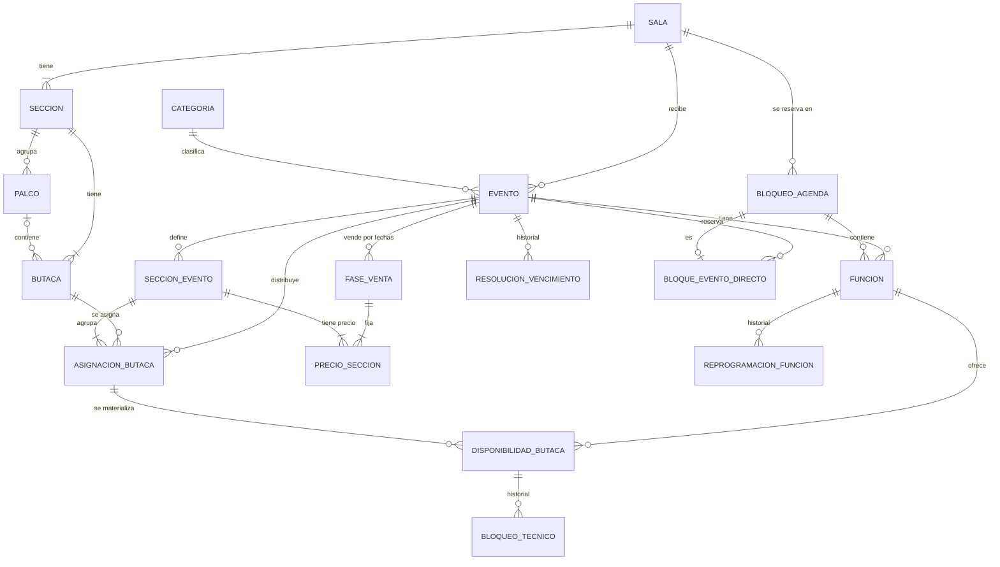
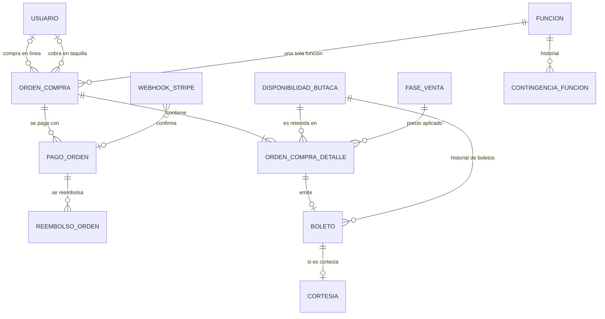
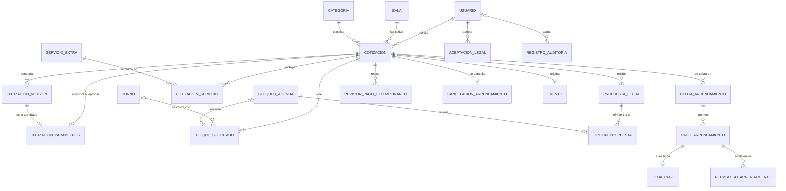

# **Modelo de Datos Relacional — v6.2 (versión final)**

Plataforma de boletaje y cotización de arrendamiento del Teatro de la Ciudad de Coatzacoalcos.

* **Estado:** Versión final para implementar. La v6.2 parte de la v6.1 (sala conservada, precio por fecha de compra con fases de venta y secciones del evento que agrupan o dividen secciones físicas) y agrega: los atributos rescatados del ER v5.6 (`propuesta_fecha.motivo`, `seccion.acceso_puerta`, `cotizacion_version` y `cotizacion_parametros.asistentes_acordados`) y el mapa de módulos definitivo de `arquitectura.md` (módulos base `recinto` y `pagos`). El historial de cambios está en el §10.
* **Alcance del documento:** sustituye a `Teatro_ER_v5.3.drawio.svg` como base para `models.py`. Diagramas en draw.io: modelo relacional completo en [`modelado_datos/Teatro_MR_v6.2.drawio`](./modelado_datos/Teatro_MR_v6.2.drawio) y diagrama entidad-relación (notación Chen) en [`modelado_datos/Teatro_ER_Chen_v6.2.drawio`](./modelado_datos/Teatro_ER_Chen_v6.2.drawio).
* **Insumos:** [alcance.md](./alcance.md), [arquitectura.md](./arquitectura.md), [maquinas-de-estado.md](./maquinas-de-estado.md), la auditoría [auditoria-egm-er-v5.3.md](./reportes/auditoria-egm-er-v5.3.md) y la propuesta *Copia ER teatro* (distribución del teatro: sala, sección, asiento, sección del evento, asiento del evento, función, inventario, listas de precio y boleto).
* **Convenciones:** nombres de tabla y columna en `snake_case` sin acentos; PK `id BIGINT` autoincremental salvo que se indique otra; importes `NUMERIC(10,2)` MXN; instantes `TIMESTAMPTZ` en UTC; enumeraciones como `TEXT` con `CHECK` (Django `TextChoices`); toda FK `ON DELETE PROTECT` (no hay borrado físico de nada contable).

---

## **1. Criterios de diseño**

1. **Normalización primero (3FN), no "menos tablas".** Se agregan tablas intermedias o de subtipo cuando evitan columnas que no aplican a la mayoría de las filas, cuando una relación es N:M o cuando un hecho se repite en el tiempo y debe conservar historia. No se fusionan entidades solo para acercarse a las 13 entidades nucleares de `arquitectura.md`; esas 13 se mantienen como **agregados de dominio**, y cada una puede ocupar varias tablas.
2. **Regla para subtipos y nulos.**
   * Si un subtipo tiene **3 o más atributos exclusivos** o **historia propia**, va en su propia tabla (ej. `cortesia`, `ficha_pago`, `bloqueo_tecnico`).
   * Si el subtipo solo agrega **1 o 2 columnas**, se quedan como columnas *nullable* con un `CHECK` que obliga a que estén llenas exactamente cuando aplican (ej. `orden_compra.usuario_id` / `cajero_id`).
   * Los **nulos de ciclo de vida** (una marca de tiempo que se llena cuando ocurre algo, como `usado_en` o `pagada_en`) son válidos y se quedan en la tabla.
3. **No se guarda lo que se puede derivar,** salvo que una tarea periódica necesite indexarlo (ej. `expira_en`). Por eso desaparecen banderas como `congelada`, `habilitada`, `saldo_restante` o `estado_liquidacion`.
4. **Integridad en la base, no solo en la aplicación.** Se usan llaves compuestas y FKs compuestas (técnica de la *Copia ER teatro*) para que PostgreSQL rechace combinaciones inválidas, como un asiento de otra sección o una orden con boletos de dos funciones.
5. **Historia en lugar de sobrescribir.** Reprogramaciones, bloqueos técnicos, prórrogas y contingencias se guardan como filas, no como columnas `*_anterior` que se pisan.

---

## **2. Mapa general por módulo (44 tablas)**

Los módulos están ordenados por capa, de abajo hacia arriba. Un módulo solo puede depender (por FK o por import) de los módulos de su misma capa base o de capas inferiores; nunca de uno superior. El detalle de esta regla está en `arquitectura.md`.

| Capa | Módulo | Tablas | Agregado de `arquitectura.md` |
| :---- | :---- | :---- | :---- |
| Base | `usuarios` | `usuario`, `aceptacion_legal` | Usuario / Perfil |
| Base | `configuracion` | `configuracion_sistema`, `turno`, `servicio_extra`, `categoria` | ConfiguracionSistema y Catálogos |
| Base | `recinto` | `sala`, `seccion`, `palco`, `butaca` | Sala, Sección y Butaca |
| Base | `agenda` | `bloqueo_agenda` | BloqueoAgenda |
| Base | `auditoria` | `registro_auditoria` | RegistroAuditoria |
| Base | `pagos` | `webhook_stripe` (más el adaptador de Stripe, sin tablas propias) | Pasarela de pagos |
| Dominio 1 | `cotizaciones` | `cotizacion`, `cotizacion_version`, `cotizacion_parametros`, `bloque_solicitado`, `cotizacion_servicio`, `propuesta_fecha`, `opcion_propuesta`, `cuota_arrendamiento`, `pago_arrendamiento`, `ficha_pago`, `reembolso_arrendamiento`, `revision_pago_extemporaneo`, `cancelacion_arrendamiento` | Cotización, Pago de Arrendamiento |
| Dominio 2 | `cartelera` | `evento`, `bloque_evento_directo`, `funcion`, `reprogramacion_funcion`, `resolucion_vencimiento`, `seccion_evento`, `asignacion_butaca`, `fase_venta`, `precio_seccion` | Evento y Función, SeccionEvento, FaseVenta, PrecioSeccion |
| Dominio 3 | `inventario` | `disponibilidad_butaca`, `bloqueo_tecnico` | DisponibilidadButaca |
| Dominio 4 | `ventas` | `orden_compra`, `orden_compra_detalle`, `pago_orden`, `reembolso_orden` | OrdenCompra |
| Dominio 5 | `boletos` | `boleto`, `cortesia`, `contingencia_funcion` | Boleto |

> **Nota de módulos (v6.2).** En la v6.1 `sala` vivía en `agenda`, y `seccion`, `butaca`, `seccion_evento`, `fase_venta` y `precio_seccion` en `inventario`. Con ese reparto había cuatro dependencias circulares (`cartelera ↔ cotizaciones`, `cartelera ↔ inventario`, `ventas ↔ boletos` y `ventas ↔ cotizaciones` por el webhook). La v6.2 las elimina **sin cambiar ninguna tabla**:
> * El catálogo físico (`sala`, `seccion`, `palco`, `butaca`) pasa al módulo base `recinto`. `agenda` depende de `recinto` y sigue siendo neutral.
> * La configuración comercial del evento (`seccion_evento`, `asignacion_butaca`, `fase_venta`, `precio_seccion`) pasa a `cartelera`, que es el módulo dueño del configurador y de la publicación. Así la compuerta de publicación vive en un solo módulo.
> * `categoria` es un catálogo fijo y pasa a `configuracion`.
> * `webhook_stripe` pasa al módulo base `pagos`, que comparten `ventas` y `cotizaciones`.
> * Los flujos que van de un módulo inferior a uno superior (cotización confirmada → crear evento, evento publicado → crear inventario, orden pagada → emitir boletos) se resuelven con eventos de dominio en proceso, descritos en `arquitectura.md`.

---

## **3. Diagramas**

### **3.1 Recinto, evento, distribución e inventario**

Módulos `recinto`, `agenda`, `configuracion` (categoría), `cartelera` e `inventario`.

### **3.2 Venta, pagos de boletos y acceso**

### **3.3 Arrendamiento, agenda y configuración**

---

## **4. Diccionario de datos**

Notación: **PK** llave primaria, **FK** llave foránea, **UQ** único, **N** admite nulo. Las columnas sin **N** son `NOT NULL`.

### **4.1 `usuarios` (base)**

#### `usuario`
Extiende `AbstractBaseUser` + `PermissionsMixin`.

| Columna | Tipo | Notas |
| :---- | :---- | :---- |
| id | BIGINT | PK |
| correo | TEXT | UQ (insensible a mayúsculas), login |
| password | TEXT | Hash Argon2 |
| nombre | TEXT | |
| apellidos | TEXT | |
| telefono | TEXT | N |
| rol | TEXT | `ADMIN`, `CAJERO`, `VERIFICADOR`, `USUARIO` |
| is_active | BOOLEAN | Suspensión de cuenta |
| is_staff, is_superuser | BOOLEAN | Requeridos por Django |
| session_version | INTEGER | Se incrementa para revocar sesiones en Redis |
| last_login | TIMESTAMPTZ | N |
| creado_en, actualizado_en | TIMESTAMPTZ | |

* El rol es una columna con dominio cerrado y **un solo rol por usuario** (alcance §3.12). No se usa `rol` + `usuario_rol` porque no existe el caso N:M; si en el futuro una persona necesitara dos roles, se migra a tabla intermedia.

#### `aceptacion_legal`
Historial LFPDPPP. Permite volver a pedir aceptación cuando cambie la versión del aviso o de los términos.

| Columna | Tipo | Notas |
| :---- | :---- | :---- |
| id | BIGINT | PK |
| usuario_id | BIGINT | FK `usuario` |
| documento | TEXT | `AVISO_PRIVACIDAD`, `TERMINOS` |
| version | TEXT | Ej. `2026-11` |
| aceptado_en | TIMESTAMPTZ | |
| ip_origen | INET | N |

* `UQ (usuario_id, documento, version)`.

### **4.2 `configuracion` (base)**

#### `configuracion_sistema`
Fila única (`id = 1`, `CHECK (id = 1)`). Una columna por parámetro editable de alcance §3.10, con su valor por defecto:

`apartado_min` (10), `gracia_pago_min` (5), `cierre_web_min` (30), `cierre_taquilla_min` (0), `prereserva_h` (48), `propuesta_h` (48), `revision_extemporanea_h` (72), `limite_publicacion_d` (15), `recordatorio_d` (7), `corte_saldo_d` (21), `margen_50_50_d` (9), `retencion_cancelacion_pct` (50.00), `reprogramacion_minima_d` (21), `sla_respuesta_dh` (3), `sla_atraso_dh` (5), `limite_boletos` (10), `actualizado_por_id` (FK `usuario`, N), `actualizado_en`.

* `CHECK` de valores positivos (incluido `margen_50_50_d > 0`, que garantiza umbral `> corte`). Los cambios se auditan y **no** afectan registros ya emitidos: cada consumidor guarda su propio *snapshot*.

#### `turno`
| Columna | Tipo | Notas |
| :---- | :---- | :---- |
| id | BIGINT | PK |
| codigo | TEXT | UQ: `MATUTINO`, `VESPERTINO`, `DIA_COMPLETO` |
| nombre | TEXT | |
| hora_inicio, hora_fin | TIME | Horario oficial |
| tarifa_renta | NUMERIC(10,2) | `CHECK (>= 0)` |
| activo | BOOLEAN | |

#### `servicio_extra`
| Columna | Tipo | Notas |
| :---- | :---- | :---- |
| id | BIGINT | PK |
| nombre | TEXT | UQ |
| descripcion | TEXT | N |
| tipo_concepto | TEXT | `EXTRA`, `INFRAESTRUCTURA` |
| unidad_cobro | TEXT | `POR_EVENTO`, `POR_DIA`, `POR_TURNO`, `POR_UNIDAD` |
| precio_referencia | NUMERIC(10,2) | `CHECK (>= 0)` |
| activo | BOOLEAN | Se desactiva, nunca se borra |

#### `categoria`
`id` PK, `nombre` UQ. Se siembran las 7 categorías fijas del alcance. Pasa a `configuracion` en la v6.2 porque es un catálogo fijo.

### **4.3 `recinto` (base)**

#### `sala`
Raíz de la estructura física y recurso que se reserva en la agenda (por eso `bloqueo_agenda` la referencia). Hoy existe una sola fila (Teatro de la Ciudad), pero el modelo admite anexar otra sala o salón con venta de boletos sin rediseñar.

| Columna | Tipo | Notas |
| :---- | :---- | :---- |
| id | BIGINT | PK |
| nombre | TEXT | UQ |
| aforo | INTEGER | `CHECK (aforo > 0)`. 1,728 para el teatro; tope de asistentes en cotizaciones |
| activa | BOOLEAN | |

* Las tarifas de turno y los parámetros siguen siendo globales; si en el futuro una sala nueva tuviera tarifas propias, `turno` recibiría un `sala_id`.

#### `seccion`
| Columna | Tipo | Notas |
| :---- | :---- | :---- |
| id | BIGINT | PK |
| sala_id | BIGINT | FK `sala` |
| nombre | TEXT | Luneta, Platea, Mezzanine, Primer Piso, Segundo Piso, Palcos |
| tipo | TEXT | `GRADERIA`, `PALCOS` |
| orden | SMALLINT | Orden de despliegue en el mapa |
| acceso_puerta | TEXT | N. Puerta o acceso de la sección (ej. "Puerta 2, pasillo izquierdo"). Se imprime en el boleto y se muestra en el mapa. Rescatado del ER v5.6 |

* `UQ (sala_id, nombre)`, `UQ (id, sala_id)`.

#### `palco`
Cabina de la sección Palcos. Es la unidad mínima de subdivisión en esa sección.

| Columna | Tipo | Notas |
| :---- | :---- | :---- |
| id | BIGINT | PK |
| seccion_id | BIGINT | FK `seccion` |
| codigo | TEXT | Ej. `P-07` |

* `UQ (seccion_id, codigo)`, `UQ (id, seccion_id)`.

#### `butaca`
Catálogo físico de las 1,728 butacas. No tiene estado: la disponibilidad depende de la función.

| Columna | Tipo | Notas |
| :---- | :---- | :---- |
| id | BIGINT | PK |
| seccion_id | BIGINT | |
| sala_id | BIGINT | Columna de enlace. FK compuesta `(seccion_id, sala_id) → seccion(id, sala_id)` |
| palco_id | BIGINT | N. FK compuesta `(palco_id, seccion_id) → palco(id, seccion_id)` |
| fila | TEXT | Etiqueta impresa (ej. `K`) |
| fila_orden | SMALLINT | Posición numérica de la fila, para validar rectángulos |
| numero | SMALLINT | Número impreso |
| columna | SMALLINT | Posición numérica horizontal, para validar rectángulos |
| es_accesible | BOOLEAN | Silla de ruedas y acompañante |
| activa | BOOLEAN | Permite retirar una butaca física sin borrarla |

* `UQ (seccion_id, fila, numero)`, `UQ (id, sala_id)`.
* `palco_id` es una sola columna, así que por la regla del §1 se queda *nullable*. La FK compuesta impide asignar un palco de otra sección. El servicio de siembra garantiza que toda butaca de Palcos tenga palco.

### **4.4 `agenda` (base)**

#### `bloqueo_agenda`
No conoce eventos ni cotizaciones (ADR-07): los módulos de dominio apuntan hacia esta tabla, nunca al revés.

| Columna | Tipo | Notas |
| :---- | :---- | :---- |
| id | BIGINT | PK |
| sala_id | BIGINT | FK `sala` |
| rango | TSTZRANGE | Intervalo semiabierto `[inicio, fin)` en UTC |
| origen | TEXT | `FUNCION`, `RENTA`, `MANTENIMIENTO` |
| estado | TEXT | `PROPUESTA_RETENIDA`, `PRE_RESERVADO`, `CONFIRMADO`, `LIBERADO` |
| etiqueta | TEXT | Texto corto para el calendario |
| expira_en | TIMESTAMPTZ | N. Solo en estados retenidos (48 h) |
| creado_en, actualizado_en | TIMESTAMPTZ | |

* Extensión `btree_gist` y `EXCLUDE USING gist (sala_id WITH =, rango WITH &&) WHERE (estado <> 'LIBERADO')`: no hay empalmes dentro de la misma sala, y dos salas distintas sí pueden ocuparse a la misma hora.
* `CHECK ((estado IN ('PROPUESTA_RETENIDA','PRE_RESERVADO')) = (expira_en IS NOT NULL))`.

### **4.5 `auditoria` (base)**

#### `registro_auditoria`
Solo inserciones (*append-only*); se recomienda revocar `UPDATE`/`DELETE` al usuario de la aplicación sobre esta tabla.

| Columna | Tipo | Notas |
| :---- | :---- | :---- |
| id | BIGINT | PK |
| actor_id | BIGINT | FK `usuario`, N (N = sistema o Celery) |
| actor_rol | TEXT | N. Copia del rol al momento de la acción |
| modulo | TEXT | `ventas`, `cotizaciones`, … |
| accion | TEXT | Ej. `CORTESIA_EMITIDA`, `FUNCION_REPROGRAMADA` |
| entidad | TEXT | Nombre de la tabla afectada |
| entidad_id | BIGINT | |
| detalles | JSONB | Antes/después y datos de contexto |
| ip_origen | INET | N |
| request_id | UUID | N |
| creado_en | TIMESTAMPTZ | |

* Es referencia polimórfica (`entidad`, `entidad_id`) a propósito: el módulo base no puede tener FK hacia módulos de dominio.

### **4.6 `pagos` (base)**

#### `webhook_stripe`
Bitácora idempotente de eventos de Stripe, compartida por `ventas` y `cotizaciones`. Vive en el módulo base `pagos`.

| Columna | Tipo | Notas |
| :---- | :---- | :---- |
| stripe_event_id | TEXT | PK. Impide procesar dos veces el mismo evento |
| tipo_evento | TEXT | Ej. `payment_intent.succeeded` |
| modulo | TEXT | `VENTAS`, `COTIZACIONES` (de `metadata.modulo`) |
| payment_intent_id | TEXT | N. Enlace lógico con `pago_orden` o `pago_arrendamiento` |
| payload | JSONB | |
| estado | TEXT | `PENDIENTE`, `PROCESADO`, `FALLIDO` |
| recibido_en | TIMESTAMPTZ | |
| procesado_en | TIMESTAMPTZ | N (ciclo de vida) |

* El enlace con el pago es por `payment_intent_id` (texto) y no por FK, para que `pagos` no dependa de ningún módulo de dominio.

### **4.7 `cotizaciones`**

#### `cotizacion`
Une *Solicitud_Renta*, *Cotización* y *Reserva_renta* de la versión 5.3. No se pierde normalización: las tres estaban en relación 1:1 y compartían un único ciclo de estados (ME-01). Los datos que varían (bloques, servicios, pagos, propuestas) sí van en tablas propias.

| Columna | Tipo | Notas |
| :---- | :---- | :---- |
| id | BIGINT | PK |
| folio | TEXT | UQ |
| solicitante_id | BIGINT | FK `usuario` |
| sala_id | BIGINT | FK `sala` |
| nombre_evento | TEXT | |
| categoria_id | BIGINT | FK `categoria` |
| modalidad | TEXT | `COMERCIAL`, `PUBLICO`, `PRIVADO` |
| asistentes_estimados | INTEGER | `CHECK (> 0)`; el tope es `sala.aforo` (1,728), validado en el servicio |
| contacto_nombre, contacto_telefono, contacto_correo | TEXT | Datos para la cotización |
| es_multidia | BOOLEAN | |
| subtotal_estimado | NUMERIC(10,2) | Informativo, calculado al enviar |
| estado | TEXT | `EN_REVISION`, `PROPUESTA_RETENIDA`, `PROPUESTA_EXPIRADA`, `PRE_RESERVADO`, `CONFIRMADO`, `EXPIRADA_SIN_PAGO`, `EXPIRADA_POR_FECHA`, `PAGO_EXTEMPORANEO_EN_REVISION`, `RECHAZADA`, `CANCELADO_POR_ARRENDATARIO`, `CANCELADO_POR_TEATRO`, `FINALIZADO` |
| enviada_en | TIMESTAMPTZ | Base para el SLA |
| respondida_en | TIMESTAMPTZ | N (ciclo de vida) |
| aprobada_en | TIMESTAMPTZ | N (ciclo de vida) |
| confirmada_en | TIMESTAMPTZ | N (ciclo de vida) |
| actualizado_en | TIMESTAMPTZ | |

* El monto oficial ya no es columna de `cotizacion`: vive en `cotizacion_version`. El monto vigente es el de la versión con mayor `numero`; el aprobado es el de `cotizacion_parametros.version_aprobada_id`.
* "Atrasada" no se guarda: se calcula con `enviada_en` y los días hábiles.
* El estado financiero (`ANTICIPO_50_PAGADO`, `LIQUIDADO_100`, `REEMBOLSO_BANCARIO_PENDIENTE`) no se guarda: se deriva de `cuota_arrendamiento` y `reembolso_arrendamiento`.

#### `cotizacion_version`
Cada monto oficial que el Admin envía al solicitante. Rescatado del ER v5.6 (`Cotización.numero_version`), pero como tabla y no como contador, para conservar cada versión enviada.

| Columna | Tipo | Notas |
| :---- | :---- | :---- |
| id | BIGINT | PK |
| cotizacion_id | BIGINT | FK `cotizacion` |
| numero | SMALLINT | `CHECK (numero >= 1)`. Consecutivo por cotización |
| monto_oficial | NUMERIC(10,2) | `CHECK (monto_oficial > 0)`. Neto en MXN |
| nota | TEXT | N. Explicación del ajuste para el solicitante |
| creada_por_id | BIGINT | FK `usuario` (Admin) |
| creada_en | TIMESTAMPTZ | |

* `UQ (cotizacion_id, numero)` y `UQ (id, cotizacion_id)` como destino de la FK compuesta de `cotizacion_parametros`.
* Solo inserciones: corregir un monto es crear una versión nueva, no editar la anterior.
* La versión 1 se crea cuando el Admin fija el primer monto oficial; mientras no exista ninguna, la cotización solo tiene `subtotal_estimado`.

#### `cotizacion_parametros`
*Snapshot* que se toma al aprobar. Agrupa valores que no existen antes de la aprobación, por eso no son columnas de `cotizacion`.

| Columna | Tipo | Notas |
| :---- | :---- | :---- |
| cotizacion_id | BIGINT | PK, FK `cotizacion` |
| version_aprobada_id | BIGINT | Versión de la cotización que el Admin aprobó. FK compuesta `(version_aprobada_id, cotizacion_id) → cotizacion_version(id, cotizacion_id)` |
| esquema_pago | TEXT | `50_50`, `100` |
| asistentes_acordados | INTEGER | `CHECK (> 0)`. Aforo acordado al aprobar; puede diferir de `cotizacion.asistentes_estimados`. El tope es `sala.aforo`, validado en el servicio. Rescatado del ER v5.6 (`ocupación_acordada`) |
| monto_anticipo | NUMERIC(10,2) | `ROUND_HALF_UP`; igual al total si `esquema_pago = 100` |
| prereserva_h, revision_extemporanea_h, corte_saldo_d, margen_50_50_d, retencion_cancelacion_pct, reprogramacion_minima_d | — | Copia de `configuracion_sistema` |
| tomado_en | TIMESTAMPTZ | |

* El saldo es `cotizacion_version.monto_oficial` (de la versión aprobada) `- monto_anticipo` (derivado).

#### `bloque_solicitado`
Cada día/turno pedido, incluidos montaje y ensayos.

| Columna | Tipo | Notas |
| :---- | :---- | :---- |
| id | BIGINT | PK |
| cotizacion_id | BIGINT | FK `cotizacion` |
| fecha | DATE | |
| turno_id | BIGINT | FK `turno`, N si el horario es personalizado |
| hora_inicio, hora_fin | TIME | Copia del turno o captura libre |
| finalidad | TEXT | `EVENTO`, `MONTAJE_ENSAYO` |
| tarifa_aplicada | NUMERIC(10,2) | *Snapshot*. `0.00` en montaje y ensayos incluidos |
| bloqueo_agenda_id | BIGINT | FK `bloqueo_agenda`, N, UQ. Se llena al pre-reservar |

#### `cotizacion_servicio`
Extras e infraestructura. Une *Solicitud_servicio* y *Detalle_Cotización*. La renta por turno ya está en `bloque_solicitado.tarifa_aplicada`, así que aquí no hace falta un `servicio_id` opcional.

| Columna | Tipo | Notas |
| :---- | :---- | :---- |
| id | BIGINT | PK |
| cotizacion_id | BIGINT | FK `cotizacion` |
| servicio_id | BIGINT | FK `servicio_extra` |
| cantidad | INTEGER | `CHECK (> 0)` |
| unidad_cobro | TEXT | *Snapshot* |
| precio_unitario | NUMERIC(10,2) | *Snapshot* |

* `UQ (cotizacion_id, servicio_id)`. El subtotal de la línea se calcula.

#### `propuesta_fecha`
Sirve para fechas alternativas y para reprogramaciones del arrendamiento.

| Columna | Tipo | Notas |
| :---- | :---- | :---- |
| id | BIGINT | PK |
| cotizacion_id | BIGINT | FK `cotizacion` |
| tipo | TEXT | `ALTERNATIVA`, `REPROGRAMACION` |
| estado | TEXT | `VIGENTE`, `ACEPTADA`, `RECHAZADA`, `EXPIRADA` |
| motivo | TEXT | N. Explicación para el solicitante: por qué se ofrecen otras fechas o por qué se reprograma. Rescatado del ER v5.6 |
| enviada_por_id | BIGINT | FK `usuario` |
| enviada_en | TIMESTAMPTZ | |
| expira_en | TIMESTAMPTZ | 48 h |
| respondida_en | TIMESTAMPTZ | N (ciclo de vida) |

* La "reprogramación gratuita ya usada" se deriva: existe una propuesta `REPROGRAMACION` en estado `ACEPTADA`.

#### `opcion_propuesta`
| Columna | Tipo | Notas |
| :---- | :---- | :---- |
| id | BIGINT | PK |
| propuesta_id | BIGINT | FK `propuesta_fecha` |
| orden | SMALLINT | `CHECK (BETWEEN 1 AND 3)` |
| fecha | DATE | |
| turno_id | BIGINT | FK `turno`, N |
| hora_inicio, hora_fin | TIME | |
| bloqueo_agenda_id | BIGINT | FK `bloqueo_agenda`, UQ (retención de 48 h) |
| elegida | BOOLEAN | |

* `UQ (propuesta_id, orden)` e índice único parcial `(propuesta_id) WHERE elegida`.

#### `cuota_arrendamiento`
| Columna | Tipo | Notas |
| :---- | :---- | :---- |
| id | BIGINT | PK |
| cotizacion_id | BIGINT | FK `cotizacion` |
| tipo | TEXT | `ANTICIPO_50`, `SALDO_50`, `TOTAL_100` |
| monto | NUMERIC(10,2) | |
| fecha_limite | TIMESTAMPTZ | Fin de pre-reserva o `D-21 23:59:59` |
| fecha_limite_ficha | TIMESTAMPTZ | N. Solo en `SALDO_50`: `fecha_limite - 48 h` |
| estado | TEXT | `PENDIENTE`, `PAGADA`, `VENCIDA` |
| pagada_en | TIMESTAMPTZ | N (ciclo de vida) |

* `UQ (cotizacion_id, tipo)` y `CHECK ((tipo = 'SALDO_50') = (fecha_limite_ficha IS NOT NULL))`.

#### `pago_arrendamiento`
Cada intento de pago de una cuota (por ejemplo, una tarjeta rechazada y luego una ficha).

| Columna | Tipo | Notas |
| :---- | :---- | :---- |
| id | BIGINT | PK |
| cuota_id | BIGINT | FK `cuota_arrendamiento` |
| metodo | TEXT | `TARJETA`, `FICHA_SPEI`, `FICHA_EFECTIVO` |
| monto | NUMERIC(10,2) | |
| stripe_payment_intent_id | TEXT | UQ |
| idempotency_key | TEXT | UQ |
| estado | TEXT | `PENDIENTE`, `EXITOSO`, `FALLIDO`, `CANCELADO`, `EXTEMPORANEO` |
| creado_en | TIMESTAMPTZ | |
| acreditado_en | TIMESTAMPTZ | N (ciclo de vida) |

#### `ficha_pago`
Subtipo de `pago_arrendamiento` para SPEI y efectivo (3 atributos propios).

| Columna | Tipo | Notas |
| :---- | :---- | :---- |
| pago_id | BIGINT | PK, FK `pago_arrendamiento` |
| linea_captura | TEXT | |
| url_ficha | TEXT | |
| expira_en | TIMESTAMPTZ | |

#### `reembolso_arrendamiento`
| Columna | Tipo | Notas |
| :---- | :---- | :---- |
| id | BIGINT | PK |
| pago_id | BIGINT | FK `pago_arrendamiento` |
| tipo | TEXT | `AUTOMATICO_TARJETA`, `BANCARIO_EXTERNO` |
| monto | NUMERIC(10,2) | |
| motivo | TEXT | |
| estado | TEXT | `PENDIENTE`, `COMPLETADO`, `FALLIDO` |
| stripe_refund_id | TEXT | N, UQ |
| idempotency_key | TEXT | N, UQ |
| creado_en | TIMESTAMPTZ | |
| resuelto_por_id | BIGINT | FK `usuario`, N. Quién confirmó la devolución bancaria |
| resuelto_en | TIMESTAMPTZ | N (ciclo de vida) |

* `CHECK ((tipo = 'AUTOMATICO_TARJETA') = (idempotency_key IS NOT NULL))`.

#### `revision_pago_extemporaneo`
| Columna | Tipo | Notas |
| :---- | :---- | :---- |
| id | BIGINT | PK |
| cotizacion_id | BIGINT | FK `cotizacion` |
| pago_id | BIGINT | FK `pago_arrendamiento`, UQ |
| expira_en | TIMESTAMPTZ | Llegada + 72 h |
| resolucion | TEXT | N. `ACEPTADO`, `RECHAZADO` |
| resuelto_por_id | BIGINT | FK `usuario`, N |
| resuelto_en | TIMESTAMPTZ | N |

#### `cancelacion_arrendamiento`
| Columna | Tipo | Notas |
| :---- | :---- | :---- |
| cotizacion_id | BIGINT | PK, FK `cotizacion` |
| tipo | TEXT | `POR_ARRENDATARIO`, `POR_TEATRO`, `INCUMPLIMIENTO_D21` |
| solicitada_en | TIMESTAMPTZ | |
| registrada_por_id | BIGINT | FK `usuario` |
| monto_retenido | NUMERIC(10,2) | Según política de §2.9 |
| monto_a_devolver | NUMERIC(10,2) | Devolución externa |
| opcion_solicitante | TEXT | N. `REEMBOLSO`, `REPROGRAMACION` (solo `POR_TEATRO`) |

### **4.8 `cartelera`**

#### `evento`
| Columna | Tipo | Notas |
| :---- | :---- | :---- |
| id | BIGINT | PK |
| nombre | TEXT | |
| descripcion | TEXT | N |
| categoria_id | BIGINT | FK `categoria` |
| sala_id | BIGINT | FK `sala` |
| modalidad | TEXT | `COMERCIAL`, `PUBLICO`, `PRIVADO` |
| origen | TEXT | `ARRENDAMIENTO`, `DIRECTO` |
| cotizacion_id | BIGINT | FK `cotizacion`, N, UQ. Solo si `origen = ARRENDAMIENTO` |
| creado_por_id | BIGINT | FK `usuario` (Admin en directos, sistema en arrendamientos) |
| poster | TEXT (ImageField) | N. Obligatorio para publicar si no es Privado |
| estado | TEXT | `PENDIENTE_PUBLICACION`, `PUBLICADO`, `VENCIDO_SIN_PUBLICAR`, `OPERACION_SIN_CARTELERA`, `CANCELADO_POR_ARRENDATARIO`, `CANCELADO_POR_TEATRO`, `FINALIZADO` |
| fecha_limite_publicacion | TIMESTAMPTZ | N. Indexada para Celery Beat |
| proximo_recordatorio_en | TIMESTAMPTZ | N. Indexada para Celery Beat |
| aprobado_por_id | BIGINT | FK `usuario`, N (ciclo de vida) |
| publicado_en | TIMESTAMPTZ | N (ciclo de vida) |
| cancelado_en | TIMESTAMPTZ | N (ciclo de vida) |
| creado_en, actualizado_en | TIMESTAMPTZ | |

* `CHECK ((origen = 'ARRENDAMIENTO') = (cotizacion_id IS NOT NULL))`.
* `CHECK (estado <> 'PUBLICADO' OR modalidad = 'PRIVADO' OR poster IS NOT NULL)`.
* `UQ (id, sala_id)` como destino de FKs compuestas. La función no guarda sala: la toma de su evento.

#### `bloque_evento_directo`
Bloques de agenda de un Evento Directo (función, montaje o mantenimiento). En arrendamientos los bloques se alcanzan por `cotizacion → bloque_solicitado`, así que no se duplican aquí.

| Columna | Tipo | Notas |
| :---- | :---- | :---- |
| bloqueo_agenda_id | BIGINT | PK, FK `bloqueo_agenda` |
| evento_id | BIGINT | FK `evento` |
| finalidad | TEXT | `EVENTO`, `MONTAJE_ENSAYO` |

#### `funcion`
| Columna | Tipo | Notas |
| :---- | :---- | :---- |
| id | BIGINT | PK |
| evento_id | BIGINT | FK `evento` |
| bloqueo_agenda_id | BIGINT | FK `bloqueo_agenda`. Bloque `RENTA` o `FUNCION` que la contiene |
| fecha | DATE | Fecha operativa (local) |
| inicio_en | TIMESTAMPTZ | |
| fin_en | TIMESTAMPTZ | `CHECK (fin_en > inicio_en)`; cubre cruce de medianoche |
| estado | TEXT | `PROGRAMADA`, `REPROGRAMADO`, `CANCELADA`, `CONCLUIDA` |
| creado_en, actualizado_en | TIMESTAMPTZ | |

* `UQ (id, evento_id)` para FKs compuestas.
* `EXCLUDE USING gist (evento_id WITH =, tstzrange(inicio_en, fin_en) WITH &&) WHERE (estado <> 'CANCELADA')`: dos funciones del mismo evento no se traslapan.
* Se eliminan `hora_inicio`/`hora_fin` separadas: se obtienen de `inicio_en`/`fin_en` convertidos a `America/Mexico_City`. Guardarlas además sería redundante.
* Que la función quede **dentro** de su bloque se valida en `AgendaService` (no se puede expresar con un `CHECK` entre tablas).

#### `reprogramacion_funcion`
Una fila por cada reprogramación. Sustituye columnas `fecha_anterior` que se perderían en una segunda reprogramación.

| Columna | Tipo | Notas |
| :---- | :---- | :---- |
| id | BIGINT | PK |
| funcion_id | BIGINT | FK `funcion` |
| inicio_anterior, fin_anterior | TIMESTAMPTZ | |
| inicio_nuevo, fin_nuevo | TIMESTAMPTZ | |
| bloqueo_anterior_id | BIGINT | FK `bloqueo_agenda` |
| bloqueo_nuevo_id | BIGINT | FK `bloqueo_agenda` |
| reprogramado_por_id | BIGINT | FK `usuario` |
| reprogramado_en | TIMESTAMPTZ | |

#### `resolucion_vencimiento`
Decisiones del Admin sobre un evento en `VENCIDO_SIN_PUBLICAR`. La prórroga puede repetirse, por eso es historial.

| Columna | Tipo | Notas |
| :---- | :---- | :---- |
| id | BIGINT | PK |
| evento_id | BIGINT | FK `evento` |
| accion | TEXT | `APOYO_ADMIN`, `PRORROGA`, `OPERACION_SIN_CARTELERA`, `CANCELACION` |
| nueva_fecha_limite | TIMESTAMPTZ | N. `CHECK ((accion = 'PRORROGA') = (nueva_fecha_limite IS NOT NULL))` |
| resuelto_por_id | BIGINT | FK `usuario` |
| resuelto_en | TIMESTAMPTZ | |

#### `seccion_evento`
*Sección del evento* de la propuesta *Copia ER teatro*: la sección lógica que ve el comprador (por ejemplo "Luneta", "Luneta - VIP" o "Palmeras"). No guarda precio: el precio depende también de la fase de venta y vive en `precio_seccion`. Una sección física deshabilitada simplemente no tiene butacas asignadas.

| Columna | Tipo | Notas |
| :---- | :---- | :---- |
| id | BIGINT | PK |
| evento_id | BIGINT | FK `evento` |
| nombre | TEXT | `CHECK (btrim(nombre) <> '')` |
| orden | SMALLINT | Orden de despliegue en mapa, carrito y taquilla |

* `UQ (evento_id, nombre)`, `UQ (id, evento_id)`.
* Puede **agrupar** varias secciones físicas completas (las 4 lunetas como "Palmeras") o **dividir** una sección física en bloques (Luneta en "Luneta - Frente" y "Luneta - Fondo"). Ver §6, decisión 3.
* Se eliminan `congelada` y `habilitada`: congelada equivale a `evento.estado = PUBLICADO` y habilitada equivale a "tiene butacas asignadas".

#### `asignacion_butaca`
*Asiento del evento* de la propuesta *Copia ER teatro*. Dice a qué sección del evento pertenece cada butaca.

| Columna | Tipo | Notas |
| :---- | :---- | :---- |
| id | BIGINT | PK sustituta (ver §8) |
| evento_id | BIGINT | UQ (1/2) |
| butaca_id | BIGINT | UQ (2/2) |
| sala_id | BIGINT | Columna de enlace |
| seccion_evento_id | BIGINT | |

* FK compuesta `(butaca_id, sala_id) → butaca(id, sala_id)` y `(evento_id, sala_id) → evento(id, sala_id)`: la butaca pertenece a la sala del evento.
* FK compuesta `(seccion_evento_id, evento_id) → seccion_evento(id, evento_id)`: la sección es del mismo evento.
* El `UQ (evento_id, butaca_id)` garantiza que una butaca está en **una sola** sección por evento: no hay solapamientos. También es el destino de la FK compuesta de `disponibilidad_butaca`.
* Reglas que valida el servicio del configurador antes de escribir (no se pueden expresar como `CHECK`): una sección del evento es **o bien** la unión de secciones físicas completas, **o bien** un bloque rectangular dentro de una sola sección física (usando `fila_orden` y `columna`); en Palcos solo cabinas completas; máximo 6 divisiones por sección física; 100% de cada sección física habilitada cubierto (compuerta de publicación).
* Ventaja frente a guardar solo rangos `(fila_inicio, fila_fin, col_inicio, col_fin)`: la misma tabla sirve para agrupar y para dividir, la no superposición la garantiza el `UQ (evento_id, butaca_id)` y el precio de cualquier butaca se obtiene con `JOIN`, sin recalcular geometría.

#### `fase_venta`
Periodo de venta con precio propio (caso real: Marco Barrientos, `$350` en septiembre y octubre, `$500` en noviembre). Todo evento comercial tiene **al menos una** fase; si no hay cambio de precio por fecha, tiene una sola.

| Columna | Tipo | Notas |
| :---- | :---- | :---- |
| id | BIGINT | PK |
| evento_id | BIGINT | FK `evento` |
| nombre | TEXT | Ej. "Preventa", "General" |
| inicia_en | TIMESTAMPTZ | La fase dura hasta que inicia la siguiente; la última, hasta el cierre de venta |

* `UQ (evento_id, nombre)`, `UQ (evento_id, inicia_en)`, `UQ (id, evento_id)`.
* Solo se guarda el inicio. Con eso **no pueden existir huecos ni traslapes** entre fases, que es lo que la restricción `EXCLUDE` sobre `vigente_desde`/`vigente_hasta` de la propuesta buscaba garantizar, y con una columna menos. La fase vigente es la de mayor `inicia_en <= now()`.
* La fase aplica a **todas las funciones** del evento y se decide por la **fecha de compra** (el momento de apartar), no por la fecha de la función.
* Las fases y sus precios se definen antes de publicar y quedan congeladas al publicar, igual que las secciones; así se respeta la regla de alcance §2.3 de no cambiar precios con la taquilla abierta.

#### `precio_seccion`
Tabla intermedia N:M entre `fase_venta` y `seccion_evento` (nombre de la propuesta).

| Columna | Tipo | Notas |
| :---- | :---- | :---- |
| id | BIGINT | PK sustituta (ver §8) |
| fase_venta_id | BIGINT | UQ (1/2) |
| seccion_evento_id | BIGINT | UQ (2/2) |
| evento_id | BIGINT | Columna de enlace |
| precio | NUMERIC(10,2) | `CHECK (precio >= 100.00)` |

* FK compuestas `(fase_venta_id, evento_id) → fase_venta(id, evento_id)` y `(seccion_evento_id, evento_id) → seccion_evento(id, evento_id)`: fase y sección son del mismo evento.
* Cubre los tres casos sin columnas extra: precio por sección sin fases (1 fase), precio por fecha igual para todas las secciones (varias fases, mismo precio en cada fila de la fase, como Marco Barrientos) y la combinación de ambos.
* Compuerta de publicación: cada par (fase, sección del evento) debe tener precio.

#### Casos de precio que cubre el modelo

La variación por sección y la variación por fecha son **independientes**: la primera la define cuántas filas tiene `seccion_evento` y la segunda cuántas filas tiene `fase_venta`. `precio_seccion` es su cruce, así que siempre tiene `secciones × fases` filas y nunca se repite un precio "a mano".

Idea clave: **`seccion_evento` es una zona de precio, no una etiqueta visual.** La sección física, fila y número de cada butaca siempre se muestran en mapa y boleto porque salen de `butaca`. Por eso, si todas las butacas cuestan lo mismo, el evento no necesita varias secciones lógicas: basta una.

| Caso | `seccion_evento` | `fase_venta` | `precio_seccion` |
| :---- | :---- | :---- | :---- |
| **0. Precio único fijo** (todo el recinto, un precio todo el periodo) | 1: "General" con las 1,728 butacas | 1: "Venta general" | 1 fila |
| **1. Precio único que cambia por fecha** (Marco Barrientos) | 1: "General" con todas las butacas | 2: "Preventa" desde el 1 de septiembre, "General" desde el 1 de noviembre | 2 filas: $350 y $500 |
| **2. Precio por sección, fijo todo el periodo** | N: por ejemplo Luneta, Platea, Palcos… | 1: "Venta general" | N filas, una por sección |
| **3. Precio por sección y por fecha** | N | M | N × M filas |

* **Valores por defecto del configurador:** al abrir el configurador se crea automáticamente **una** fase ("Venta general", con inicio en la publicación) y **una** sección del evento por cada sección física (la "conservación estándar" de 1 clic del alcance). El usuario solo agrega fases si el precio cambia por fecha, y junta todo en "General" si quiere precio único. Así ningún caso exige pasos de más.
* **Por qué no se usan columnas opcionales** (por ejemplo `evento.precio_unico` o `fase_venta_id` nulo): habría dos lugares posibles para el precio y cada consulta tendría que revisar los dos. Con una sola regla (precio = cruce sección × fase vigente) el cálculo es siempre el mismo `JOIN`.
* Si un evento quiere seguir mostrando nombres de zona distintos (por ejemplo "Luneta" y "Platea") pero con el mismo precio, se crean las dos secciones y el precio se repite en `precio_seccion`. Es la única situación con un valor repetido, y es una decisión de presentación, no un requisito del modelo.

### **4.9 `inventario`**

#### `disponibilidad_butaca`
*Función-asiento* de la propuesta. Inventario por función, se crea con `bulk_create` al publicar.

| Columna | Tipo | Notas |
| :---- | :---- | :---- |
| id | BIGINT | PK |
| funcion_id | BIGINT | |
| evento_id | BIGINT | Columna de enlace |
| butaca_id | BIGINT | |
| estado | TEXT | `DISPONIBLE`, `APARTADA`, `VENDIDA`, `BLOQUEO_TECNICO`, `CORTESIA` |
| actualizado_en | TIMESTAMPTZ | |

* FK compuesta `(funcion_id, evento_id) → funcion(id, evento_id)`.
* FK compuesta `(evento_id, butaca_id) → asignacion_butaca(evento_id, butaca_id)`: solo existen filas de butacas que tienen sección del evento, y por lo tanto precio.
* `UQ (funcion_id, butaca_id)`, `UQ (id, funcion_id)`.
* El *polling* sigue siendo `SELECT butaca_id, estado FROM disponibilidad_butaca WHERE funcion_id = ?`, sin `JOIN`.
* Se crean filas solo para butacas de secciones habilitadas (no siempre 1,728); `arquitectura.md` ya lo refleja. En el mapa, una butaca sin fila se pinta como "sección deshabilitada".

#### `bloqueo_tecnico`
Historial de bloqueos técnicos. Una butaca puede bloquearse y liberarse varias veces.

| Columna | Tipo | Notas |
| :---- | :---- | :---- |
| id | BIGINT | PK |
| disponibilidad_id | BIGINT | FK `disponibilidad_butaca` |
| motivo | TEXT | |
| bloqueado_por_id | BIGINT | FK `usuario` |
| bloqueado_en | TIMESTAMPTZ | |
| retirado_por_id | BIGINT | FK `usuario`, N (ciclo de vida) |
| retirado_en | TIMESTAMPTZ | N (ciclo de vida) |

* Índice único parcial `(disponibilidad_id) WHERE retirado_en IS NULL`: un solo bloqueo vigente por butaca y función.

### **4.10 `ventas`**

#### `orden_compra`
Une *Carrito* y *Transacción* de la versión 5.3: son el mismo objeto en distintos momentos de un único ciclo (`APARTADO → PAGO_EN_PROCESO → PAGADA`). Tenerlos separados obligaba a sincronizar tres estados.

| Columna | Tipo | Notas |
| :---- | :---- | :---- |
| id | BIGINT | PK |
| folio | TEXT | UQ. Número de orden impreso en el boleto |
| funcion_id | BIGINT | FK `funcion` |
| canal | TEXT | `LINEA`, `TAQUILLA` |
| usuario_id | BIGINT | FK `usuario`, N. Comprador en línea |
| cajero_id | BIGINT | FK `usuario`, N. Cajero en taquilla |
| estado | TEXT | `APARTADO`, `PAGO_EN_PROCESO`, `PAGADA`, `EXPIRADA`, `REEMBOLSADA_AUTOMATICA` |
| expira_en | TIMESTAMPTZ | Primer asiento + 10 min |
| gracia_hasta | TIMESTAMPTZ | N. Se llena al pasar a `PAGO_EN_PROCESO` |
| pagada_en | TIMESTAMPTZ | N (ciclo de vida) |
| creado_en, actualizado_en | TIMESTAMPTZ | |

* `CHECK ((canal = 'LINEA' AND usuario_id IS NOT NULL AND cajero_id IS NULL) OR (canal = 'TAQUILLA' AND cajero_id IS NOT NULL AND usuario_id IS NULL))`.
* Índice único parcial `(usuario_id) WHERE canal = 'LINEA' AND estado IN ('APARTADO','PAGO_EN_PROCESO')`: un solo carrito activo por usuario.
* `UQ (id, funcion_id)` para la FK compuesta del detalle.
* El total **no se guarda**: es la suma del detalle. Lo cobrado queda en `pago_orden.monto`.

#### `orden_compra_detalle`
Tabla intermedia orden ↔ butaca de la función. La auditoría proponía poner `orden_compra_id` directo en `disponibilidad_butaca`; aquí se conserva la tabla intermedia porque al expirar una orden la butaca vuelve a `DISPONIBLE` y se perdería **qué butacas tenía la orden**, dato que se necesita para reasignar si llega un pago tardío (alcance §2.10.A).

| Columna | Tipo | Notas |
| :---- | :---- | :---- |
| id | BIGINT | PK |
| orden_id | BIGINT | |
| funcion_id | BIGINT | Columna de enlace |
| disponibilidad_id | BIGINT | |
| evento_id | BIGINT | Columna de enlace |
| fase_venta_id | BIGINT | Fase vigente al apartar. FK compuesta `(fase_venta_id, evento_id) → fase_venta(id, evento_id)` |
| precio_unitario | NUMERIC(10,2) | Copia de `precio_seccion.precio` al apartar |
| activo | BOOLEAN | `true` mientras la orden retiene o posee la butaca |

* FK compuesta `(orden_id, funcion_id) → orden_compra(id, funcion_id)` y `(disponibilidad_id, funcion_id) → disponibilidad_butaca(id, funcion_id)`: la base impide mezclar funciones en una orden.
* `UQ (orden_id, disponibilidad_id)`.
* `precio_unitario` es una copia intencional: deja el historial de lo cobrado aunque se consulte años después, y `fase_venta_id` da la trazabilidad de qué precio se aplicó (lo que la propuesta guardaba como `lista_precio_id` en el boleto).
* Índice único parcial `(disponibilidad_id) WHERE activo`: una butaca no puede estar retenida por dos órdenes a la vez.
* El límite de 10 boletos se cuenta sobre esta tabla (`activo` y estado de la orden) bajo el candado de `usuario`, como indica la arquitectura.

#### `pago_orden`
| Columna | Tipo | Notas |
| :---- | :---- | :---- |
| id | BIGINT | PK |
| orden_id | BIGINT | FK `orden_compra` |
| metodo | TEXT | `TARJETA_STRIPE`, `EFECTIVO`, `TARJETA_TERMINAL` |
| monto | NUMERIC(10,2) | `CHECK (monto > 0)` |
| estado | TEXT | `PENDIENTE`, `EXITOSO`, `FALLIDO`, `CANCELADO` |
| stripe_payment_intent_id | TEXT | N, UQ |
| idempotency_key | TEXT | N, UQ |
| creado_en | TIMESTAMPTZ | |
| confirmado_en | TIMESTAMPTZ | N (ciclo de vida) |

* `CHECK ((metodo = 'TARJETA_STRIPE') = (stripe_payment_intent_id IS NOT NULL AND idempotency_key IS NOT NULL))`.
* Índice único parcial `(orden_id) WHERE estado = 'EXITOSO'`: una orden no se cobra dos veces.

#### `reembolso_orden`
Solo reembolsos técnicos automáticos por pago tardío (alcance §2.10.A).

| Columna | Tipo | Notas |
| :---- | :---- | :---- |
| id | BIGINT | PK |
| pago_id | BIGINT | FK `pago_orden` |
| stripe_refund_id | TEXT | UQ, N hasta que Stripe responde |
| idempotency_key | TEXT | UQ |
| monto | NUMERIC(10,2) | |
| motivo | TEXT | `BUTACAS_OCUPADAS`, `LIMITE_EXCEDIDO`, `FUNCION_CONCLUIDA_O_CANCELADA` |
| estado | TEXT | `PENDIENTE`, `EXITOSO`, `FALLIDO` |
| creado_en | TIMESTAMPTZ | |

### **4.11 `boletos`**

#### `boleto`
| Columna | Tipo | Notas |
| :---- | :---- | :---- |
| id | BIGINT | PK |
| token | UUID | UQ. Se firma con `QR_HMAC_SECRET` al generar el QR |
| folio_corto | TEXT | UQ. ≥ 8 caracteres Base32 sin `0/O/1/I` |
| funcion_id | BIGINT | |
| disponibilidad_id | BIGINT | |
| origen | TEXT | `COMPRA`, `CORTESIA` |
| orden_detalle_id | BIGINT | N, UQ. FK `orden_compra_detalle`, solo si `origen = COMPRA` |
| estado | TEXT | `EMITIDO`, `USADO`, `USADO_CONTINGENCIA`, `INVALIDADO` |
| emitido_en | TIMESTAMPTZ | |
| usado_en | TIMESTAMPTZ | N (ciclo de vida) |
| validado_por_id | BIGINT | FK `usuario`, N (ciclo de vida) |
| invalidado_en | TIMESTAMPTZ | N (ciclo de vida) |
| invalidado_por_id | BIGINT | FK `usuario`, N |
| motivo_invalidacion | TEXT | N |

* FK compuesta `(disponibilidad_id, funcion_id) → disponibilidad_butaca(id, funcion_id)`.
* `CHECK ((origen = 'COMPRA') = (orden_detalle_id IS NOT NULL))`.
* Índice único parcial `(disponibilidad_id) WHERE estado <> 'INVALIDADO'`: un solo boleto vigente por butaca y función, pero se conservan los invalidados (por ejemplo, una cortesía revocada y luego vendida).
* `CHECK ((estado IN ('USADO','USADO_CONTINGENCIA')) = (usado_en IS NOT NULL))`.
* El precio y el método de pago impresos se obtienen de `orden_compra_detalle` y `pago_orden`; en cortesía son `$0.00` y "Cortesía". No se duplican aquí.
* Se elimina `codigo_barras`: el acceso es por QR firmado y folio corto.

#### `cortesia`
Subtipo de `boleto` con 3 atributos propios.

| Columna | Tipo | Notas |
| :---- | :---- | :---- |
| boleto_id | BIGINT | PK, FK `boleto` |
| emitida_por_id | BIGINT | FK `usuario` (Admin) |
| beneficiario | TEXT | N |
| motivo | TEXT | N |

#### `contingencia_funcion`
| Columna | Tipo | Notas |
| :---- | :---- | :---- |
| id | BIGINT | PK |
| funcion_id | BIGINT | FK `funcion` |
| activada_por_id | BIGINT | FK `usuario` |
| activada_en | TIMESTAMPTZ | |
| cerrada_por_id | BIGINT | FK `usuario`, N |
| cerrada_en | TIMESTAMPTZ | N |
| aplicados, ya_usados, rechazados | INTEGER | N. Resultado de la reconciliación en lote |

* Índice único parcial `(funcion_id) WHERE cerrada_en IS NULL`: una sola contingencia abierta por función.
* Las exportaciones de folios se registran en `registro_auditoria`.

---

## **5. Relación con la auditoría `ER-C01` a `ER-I06`**

| Hallazgo | Cómo queda |
| :---- | :---- |
| ER-C01 `OrdenCompra` partida en 4 | **Atendido.** `orden_compra` única, con taquilla sin cuenta. Se conserva `orden_compra_detalle` como tabla intermedia (ver §6, diferencia A). |
| ER-C02 Geometría tarifaria y `Asiento_evento` | **Atendido con otro enfoque.** Se conserva `asignacion_butaca` (antes `Asiento_evento`) porque garantiza en la base que cada butaca está en una sola sección del evento; la geometría se valida en el servicio. `butaca` pierde `estado` y gana `fila_orden`, `columna` y `palco_id`. Piso `>= 100.00` en `precio_seccion`. |
| ER-C03 Agenda acoplada | **Atendido.** `bloqueo_agenda` con `TSTZRANGE` y `EXCLUDE`, sin FKs hacia dominio. |
| ER-C04 Webhooks e idempotencia | **Atendido.** `webhook_stripe` con `stripe_event_id` PK, pagos separados por módulo, `ficha_pago` y reembolsos con llave de idempotencia. |
| ER-C05 `Turno`, configuración y auditoría | **Atendido.** `turno`, `configuracion_sistema` con todos los parámetros y `registro_auditoria` conectada al actor. |
| ER-C06 Restricciones físicas | **Atendido.** Tipos, `CHECK`, índices únicos parciales y `EXCLUDE` declarados por tabla. |
| ER-I01 Evento y Función | **Atendido.** Origen directo/arrendamiento, `inicio_en`/`fin_en` UTC, historial de reprogramaciones, contingencia y resoluciones de vencimiento en tablas propias. |
| ER-I02 Finanzas del arrendamiento | **Atendido.** Cuotas, *snapshot* de parámetros, fichas, revisión de 72 h y cancelaciones. |
| ER-I03 Boleto | **Atendido.** Cortesía como subtipo, invalidación sin borrar, un boleto vigente por butaca con índice parcial. |
| ER-I04 Usuario y LFPDPPP | **Atendido.** `session_version`, campos de Django y `aceptacion_legal` con versión. |
| ER-I05 Cardinalidades y nombres | **Atendido.** Nombres alineados al glosario; tabla de equivalencias en §7. |
| ER-M01 Fuera de alcance | **Atendido.** Sin `Artista_Organizacion`, cargos por servicio, paquetes, `codigo_barras`, país ni CP. |
| ER-M03 Sobre-normalización | **No se adopta.** Ver §6. |

---

## **6. Decisiones donde este modelo se aparta de la auditoría o de la propuesta**

### **Se aparta de la auditoría (más tablas, a propósito)**

* **A. `orden_compra_detalle` se conserva.** Sin ella, al expirar una orden se pierde qué butacas tenía, y el flujo de pago tardío no puede verificar si "el 100% de las butacas de la orden siguen disponibles". Además permite el índice parcial "una butaca, una orden activa" y la FK compuesta "una sola función por orden".
* **B. `asignacion_butaca` se conserva** (la auditoría pedía eliminar `Asiento_evento`). Con la llave `(evento_id, butaca_id)` la base impide solapamientos y huecos dobles; con solo rangos geométricos, eso dependería de código. El costo son ~1,728 filas por evento comercial, que para PostgreSQL es poco. El *polling* no se ve afectado porque lee solo `disponibilidad_butaca`.
* **C. Historiales en tablas propias:** `bloqueo_tecnico`, `reprogramacion_funcion`, `resolucion_vencimiento`, `contingencia_funcion`, `aceptacion_legal`. La auditoría proponía columnas en la tabla padre; eso solo guarda el último cambio.
* **D. Subtipos en tablas propias:** `cortesia`, `ficha_pago`, `cotizacion_parametros`, `cancelacion_arrendamiento`, `revision_pago_extemporaneo`. Evitan columnas vacías en la mayoría de las filas.
* **E. `cotizacion_servicio` sin `servicio_id` opcional.** La auditoría hacía opcional el servicio para meter la renta por turno en el mismo detalle; aquí la renta se queda en `bloque_solicitado.tarifa_aplicada` y cada tabla tiene una sola responsabilidad.
* **F. Pagos separados por módulo** (`pago_orden` y `pago_arrendamiento`) en lugar de un `Pago` con FK XOR a orden o cuota. Evita dependencias entre `ventas` y `cotizaciones` y una FK siempre vacía.
* **G. Se quitan datos derivados** que la auditoría proponía guardar: `congelada`, `habilitada`, `saldo_restante`, `estado_liquidacion`, `atrasada`, `reprogramacion_gratuita_usada`, total de la orden, precio en el boleto.

### **Decisiones tomadas con Sanji (v6.1, vigentes en v6.2)**

* **1. Precio por fecha de compra: `fase_venta` + `precio_seccion`.** Se adopta la idea de `lista_precio` de la propuesta con dos ajustes: (a) la fase pertenece al **evento** y no a cada función, porque el precio se decide por la fecha de compra y aplica igual a todas las funciones; (b) la fase solo guarda `inicia_en`, así que no puede haber huecos ni traslapes. Esto **cambia el alcance**: §2.3 dice "un precio por sección" y hay que redactarlo como "un precio por sección y fase de venta, definido antes de publicar". No contradice §4.7, que excluye descuentos por perfil y cupones, no precios por fecha.
* **2. Se conserva `sala`.** Queda como raíz de `seccion`, `evento`, `cotizacion` y `bloqueo_agenda`, y la restricción anti-empalmes pasa a ser por sala. Hoy hay una sola fila. Costo: una columna `sala_id` de enlace en `butaca` y `asignacion_butaca` para que la base valide que la butaca es de la sala del evento.
* **3. Secciones del evento libres: pueden agrupar o dividir secciones físicas.** Se evaluaron tres opciones:

| Opción | Qué permite | Ventaja | Problema |
| :---- | :---- | :---- | :---- |
| **A. Precio directo a la sección física** | Solo las 6 secciones tal cual | La más simple, sin configurador | No se puede partir una sección grande (pierde la subdivisión que exige alcance §2.3) ni agrupar |
| **B. Subsecciones dentro de una sección física** (v6.0) | Dividir, no agrupar | La base impide mezclar secciones | No permite "Palmeras" = 4 lunetas |
| **C. Sección del evento libre + asignación por butaca** (v6.1, **recomendada**) | Dividir **y** agrupar | Misma tabla para ambos casos, sin tablas extra; el `UQ (evento_id, butaca_id)` de `asignacion_butaca` sigue impidiendo solapamientos | Las reglas de forma (bloque rectangular o secciones completas) se validan en el servicio, no en la base |

  Se recomienda **C** porque cubre el caso de dividir (que el alcance ya pide) y el de agrupar (el de Sanji) con exactamente las mismas tablas que B. Lo único que cambia es quitar `seccion_id` de la sección del evento. El nombre en mapa y boleto pasa a ser el de la sección del evento (ej. "Palmeras"), y el boleto sigue mostrando la sección física, fila y número de la butaca. Hay que ajustar en alcance §2.3 la regla de nombre compuesto `{Sección} - {Nombre}`, que ya no aplica cuando una sección del evento abarca varias físicas.

### **Decisiones de la v6.2 (versión final)**

* **7. Rescates del ER v5.6.** Se revisó la v5.6 atributo por atributo (ver `comparativa-er-v5.6-vs-v6.1.md`) y se incorporan cuatro elementos:

| Origen en v5.6 | Destino en v6.2 | Por qué |
| :---- | :---- | :---- |
| `Propuesta_Fecha.motivo` | `propuesta_fecha.motivo` (TEXT, N) | El solicitante necesita entender por qué se le ofrecen otras fechas o por qué se reprograma. |
| `Sección.acceso_puerta` | `seccion.acceso_puerta` (TEXT, N) | Es un dato del lugar físico. Ayuda al asistente y al Verificador, y se puede imprimir en el boleto sin costo. |
| `Cotización.numero_version` | Tabla `cotizacion_version` | El Admin puede ajustar el monto oficial más de una vez. Un contador suelto pierde los montos anteriores; la tabla conserva cada versión enviada y `cotizacion_parametros.version_aprobada_id` dice cuál se aprobó. Por eso `cotizacion.monto_oficial` deja de existir. |
| `Cotización.ocupación_acordada` | `cotizacion_parametros.asistentes_acordados` | El aforo acordado al aprobar puede diferir del estimado al solicitar. Va en el *snapshot* porque no existe antes de la aprobación. |

  Se descartan, con su razón: `Sección.pasillo` (el alcance no lo pide y `acceso_puerta` ya cubre la orientación), `Artista_Organizacion`, `Usuario.codigo_postal` y `pais` (fuera de alcance, ER-M01), `Boleto.codigo_barras` (el acceso es por QR) y las notas por línea de `Detalle_Cotización` (`cotizacion_servicio` y `bloque_solicitado` ya cubren lo acordado).

* **8. Mapa de módulos definitivo.** Las tablas no cambian de estructura, pero cambian de módulo para eliminar las dependencias circulares (ver la nota del §2): `sala`, `seccion`, `palco` y `butaca` pasan a `recinto`; `categoria` a `configuracion`; `seccion_evento`, `asignacion_butaca`, `fase_venta` y `precio_seccion` a `cartelera`; `webhook_stripe` a `pagos`.
* **9. PK sustitutas en tablas puente.** `asignacion_butaca` y `precio_seccion` usan `id` propio más `UNIQUE` en sus dos columnas, en lugar de PK compuesta. El resultado lógico es el mismo y evita las limitaciones de Django y DRF con PK compuestas (ver §8).

### **Se aparta de la propuesta *Copia ER teatro***

* **4. No se incluyen `cartera`, `metodo_pago_guardado` ni `metodo_pago`.** Guardar tarjetas no está en el alcance y aumenta la exposición a datos sensibles; Stripe ya las maneja. El método queda como enumeración en cada pago.
* **5. `rol` + `usuario_rol` se reemplazan por la columna `usuario.rol`,** porque cada cuenta tiene un solo rol.
* **6. `disponibilidad_butaca` apunta a `asignacion_butaca`** igual que en la propuesta (solo existen filas de butacas con sección del evento). `arquitectura.md` ya refleja que no siempre son 1,728 filas.

### **Se conserva de la propuesta *Copia ER teatro***

* `sala` como raíz de la estructura física.
* Separación entre estructura física fija (`seccion`, `butaca`) y distribución por evento (`seccion_evento`, `asignacion_butaca`).
* Precios en tabla intermedia `precio_seccion` entre fase/lista y sección del evento.
* Inventario por función con `UQ (funcion_id, butaca_id)`.
* FKs compuestas para que la base valide la pertenencia (butaca de la sala del evento, sección del evento del mismo evento, fase y precio del mismo evento, orden y butaca de la misma función).
* Precio derivable por `disponibilidad_butaca → asignacion_butaca → seccion_evento → precio_seccion` (con la fase vigente), sin guardarlo en el asiento.
* Boleto con unicidad sobre la butaca de la función, ahora como índice parcial para conservar boletos invalidados.

---

## **7. Equivalencias de nombres**

| ER v5.3 / *Copia ER teatro* | Este modelo |
| :---- | :---- |
| `Sala` | `sala` |
| `Seccion` | `seccion` |
| `Asiento` | `butaca` |
| `Seccion_evento` / `Subsección_tarifaria` | `seccion_evento` |
| `Asiento_evento` | `asignacion_butaca` |
| `Funcion_asiento` | `disponibilidad_butaca` |
| `Lista_precio` | `fase_venta` (por evento) |
| `Precio_seccion`, `Precio_zona` | `precio_seccion` |
| `Carrito`, `Transaccion` | `orden_compra` |
| `DetalleCarrito`, `Detalle_Transaccion` | `orden_compra_detalle` |
| `Pago`, `Metodo_Pago` | `pago_orden` / `pago_arrendamiento` |
| `Notificación_pago` | `webhook_stripe` |
| `Solicitud_Renta`, `Cotización`, `Reserva_renta` | `cotizacion` |
| `Solicitud_servicio`, `Detalle_Cotización` | `cotizacion_servicio` (+ `bloque_solicitado.tarifa_aplicada`) |
| `Servicio` | `servicio_extra` |
| `Ocupación_teatro` | `bloqueo_agenda` |
| `Propuesta_Fecha`, `Opción_Fecha` | `propuesta_fecha`, `opcion_propuesta` |
| `Propuesta_Fecha.motivo` (v5.6) | `propuesta_fecha.motivo` |
| `Sección.acceso_puerta` (v5.6) | `seccion.acceso_puerta` |
| `Cotización.numero_version` (v5.6) | `cotizacion_version` |
| `Cotización.ocupación_acordada` (v5.6) | `cotizacion_parametros.asistentes_acordados` |
| `Cuota_Arrendamiento` | `cuota_arrendamiento` |
| `Configuracion_sistema` | `configuracion_sistema` |
| `Registro_auditoría` | `registro_auditoria` |
| `Rol`, `Usuario_rol` | `usuario.rol` |
| `Cartera`, `Metodo_pago_guardado`, `Artista_Organizacion` | — (fuera de alcance) |

---

## **8. Notas de implementación en Django**

* **Versión de Django:** 5.2 LTS (`Django>=5.2,<5.3`), igual que en `stack-tecnologico.md`.
* **PK compuestas: no se usan.** `asignacion_butaca` y `precio_seccion` llevan `id` sustituto y `UniqueConstraint` sobre sus dos columnas. Motivo: en Django 5.2 un `ForeignKey` no puede apuntar a un modelo con `CompositePrimaryKey` (y `disponibilidad_butaca` apunta a `asignacion_butaca`), y DRF no maneja bien PK compuestas en serializadores.
* **FKs compuestas (14):** Django no las declara de forma nativa. Cada modelo mantiene su `ForeignKey` simple y la restricción compuesta se agrega con `migrations.RunSQL` (`ALTER TABLE … ADD CONSTRAINT … FOREIGN KEY (…) REFERENCES …(…)`, con su `reverse_sql`) en una migración `00xx_restricciones_compuestas` por módulo. Los `UQ (id, x)` que sirven de destino se declaran como `UniqueConstraint`. Una prueba consulta `pg_constraint` y falla si falta alguna.
* **`EXCLUDE`:** `django.contrib.postgres.constraints.ExclusionConstraint` con `BtreeGistExtension()` en la primera migración de `agenda`.
* **Índices parciales:** `UniqueConstraint(..., condition=Q(...))`.
* **Sin borrado:** toda FK con `on_delete=models.PROTECT` (una prueba recorre los modelos y lo verifica). `registro_auditoria` y `cotizacion_version` son solo inserciones; en `registro_auditoria` se revoca `UPDATE`/`DELETE` al rol de aplicación de PostgreSQL (`teatro_app`), mientras que las migraciones corren con el rol propietario (`teatro_owner`).
* **Orden de candados:** `usuario → orden_compra → disponibilidad_butaca (por funcion_id, butaca_id) → orden_compra_detalle → boleto`, igual que en `arquitectura.md`.
* **Pruebas siempre sobre PostgreSQL:** el modelo usa `EXCLUDE`, `TSTZRANGE`, FKs compuestas e índices parciales, que SQLite no soporta.

## **9. Pendientes**

1. Definir el desglose real de filas, columnas, palcos y butacas accesibles que suman 1,728, y la puerta de acceso de cada sección (para `seed_teatro.py`).
2. Confirmar si una fase de venta puede variar por función (hoy aplica a todo el evento).

---

## **10. Historial de versiones**

| Versión | Fecha | Cambios |
| :---- | :---- | :---- |
| v6.0 | 2026-11-25 | Primera versión normalizada a partir de la auditoría del ER v5.3 (40 tablas). |
| v6.1 | 2026-11-25 | Se conserva `sala`; precio por fecha de compra (`fase_venta` + `precio_seccion`); secciones del evento que agrupan o dividen secciones físicas (43 tablas). |
| v6.2 | 2026-11-26 | Versión final. Rescates del ER v5.6: `propuesta_fecha.motivo`, `seccion.acceso_puerta`, tabla `cotizacion_version` (sale `cotizacion.monto_oficial`, entra `cotizacion_parametros.version_aprobada_id`) y `cotizacion_parametros.asistentes_acordados`. Mapa de módulos sin ciclos (módulos base `recinto` y `pagos`). PK sustitutas en `asignacion_butaca` y `precio_seccion`. Notas de Django 5.2 y roles de PostgreSQL. 44 tablas, 14 FKs compuestas. Diagramas `Teatro_MR_v6.2.drawio` y `Teatro_ER_Chen_v6.2.drawio`. |
