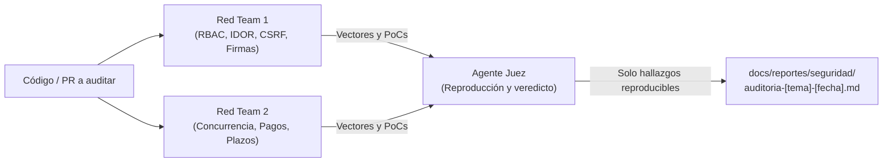

# Plan Maestro de Pruebas — Teatro de la Ciudad de Coatzacoalcos

**Estándar de referencia:** ISO/IEC/IEEE 29119-3 (Plan de Pruebas) · **Modelo:** v6.2 (44 tablas) · **Contrato API:** v1 (rev. 0.4) · **Fecha:** 2026-11-26.

Este documento establece la estrategia integral de aseguramiento de calidad, verificación funcional, pruebas de concurrencia, seguridad y técnicas avanzadas de prueba para la plataforma de boletaje y arrendamiento del **Teatro de la Ciudad de Coatzacoalcos**.

## 1. Objetivos, Alcance y Fuentes de Verdad

### 1.1. Fuentes de Verdad Vinculadas
Toda prueba diseñada o ejecutada debe alinearse estrictamente con los artefactos normativos del repositorio:

| Artefacto | Archivo | Aporte al Plan de Pruebas |
| :--- | :--- | :--- |
| Reglas de negocio y exclusiones | [alcance.md](alcance.md) | Plazos (`10+5 min`, `48 h`, `72 h`, `> 30 d / D-21`, `-30 min / 0 min`, `-2 h`, `24 h`), piso `>= $100.00 MXN`, límite `<= 10` boletos, exclusiones de alcance. |
| Arquitectura y concurrencia | [arquitectura.md](arquitectura.md) | Capas ADP, `services.py`, orden de candados (`NOWAIT`/`SKIP LOCKED`), RBAC/anti-IDOR, SPAs `/` y `/gestion/`. |
| Modelo de datos v6.2 | [modelo-datos.md](modelo-datos.md) | 44 tablas, 14 FKs compuestas (`RunSQL`), `ExclusionConstraint` (`btree_gist`), `on_delete=PROTECT`, roles `teatro_owner` / `teatro_app`. |
| Máquinas de estado | [maquinas-de-estado.md](maquinas-de-estado.md) | 43 transiciones oficiales (`T-1.1`–`T-1.17`, `T-2.1`–`T-2.10`, `T-3.1`–`T-3.8`, `T-4.1`–`T-4.8`). |
| Contrato de API | [contrato-api.md](contrato-api.md) | Rutas `/api/v1/`, esquemas JSON, códigos HTTP, códigos `code` estables y `Idempotency-Key`. |
| Stack y exclusiones técnicas | [stack-tecnologico.md](stack-tecnologico.md) | Django 5.2 `TestCase`/`TransactionTestCase` (sin `pytest`), PostgreSQL 16 (sin SQLite), Vitest, Playwright, `ruff`, `import-linter`, `k6` (QA). |
| Requerimientos funcionales | [requisitos-funcionales.md](requisitos/requisitos-funcionales.md) | 103 requerimientos atómicos (`RF-01` a `RF-103`) distribuidos en 10 módulos. |
| Requerimientos no funcionales | [requisitos-no-funcionales.md](requisitos/requisitos-no-funcionales.md) | 43 requerimientos no funcionales verificables (`RNF-01` a `RNF-43`) bajo ISO/IEC 25010. |
| Diagramas UML | `docs/diagramas-uml/` | 10 diagramas de casos de uso (`01`–`10`), robustez (`RB01`–`RB10`), secuencia (`SD01`–`SD10`) y clases. |

### 1.2. Objetivos de Calidad Verificables
1. **Cero sobreventa y cero empalmes (`0%`):** Garantizar mediante pruebas multihilo reales en PostgreSQL que ninguna localidad de las `1,730` butacas pueda asignarse dos veces ni ningún bloque en `BloqueoAgenda` pueda traslaparse.
2. **Integridad financiera y temporal:** Verificar con exactitud `Decimal(10, 2)` en MXN (`ROUND_HALF_UP`) y cortes evaluados en `America/Mexico_City` con persistencia UTC (`TIMESTAMPTZ`).
3. **Aislamiento de seguridad y RBAC:** Verificar separación estricta entre `Visitante`, `USUARIO`, `CAJERO`, `VERIFICADOR` y `ADMIN`, cookies `HttpOnly` + CSRF, anti-IDOR/BOLA y validación criptográfica de `Stripe-Signature` y `QR_HMAC_SECRET`.
4. **Resiliencia ante entradas anómalas y mutaciones:** Complementar la pirámide tradicional con **Property-Based Testing**, **API Fuzzing**, **Pruebas Metamórficas**, **Pruebas Diferenciales**, **Mutación**, **Evals Deterministas** y **Revisión Adversarial Multi-Agente**.

### 1.3. Exclusiones del Plan (Fuera de Alcance)
En correspondencia con [alcance.md](alcance.md) §4 y [stack-tecnologico.md](stack-tecnologico.md) §4, **no** se probarán capacidades explícitamente excluidas (salvo como pruebas negativas para confirmar su bloqueo): compra web sin cuenta, fichas SPEI/efectivo para boletos web, integración hardware POS, validación QR offline/PWA, facturación CFDI, cupones/descuentos por perfil, transferencias entre cuentas ni ejecución de suites backend sobre SQLite o `pytest`.

---

## 2. Matriz de Evaluación y Priorización de Riesgos

| ID Riesgo | Descripción del Riesgo | Módulo(s) | Probabilidad | Impacto | Prioridad | Mitigación de Pruebas |
| :--- | :--- | :--- | :---: | :---: | :---: | :--- |
| `R-01` | Sobreventa de una misma butaca en apertura de taquilla (web + ventanilla) | `inventario`, `ventas` | Alta | Crítico | **P0** | `TransactionTestCase` multihilo (`nowait=True`), verificación orden de candados, `MR-2`. |
| `R-02` | Doble acceso en puertas paralelas con el mismo QR o folio | `boletos` | Alta | Crítico | **P0** | `TransactionTestCase` sobre `select_for_update(of=('self',), nowait=True)`, Evals QR (ME-04). |
| `R-03` | Empalme de fechas/turnos en agenda del recinto | `agenda`, `cotizaciones`, `cartelera` | Media | Crítico | **P0** | `TransactionTestCase` sobre `ExclusionConstraint` (`btree_gist`), pruebas de rangos contiguos `[a,b)` y `[b,c)`. |
| `R-04` | Superación del límite `<= 10` boletos vía pestañas simultáneas o webhook tardío | `ventas`, `pagos` | Media | Crítico | **P0** | `TransactionTestCase` (`6+6`), pruebas `T-3.7`/`T-3.8` e idempotencia de `WebhookStripe`. |
| `R-05` | Discrepancia de centavos en parcialidades `50/50` o estimación frontend vs backend | `cotizaciones`, `frontend` | Media | Alto | **P1** | `Hypothesis` (`ROUND_HALF_UP`), pruebas diferenciales TS vs Python (500 escenarios). |
| `R-06` | Acceso cruzado IDOR/BOLA (leer/pagar cotización o descargar boleto ajeno) | `usuarios`, `cotizaciones`, `ventas`, `boletos` | Media | Crítico | **P0** | Pruebas RBAC/anti-IDOR por los 5 perfiles + Revisión Adversarial Multi-Agente (Red Team). |
| `R-07` | Desfase de zona horaria (`UTC` vs `America/Mexico_City`) en `D-21 23:59:59`, `-30 min`, `-2 h` | `cotizaciones`, `ventas`, `boletos` | Alta | Alto | **P1** | Pruebas unitarias con `timezone.now` mockeado en cambio de día y cruce de medianoche. |
| `R-08` | Ruptura de esquema de BD (faltan FKs compuestas, `CASCADE` indebido o FK hacia capa superior) | Todos | Baja | Crítico | **P0** | Pruebas de introspección `pg_constraint`, `on_delete=PROTECT`, cross-layer FK y `import-linter`. |
| `R-09` | Caída `500 Internal Server Error` ante JSON corrupto, archivos `> 5 MB` o caracteres inválidos | API `/api/v1/` | Media | Alto | **P1** | API Fuzzing con `Schemathesis` sobre esquema OpenAPI (`drf-spectacular`). |
| `R-10` | Regresión en subdivisión del plano de `1,730` butacas (solapes, huérfanas o palcos partidos) | `cartelera`, `frontend` | Media | Alto | **P1** | `fast-check` (PBT), prueba metamórfica `MR-1`, Playwright en 360 px y escritorio. |
| `R-11` | Eliminación física o alteración de `RegistroAuditoria` / `CotizacionVersion` | `auditoria`, `cotizaciones`, `ventas` | Baja | Crítico | **P0** | Pruebas de permisos PostgreSQL del rol `teatro_app` (`REVOKE UPDATE, DELETE`) + anulación auditada. |
| `R-12` | Desincronización de caché Redis / `ETag` en cambio de `FaseVenta` | `inventario`, `cartelera` | Media | Medio | **P2** | Pruebas de integración con Redis verificando invalidación `on_commit` y `200` vs `304`. |

---

## 3. Matriz de Trazabilidad de Requisitos (RTM)

Mapeo exhaustivo de los **103 requerimientos funcionales** (`RF-01`–`RF-103`), los **43 requerimientos no funcionales** (`RNF-01`–`RNF-43`), las **43 transiciones oficiales** (`T-1.1`–`T-4.8`) y los **10 diagramas de secuencia** (`SD01`–`SD10`) hacia los niveles y técnicas de prueba.

### 3.1. Módulo 1 — Configuración Administrativa y Catálogos Base (`SD08`)
| RF | Transiciones / Reglas | Endpoint(s) | Niveles y Técnicas de Prueba |
| :--- | :--- | :--- | :--- |
| `RF-01` | Regla *snapshot* | `GET/PUT configuracion/turnos/{turno}/` | `TestCase` (snapshot + RBAC), `Vitest`, `Schemathesis` |
| `RF-02` | Zona `America/Mexico_City` | `PUT configuracion/turnos/{turno}/` | `TestCase` (rangos válidos/invertidos), `Hypothesis` |
| `RF-03` | `unidad_cobro` obligatoria | `POST configuracion/extras/` | `TestCase`, `Schemathesis`, `Vitest` |
| `RF-04` | Regla *snapshot* | `PATCH configuracion/extras/{id}/` | `TestCase` (no altera cotizaciones emitidas), `Diferencial` |
| `RF-05` | Catálogo activo/inactivo | `PATCH configuracion/extras/{id}/` | `TestCase` (`activo: false` excluye de `catalogos/`) |
| `RF-06` | `apartado_min`, `gracia_pago_min`, `cierre_web_min` | `GET/PATCH configuracion/parametros/` | `TestCase` (rangos positivos), `Evals` |
| `RF-07` | `cierre_taquilla_min` (`>= 0`) | `PATCH configuracion/parametros/` | `TestCase`, `Vitest` |
| `RF-08` | `umbral > corte`, `sla_atraso_dh > sla_respuesta_dh` | `PATCH configuracion/parametros/` | `TestCase`, `Hypothesis` (combinaciones inválidas -> `400`), `Schemathesis` |

### 3.2. Módulo 2 — Autenticación, Cuentas y Cumplimiento Legal (`SD01`, `SD10`)
| RF | Transiciones / Reglas | Endpoint(s) | Niveles y Técnicas de Prueba |
| :--- | :--- | :--- | :--- |
| `RF-09` | LFPDPPP (Aviso de Privacidad) | Vista estática `LegalPage` | `Vitest`, `Playwright` (`compra.spec.ts`) |
| `RF-10` | LFPDPPP (Términos de Servicio) | Vista estática `LegalPage` | `Vitest`, `Playwright` |
| `RF-11` | `acepta_privacidad`, `acepta_terminos`, sin abrir sesión | `GET usuarios/csrf/`, `POST usuarios/registro/` | `TestCase` (Argon2, `AceptacionLegal`), `Schemathesis`, `Playwright` |
| `RF-12` | Cookie `HttpOnly` + Redis, `403 CUENTA_SUSPENDIDA` | `POST usuarios/login/`, `GET usuarios/sesion/` | `TestCase`, `Vitest`, `Playwright`, `Red Team` |
| `RF-13` | Preservación de función y asiento tras login | `AuthContext.tsx` + `GET inventario/funciones/{id}/disponibilidad/` | `Vitest`, `Playwright` (`compra.spec.ts`) |
| `RF-14` | Revocación en Redis + liberación en taquilla | `POST usuarios/logout/` | `TestCase` (sesión revocada y liberación de apartado `CAJERO`), `Playwright` |
| `RF-15` | Respuesta uniforme anti-enumeración + SMTP | `POST usuarios/recuperar-password/` | `TestCase` (mock SMTP / Mailpit), `Red Team` |
| `RF-16` | Token un uso `30 min` + revocación sesiones | `POST usuarios/recuperar-password/confirmar/` | `TestCase` (token expirado/reutilizado -> `400`), `Red Team` |
| `RF-17` | Anti-IDOR, rol inmutable por titular | `GET/PATCH usuarios/perfil/` | `TestCase`, `Red Team` (intento escalar `rol`) |
| `RF-18` | Roles internos `C`, `V`, `A` exclusivos `ADMIN` | `GET/POST usuarios/cuentas/` | `TestCase` (RBAC `403` otros roles), `Playwright` |
| `RF-19` | `activa: false` revoca sesiones, `409 ADMIN_PROPIO` | `GET/PATCH usuarios/cuentas/{id}/` | `TestCase` (`session_version` Redis), `Red Team` |

### 3.3. Módulo 3 — Agenda Maestra del Recinto (`SD05`)
| RF | Transiciones / Reglas | Endpoint(s) | Niveles y Técnicas de Prueba |
| :--- | :--- | :--- | :--- |
| `RF-20` | Intervalo `[inicio_en, fin_en)` | `GET agenda/bloqueos/` | `TestCase` (rango invertido `400`), `Vitest` (FullCalendar) |
| `RF-21` | `ExclusionConstraint` (`btree_gist`), turnos contiguos | `AgendaService` | `TransactionTestCase` (contención concurrente `409 CRUCE_AGENDA`), `Hypothesis` |
| `RF-22` | Origen `MANTENIMIENTO`, estado `CONFIRMADO` | `POST agenda/mantenimientos/` | `TestCase`, `TransactionTestCase`, `Schemathesis` |
| `RF-23` | Liberación explícita auditada (`409 BLOQUEO_VIGENTE`) | `POST agenda/mantenimientos/{id}/liberar/`, `POST agenda/bloqueos/{id}/liberar/` | `TestCase` (idempotencia y auditoría), `Red Team` |

### 3.4. Módulo 4 — Cotización y Arrendamiento del Teatro (`SD04`, `SD05`)
| RF | Transiciones / Reglas | Endpoint(s) | Niveles y Técnicas de Prueba |
| :--- | :--- | :--- | :--- |
| `RF-24` | Extras por `unidad_cobro`, montaje/ensayos sin cargo extra | `GET configuracion/catalogos/`, `POST cotizaciones/estimaciones/` | `TestCase`, `Hypothesis`, **`Diferencial` (TS vs Python)** |
| `RF-25` | `asistentes <= 1,730`, multi-día, sin bloquear agenda | `POST cotizaciones/`, `PUT cotizaciones/{id}/poster/` | `TestCase`, `Schemathesis`, `Playwright` (`cotizacion.spec.ts`) |
| `RF-26` | Anti-IDOR propietario + PDF comprobante | `GET cotizaciones/`, `GET cotizaciones/{id}/`, `GET cotizaciones/{id}/comprobante/` | `TestCase` (ReportLab PDF + `403` ajeno), `Red Team` |
| `RF-27` | SLA `3/5 días hábiles` lun–vie `America/Mexico_City` | `GET cotizaciones/` + tarea `actualizar_sla_cotizaciones` | `TestCase` (`timezone.now` saltando fines de semana), `Evals` |
| `RF-28` | `T-1.4` (`EXPIRADA_POR_FECHA`) | Tarea Celery Beat `actualizar_sla_cotizaciones` | `TestCase` (fecha estimada pasada) |
| `RF-29` | Versiones numeradas inmutables (`cotizacion_version`) | `POST cotizaciones/{id}/versiones/` | `TestCase` (inmutabilidad BD + `REVOKE UPDATE/DELETE`) |
| `RF-30` | `T-1.6` (`PRE_RESERVADO` `48 h`, `>30 d` vs `<=30 d`) | `POST cotizaciones/{id}/aprobar/` | `TestCase`, `TransactionTestCase` (`409 CRUCE_AGENDA`), `Evals`, `mutmut` |
| `RF-31` | `ROUND_HALF_UP`, `anticipo + saldo == total` | `CotizacionesService` | `TestCase`, **`Hypothesis` (PBT)**, `mutmut` |
| `RF-32` | `T-1.5` (`RECHAZADA` + libera retención `T-1.2`) | `POST cotizaciones/{id}/rechazar/` | `TestCase` |
| `RF-33` | `T-1.1` (`PROPUESTA_RETENIDA`, `1..3` opciones disjuntas `48 h`) | `POST cotizaciones/{id}/alternativas/` | `TestCase` (`0` o `4` opciones -> `400`), `TransactionTestCase` |
| `RF-34` | `T-1.2` (acepta 1, libera descartadas, vuelve `EN_REVISION`) | `POST cotizaciones/{id}/responder-alternativas/` | `TestCase` (anti-IDOR), `Playwright` (`cotizacion.spec.ts`) |
| `RF-35` | `T-1.3` (rechaza todas -> `PROPUESTA_EXPIRADA`) | `POST cotizaciones/{id}/responder-alternativas/` | `TestCase` |
| `RF-36` | `T-1.3` (expiración automática `48 h`) | Tarea Celery Beat `expirar_retenciones_agenda` | `TestCase` (`timezone.now` `+48 h + 1 s`) |
| `RF-37` | Pago tarjeta (`ANTICIPO_50`, `SALDO_50`, `TOTAL_100`) + `Idempotency-Key` | `POST cotizaciones/{id}/pagos/` | `TestCase` (mock `StripeAdapter`), `Playwright`, `Red Team` |
| `RF-38` | Fichas `FICHA_SPEI`/`FICHA_EFECTIVO`, bloqueo `48 h` pre-`D-21`, tope efectivo | `POST cotizaciones/{id}/pagos/` | `TestCase` (`409 METODO_NO_DISPONIBLE`), `Hypothesis`, `Evals` |
| `RF-39` | `T-1.7` (webhook idempotente -> `CONFIRMADO`) | `POST pagos/webhooks/stripe/` | `TestCase` (firma HMAC + reentrega idempotente), `Red Team` |
| `RF-40` | `T-1.8` (`PRE_RESERVADO` -> `EXPIRADA_SIN_PAGO`) | Tarea Celery Beat `expirar_retenciones_agenda` | `TestCase` |
| `RF-41` | `T-1.9` (`PAGO_EXTEMPORANEO_EN_REVISION`, `72 h`) | `POST pagos/webhooks/stripe/` | `TestCase`, `TransactionTestCase` |
| `RF-42` | `T-1.11`, `T-1.12` (aceptar, rechazar o expirar `72 h`) | `POST cotizaciones/{id}/resolver-pago-extemporaneo/`, Celery `expirar_revision_extemporanea` | `TestCase` (`409 CRUCE_AGENDA`), `mutmut` |
| `RF-43` | `T-1.10`, `T-1.15` (reembolso Stripe vs `REEMBOLSO_BANCARIO_PENDIENTE`) | `POST pagos/webhooks/stripe/`, `POST cotizaciones/{id}/pagos/{pago_id}/confirmar-reembolso-bancario/` | `TestCase` (idempotencia confirmación bancaria) |
| `RF-44` | `T-1.13` (`SALDO_50` antes `D-21 23:59:59`) | `POST pagos/webhooks/stripe/` | `TestCase` (límite exacto `23:59:59` vs `00:00:00` en `America/Mexico_City`) |
| `RF-45` | Solicitud estructurada de cancelación (`CANCELACION`) | `POST cotizaciones/{id}/cambios/` | `TestCase` (anti-IDOR) |
| `RF-46` | `T-1.15` (`CANCELADO_POR_ARRENDATARIO`, retención `50%/100%`, incumplimiento `D-21`) | `POST cotizaciones/{id}/cambios/{cambio_id}/resolver/`, Celery `verificar_incumplimiento_saldo` | `TestCase`, `Evals` (tabla 21 d), `mutmut` |
| `RF-47` | `T-1.16a/b/c` (`CANCELADA_REPROGRAMABLE`) (`CANCELADO_POR_TEATRO`) | `POST cotizaciones/{id}/cambios/{cambio_id}/resolver/`, `POST cartelera/eventos/{id}/cancelar/` | `TestCase` |
| `RF-48` | Elección `REEMBOLSO` o `REPROGRAMACION` | `POST cotizaciones/{id}/eleccion-cancelacion/` | `TestCase` (anti-IDOR) |
| `RF-49` | Solicitud reprogramación gratuita (`>= 21 d`, 1ra vez) | `POST cotizaciones/{id}/cambios/` | `TestCase` |
| `RF-50` | `T-1.14`, `T-1.17` (reprogramación atómica, recálculo `D-21`, `409 SALDO_PENDIENTE`, `FINALIZADO`) | `POST cotizaciones/{id}/cambios/{cambio_id}/resolver/` | `TransactionTestCase` (atomicidad `AgendaService`), `Evals` |

### 3.5. Módulo 5 — Gestión de Eventos, Funciones, Tarifario y Publicación (`SD06`)
| RF | Transiciones / Reglas | Endpoint(s) | Niveles y Técnicas de Prueba |
| :--- | :--- | :--- | :--- |
| `RF-51` | `T-2.1` (`PENDIENTE_PUBLICACION`), `T-2.2` (`Privado -> OPERACION_SIN_CARTELERA`) | `CarteleraService` (al formalizar renta) | `TestCase` |
| `RF-52` | `T-2.1`, `T-2.2` (Evento Directo sin cotización) | `GET/POST cartelera/gestion/eventos/`, `PATCH cartelera/gestion/eventos/{id}/` | `TestCase`, `TransactionTestCase` (`409 CRUCE_AGENDA`) |
| `RF-53` | Funciones dentro de bloque, cruce de medianoche | `POST cartelera/eventos/{id}/funciones/` | `TestCase` (traslape interno y cruce medianoche), `Hypothesis` |
| `RF-54` | Póster JPG/PNG/WebP `<= 5 MB`, EXIF stripping, anti-IDOR | `PUT cartelera/eventos/{id}/poster/` | `TestCase` (Pillow validación + EXIF), `Schemathesis`, `Red Team` |
| `RF-55` | Carga de póster por `ADMIN` antes de publicar | `PUT cartelera/eventos/{id}/poster/` | `TestCase` |
| `RF-56` | 4 modalidades de `SeccionEvento`, `<= 6`, Palcos por cabina, nombres únicos | `PUT cartelera/eventos/{id}/tarifario/` | `TestCase`, **`fast-check` (PBT)**, **`MR-1` (Metamórfica)**, `Playwright` |
| `RF-57` | `FaseVenta` consecutivas sin huecos ni traslapes | `PUT cartelera/eventos/{id}/tarifario/` | `TestCase`, `Hypothesis` |
| `RF-58` | Precio `>= $100.00 MXN` en 100% de pares sección/fase | `PUT cartelera/eventos/{id}/tarifario/` | `TestCase` (`99.99` -> `400`), `Hypothesis` |
| `RF-59` | Configuración tarifaria por `ADMIN` antes de publicar | `PUT cartelera/eventos/{id}/tarifario/` | `TestCase` |
| `RF-60` | Fórmula determinista `min(inicio, max(D-15, pago+3d))` | `CarteleraService` | `TestCase`, **`Evals`**, `Hypothesis` |
| `RF-61` | `T-2.3` (compuerta publicación, `409 REQUISITOS_PENDIENTES`) | `POST cartelera/eventos/{id}/publicar/` | `TestCase` (falta póster / tarifa / pago), `Playwright` |
| `RF-62` | `T-2.3`, `T-4.1` (`bulk_create` `DisponibilidadButaca` (filas asignadas ≤ 1,730) + `409 TARIFARIO_CONGELADO`) | `POST cartelera/eventos/{id}/publicar/` | `TestCase` (`1,730` filas y bloqueo de edición posterior), `MR-1` |
| `RF-63` | `T-2.4` (`VENCIDO_SIN_PUBLICAR`, conserva agenda) | Tarea Celery Beat `verificar_limite_publicacion` | `TestCase` |
| `RF-64` | `T-2.5a` y `T-2.5b`, `T-2.6`, `T-2.7` (4 acciones auditadas) | `POST cartelera/eventos/{id}/resolver-vencimiento/` | `TestCase`, `Evals` |
| `RF-65` | `T-2.9`, `T-2.10` (`REPROGRAMADO` a nivel Función, conserva QR y evento padre) | `POST cartelera/funciones/{id}/reprogramar/` | `TransactionTestCase` (agenda atómica + preservación de `Boleto`) |
| `RF-66` | `T-2.8`, `T-4.8` (cierra canales, invalida QRs, `liberar_agenda` explícito) | `POST cartelera/eventos/{id}/cancelar/` | `TestCase` (causa `DIRECTO` solo `TEATRO`) |
| `RF-67` | `T-4.4` (`DISPONIBLE -> BLOQUEO_TECNICO`, lote atómico) | `GET/POST inventario/funciones/{id}/bloqueos/` | `TestCase` (lote con 1 ocupada -> `409` y rollback) |
| `RF-68` | `T-4.4` (`BLOQUEO_TECNICO -> DISPONIBLE`) | `DELETE inventario/funciones/{id}/bloqueos/{bloqueo_id}/` | `TestCase` |
| `RF-69` | `T-4.5`, `T-4.6` (`CORTESIA` `$0.00`, exento `<= 10`, revocación pre-ingreso) | `POST boletos/funciones/{id}/cortesias/`, `POST .../revocar/` | `TestCase` (`409 BOLETO_YA_USADO` al revocar usada) |
| `RF-70` | Descarga PDF de cortesías (`ReportLab` + QR) | `GET boletos/{id}/archivo/` | `TestCase` |

### 3.6. Módulo 6 — Cartelera Pública y Mapa de Disponibilidad (`SD01`, `SD02`)
| RF | Transiciones / Reglas | Endpoint(s) | Niveles y Técnicas de Prueba |
| :--- | :--- | :--- | :--- |
| `RF-71` | Solo `Comercial`/`Público` en `PUBLICADO` (oculta `Privado`/pendientes) | `GET cartelera/eventos/` | `TestCase`, `Vitest`, `Playwright` |
| `RF-72` | Filtros `fecha`, `categoria_id` (`400` si inválido) | `GET cartelera/eventos/`, `GET cartelera/categorias/` | `TestCase` (`django-filter`), `Schemathesis`, `Vitest` |
| `RF-73` | Detalle público (`404` si `Privado` o no publicado) | `GET cartelera/eventos/{id}/`, `GET cartelera/funciones/{id}/` | `TestCase`, `Red Team` |
| `RF-74` | `1,730` butacas, 5 estados, `ETag`/`304`, `Cache-Control`, cambio de fase | `GET recinto/salas/{id}/plano/`, `GET inventario/funciones/{id}/mapa/`, `.../disponibilidad/` | `TestCase` (Redis invalidation), `Vitest` (360 px + `React.memo`), **`fast-check`** |

### 3.7. Módulo 7 — Venta de Boletos en Línea (`SD02`)
| RF | Transiciones / Reglas | Endpoint(s) | Niveles y Técnicas de Prueba |
| :--- | :--- | :--- | :--- |
| `RF-75` | `T-3.1`, `T-3.2`, `T-4.2` (`<= 10` acumulado, reloj `10 min` único, precio por fase) | `POST ventas/carrito/apartar/`, `POST ventas/ordenes/{id}/liberar/` | `TestCase`, **`TransactionTestCase`** (contención + `6+6`), **`MR-2`**, **`MR-3`**, `mutmut` |
| `RF-76` | `409 CAMBIO_FUNCION` y reemplazo atómico `reemplazar_orden_id` | `POST ventas/carrito/apartar/` | `TransactionTestCase` (rollback completo si falla nueva selección), `Vitest` |
| `RF-77` | `T-3.3` (`PAGO_EN_PROCESO`, gracia `+5 min`, `Idempotency-Key`, fuera de lock BD) | `POST ventas/checkout/` | `TestCase` (`409 CLAVE_REUTILIZADA`, reintento reutiliza `PaymentIntent`), `Playwright` |
| `RF-78` | Cierre web `-30 min` por función sin afectar el portal | `POST ventas/carrito/apartar/`, `POST ventas/checkout/` | `TestCase` (`409 VENTA_CERRADA` libera solo orden propia `APARTADO`) |
| `RF-79` | `T-3.6`, `T-4.3` (`EXPIRADA` + `skip_locked=True` en Celery Beat) | Tarea Celery Beat `expirar_carritos_boletos` | `TransactionTestCase` (carrera Celery Beat vs webhook) |
| `RF-80` | `T-3.5`, `T-4.3` (webhook idempotente -> `PAGADA`, `VENDIDA`, `Boleto` `EMITIDO`) | `POST pagos/webhooks/stripe/` | `TestCase` (firma HMAC + reentrega), `Playwright` (`compra.spec.ts`), `Red Team` |
| `RF-81` | `T-3.7` (reasignación atómica tardía si 100% libres y `<= 10`) | `POST pagos/webhooks/stripe/` | `TransactionTestCase` (candados ordenados), `mutmut` |
| `RF-82` | `T-3.8` (`REEMBOLSADA_AUTOMATICA` + `stripe.Refund.create`) | `POST pagos/webhooks/stripe/` | `TestCase` (mock `StripeAdapter`), `mutmut` |
| `RF-83` | Anti-IDOR en órdenes y boletos propios | `GET ventas/ordenes/`, `GET ventas/ordenes/{id}/`, `GET boletos/` | `TestCase`, `Red Team` |
| `RF-84` | PDF digital con todos los datos obligatorios + `qr_token` | `GET boletos/{id}/`, `GET boletos/{id}/archivo/` | `TestCase` (verificación campos obligatorios en JSON y PDF), `Playwright` |

### 3.8. Módulo 8 — Taquilla Física (`SD03`)
| RF | Transiciones / Reglas | Endpoint(s) | Niveles y Técnicas de Prueba |
| :--- | :--- | :--- | :--- |
| `RF-85` | `T-3.1`, `T-4.2` (cierre `0 min`, `<= 10` por operación, inventario compartido) | `POST ventas/taquilla/apartar/`, `GET ventas/carrito/` | `TransactionTestCase` (carrera web vs taquilla), `Playwright` (`taquilla.spec.ts`) |
| `RF-86` | `T-3.6`, `T-4.3` (liberación inmediata al cancelar o cerrar sesión) | `POST ventas/ordenes/{id}/liberar/`, `POST usuarios/logout/` | `TestCase` |
| `RF-87` | `T-3.4`, `T-4.3` (`EFECTIVO` o `TARJETA_TERMINAL`, `Idempotency-Key`) | `POST ventas/taquilla/cobrar/` | `TestCase` (cobro repetido devuelve comprobante existente), `Playwright` |
| `RF-88` | Primera impresión física (`ReportLab` + bitácora impresiones) | `POST boletos/ordenes/{id}/impresiones/` | `TestCase` |
| `RF-89` | Reimpresión por `CAJERO` (`400 MOTIVO_REQUERIDO`, reutiliza folio/QR) | `POST boletos/ordenes/{id}/impresiones/` | `TestCase` |
| `RF-90` | Reimpresión excepcional por `ADMIN` (auditada, mismos folios/QR) | `POST boletos/ordenes/{id}/impresiones/` | `TestCase` |

### 3.9. Módulo 9 — Control de Acceso QR y Modo Contingencia (`SD07`)
| RF | Transiciones / Reglas | Endpoint(s) | Niveles y Técnicas de Prueba |
| :--- | :--- | :--- | :--- |
| `RF-91` | `T-4.7` (100% online, ventana `[-2 h, fin]`, 7 respuestas exactas, `nowait=True`) | `POST boletos/validar/` | `TestCase`, **`TransactionTestCase`** (doble puerta simultánea -> `409 VALIDACION_EN_CURSO`), **`Evals` (ME-04)**, `Playwright` (`acceso.spec.ts`) |
| `RF-92` | Respaldo manual `folio_corto` (`>= 8` Base32) + `funcion_id` + auditoría fallos | `POST boletos/validar/` | `TestCase`, `Vitest`, `Playwright` |
| `RF-93` | Soporte operativo en puerta por `ADMIN` | `POST boletos/validar/` | `TestCase` (RBAC `VERIFICADOR`/`ADMIN`, `403` `CAJERO`/`USUARIO`) |
| `RF-94` | Exportación `<= 24 h` (`409 LISTADO_NO_DISPONIBLE`), columnas exactas | `GET boletos/funciones/{id}/contingencia/listado/` | `TestCase` (PDF/CSV `folio_corto, seccion_subseccion, fila, asiento`), `Playwright` (`contingencia.spec.ts`) |
| `RF-95` | Apertura auditada única por función (`contingencia_funcion`) | `POST boletos/funciones/{id}/contingencia/activar/` | `TestCase` |
| `RF-96` | `T-4.8` (CSV/JSON, `USADO_CONTINGENCIA`, conteos y cierre atómico) | `POST boletos/funciones/{id}/contingencia/reconciliar/` | `TestCase` (conserva `USADO` previos, rechaza ajenos), `Playwright` |

### 3.10. Módulo 10 — Supervisión, Auditoría y Notificaciones Automáticas (`SD09`, `SD01`–`SD06`)
| RF | Transiciones / Reglas | Endpoint(s) | Niveles y Técnicas de Prueba |
| :--- | :--- | :--- | :--- |
| `RF-97` | Consulta global + anulación auditada solo `TAQUILLA PAGADA` sin boletos usados (`409 AJUSTE_NO_PERMITIDO`) | `GET ventas/ordenes/`, `GET ventas/pagos/`, `GET pagos/webhooks/`, `POST ventas/ordenes/{id}/anulaciones/` | `TestCase` (orden conserva `PAGADA`, boletos e inventario), `Red Team` |
| `RF-98` | `RegistroAuditoria` solo inserción (`REVOKE UPDATE, DELETE`) | `GET auditoria/registros/`, `AuditoriaService` | `TestCase` (prueba permiso rol `teatro_app` en PostgreSQL) |
| `RF-99` | Correo SMTP confirmación + boletos PDF (`on_commit`) | Celery Worker + Mailpit | `TestCase` (`django.core.mail.outbox` + `captureOnCommitCallbacks`) |
| `RF-100` | Correo SMTP reembolso técnico 100% (`on_commit`) | Celery Worker + Mailpit | `TestCase` (`mail.outbox`) |
| `RF-101` | Correo SMTP cambios de cotización / alternativas | Celery Worker + Mailpit | `TestCase` (`mail.outbox`) |
| `RF-102` | Recordatorios `3 d` y cada `7 d` + alerta pre-reserva `48 h` | Celery Beat `enviar_recordatorios_requisitos` | `TestCase` (`timezone.now` + `mail.outbox`) |
| `RF-103` | Aviso reprogramación a compradores con cuenta | Celery Worker + Mailpit | `TestCase` (omite ventas presenciales sin cuenta) |

### 3.11. Matriz de Trazabilidad de Requisitos No Funcionales (`RNF-01`–`RNF-43`)
| RNF | Categoría ISO/IEC 25010 | Criterio / Umbral Verificable | Nivel y Técnica de Prueba |
| :--- | :--- | :--- | :--- |
| `RNF-01` | Eficiencia de Desempeño | Cartelera, mapa y disponibilidad `p95 < 300 ms` | Prueba de carga `k6` (perfil Docker QA), `TestCase` |
| `RNF-02` | Eficiencia de Desempeño | `POST /api/v1/boletos/validar/` `p95 < 200 ms`, `of=('self',)` | Prueba de carga `k6`, `TransactionTestCase` |
| `RNF-03` | Eficiencia de Desempeño | `150–250` usuarios concurrentes sin errores `5xx` | Prueba de carga `k6` (rampa 250 VUs), monitoreo `/health/` |
| `RNF-04` | Eficiencia de Desempeño | `.values_list()`, caché Redis `2–3 s`, `ETag`/`304`, `Cache-Control` | `TestCase` (Redis invalidation + HTTP headers) |
| `RNF-05` | Eficiencia de Desempeño | Polling `10–15 s`, pausa `visibilityState`, `React.memo` | `Vitest` + `React Testing Library` |
| `RNF-06` | Eficiencia de Desempeño | Paginación `20` (`1..100`), `django-filter -> 400` | `TestCase`, `Schemathesis` |
| `RNF-07` | Eficiencia de Desempeño | `6m` Nginx, póster `<= 5 MB`, `MAX_IMAGE_PIXELS` | `TestCase` (`poster_grande.png`), inspección `nginx.conf` |
| `RNF-08` | Eficiencia de Desempeño | `1,730` filas `bulk_create`, raíz `sala_id` multi-sala | `TestCase`, introspección esquema PostgreSQL |
| `RNF-09` | Confiabilidad | Disponibilidad `>= 99.5%`, `restart: unless-stopped` | Monitoreo `/api/v1/health/`, inspección `docker-compose.yml` |
| `RNF-10` | Confiabilidad | `0%` sobreventa, `0` `40P01`, orden candados, `nowait`/`skip_locked`, índice parcial | `TransactionTestCase` multihilo, inspección `pg_indexes` |
| `RNF-11` | Confiabilidad | `0%` empalmes agenda (`TSTZRANGE`, `ExclusionConstraint` `btree_gist`) | `TransactionTestCase`, introspección `pg_constraint` |
| `RNF-12` | Confiabilidad | `0%` doble acceso QR (`100%` online sin PWA, `of=('self',)`) | `TransactionTestCase`, `Playwright` (`acceso.spec.ts`) |
| `RNF-13` | Confiabilidad | Idempotencia `stripe_event_id`, `Idempotency-Key >= 24 h`, fuera locks BD, `on_commit` | `TestCase`, `TransactionTestCase` |
| `RNF-14` | Confiabilidad | `ON DELETE PROTECT` 100%, `14` FKs compuestas, `0` borrado físico | Introspección `apps.get_models()` + `pg_constraint` |
| `RNF-15` | Confiabilidad | `NUMERIC(10,2)`/`Decimal`/`ROUND_HALF_UP`, `0` float, paridad `$0.00` | `Hypothesis` (PBT), diferencial TS vs Python (500 casos) |
| `RNF-16` | Confiabilidad | UTC (`TIMESTAMPTZ`)/NTP + `America/Mexico_City`, ISO 8601 | `TestCase` (`timezone.now`), `Evals` (`eval_cotizaciones_plazos.json`) |
| `RNF-17` | Confiabilidad | `RPO <= 24 h`, `RTO <= 2 h` (`pg_dump` + `/media/` cifrado) | Simulacro `pg_restore` y verificación cron |
| `RNF-18` | Confiabilidad | Contingencia PDF/CSV (`24 h` antes), 1 abierta/función, reconciliación | `TestCase`, `Playwright` (`contingencia.spec.ts`) |
| `RNF-19` | Seguridad | Sesiones Redis `db 0/1/2` (`HttpOnly`/`Secure`/`SameSite=Lax`), CSRF, sin CORS/JWT | `TestCase`, Revisión Adversarial Red Team 1 |
| `RNF-20` | Seguridad | Revocación inmediata (`is_active` + `session_version`) | `TestCase` (`apps/usuarios/tests/`) |
| `RNF-21` | Seguridad | `Argon2`, token `30 min` un uso, anti-enumeración | `TestCase`, inspección `settings.py`, Red Team 1 |
| `RNF-22` | Seguridad | RBAC 5 perfiles, anti-IDOR, sin Django Admin, bundles `/` vs `/gestion/` | `TestCase`, Red Team 1, verificación de build |
| `RNF-23` | Seguridad | Roles PG (`teatro_owner`/`teatro_app`), `REVOKE UPDATE, DELETE` auditoría | `TestCase` (`InsufficientPrivilege` sobre BD real) |
| `RNF-24` | Seguridad | PCI-DSS delegado (`Stripe Elements`, `0` tarjetas/CVV en servidor) | Auditoría serializers/modelos, `Playwright` (`compra.spec.ts`) |
| `RNF-25` | Seguridad | Verificación `Stripe-Signature` sobre bytes crudos (`400` si inválida) | `TestCase`, Red Team 2 |
| `RNF-26` | Seguridad | QR `UUID v4` + `HMAC-SHA256` (`QR_HMAC_SECRET`), `folio_corto >= 8` Base32 `secrets` | `TestCase`, `Evals` (`eval_qr_me04.json`), Red Team 1 |
| `RNF-27` | Seguridad | `TLS 1.2/1.3`, UFW (`80/443`), PG/Redis aislados | Inspección Nginx/UFW/`docker-compose.yml`, escaneo QA |
| `RNF-28` | Seguridad | Rate limit Nginx IP + `ScopedRateThrottle` `user.id` (`429` + `Retry-After`) | `TestCase`, prueba perimetral Nginx, Red Team 1 |
| `RNF-29` | Seguridad | Cabeceras Nginx (`HSTS`, `nosniff`, `DENY`, `CSP` `/media/`) | Verificación HTTP headers sobre perfil Nginx QA |
| `RNF-30` | Seguridad | ORM parametrizado + `django-filter`, Pillow EXIF stripping + UUID | `Schemathesis`, `TestCase` (`poster_valido.jpg`, `archivo_falso.jpg`) |
| `RNF-31` | Seguridad | LFPDPPP (`aceptacion_legal`), `RegistroAuditoria`, `0` `.env`/secretos en Git | `TestCase`, inspección de repositorio antes de commit |
| `RNF-32` | Usabilidad | Responsive sin overflow horizontal (`360 px` a `1280 px`) | `Playwright` (`360x800` y `1280x800`) |
| `RNF-33` | Usabilidad | Contraste **WCAG 2.1 AA/AAA**, `>= 12 px`, `Manrope tabular-nums` | Auditoría UI / `Playwright` + checklist `teatro-design-system` |
| `RNF-34` | Usabilidad | Distinción no cromática (`5` estados + `12` accesibles `♿`) | `Vitest` + `RTL`, revisión visual mapa SVG |
| `RNF-35` | Usabilidad | Español MX (`Intl.*`), JSON uniforme, `6` mensajes literales puerta QR | `Vitest`, `Evals` (`eval_qr_me04.json`) |
| `RNF-36` | Mantenibilidad | Capas ADP (`6` base + `5` dominio), `Service Layer`, adaptadores en bordes | `lint-imports` (`import-linter`), prueba FKs `apps.get_models()` |
| `RNF-37` | Mantenibilidad | Migraciones Django única fuente de BD (`database/*.sql` pasivo) | CI `makemigrations --check --dry-run` |
| `RNF-38` | Mantenibilidad | `0` errores en `ruff`, `tsc --noEmit`, `eslint`, `prettier` | Etapa 1 pipeline CI |
| `RNF-39` | Mantenibilidad | Cobertura `>= 90%`, mutación `>= 85%`, `TestCase`/`TransactionTestCase` | Etapas 2/5 CI (`manage.py test`, `vitest run`, `mutmut`) |
| `RNF-40` | Mantenibilidad | Logs UTC rotados (`logrotate`) + `/api/v1/health/` sin secretos | `TestCase`, inspección de configuración logging |
| `RNF-41` | Compatibilidad | iOS Safari / Android Chrome, `getUserMedia()` HTTPS, sin app nativa/PWA | Pruebas manuales móviles, `Playwright` (`acceso.spec.ts`) |
| `RNF-42` | Portabilidad | Mínimo `2 vCPU / 4 GB / 40 GB SSD`, límites Gunicorn/Celery/Redis/`mem_limit` | Inspección `docker-compose.yml`, prueba de carga `k6` |
| `RNF-43` | Portabilidad | Docker Compose v2, `0` Node en prod, `reportlab` puro (sin Cairo/Chromium) | `docker compose up --build`, inspección `Dockerfile`/`requirements.txt` |

---

## 4. Estrategia por Niveles de Prueba Tradicionales (Stack Oficial)

### 4.1. Pruebas de Esquema, Integridad y Arquitectura (Backend)
Se ejecutan en cada corrida de CI sobre PostgreSQL real:
1. **Contrato de capas (`import-linter`):** Valida el orden estricto en 7 niveles `apps.boletos > apps.ventas > apps.inventario > apps.cartelera > apps.cotizaciones > (apps.agenda | apps.configuracion | apps.auditoria | apps.pagos) > (apps.recinto | apps.usuarios)`.
2. **Prueba de FKs entre capas y `on_delete=PROTECT`:** Recorre `apps.get_models()` y falla si alguna `ForeignKey` apunta a una capa superior o usa `CASCADE`/`SET_NULL` en lugar de `PROTECT`.
3. **Verificación de 14 FKs compuestas y `ExclusionConstraint`:** Consulta `pg_constraint` en PostgreSQL para asegurar que todas las restricciones declaradas con `RunSQL` y `btree_gist` existen físicamente tras `migrate`.
4. **Inmutabilidad del rol `teatro_app`:** Verifica que intentar `UPDATE` o `DELETE` sobre `registro_auditoria` o `cotizacion_version` con la conexión de aplicación lanza `InsufficientPrivilege`.
5. **Sonda de salud (`GET /api/v1/health/`):** Verifica `200` y respuesta `503` con únicamente los tres indicadores definidos (sin exponer credenciales ni *stack traces*).

### 4.2. Pruebas Unitarias e Integración Backend (`django.test.TestCase`)
* **Motor obligatorio:** `python manage.py test` sobre PostgreSQL 16 (prohibido `pytest` y SQLite).
* **Aislamiento externo:** `StripeAdapter` se simula con `unittest.mock.patch`; las tareas encoladas vía `transaction.on_commit()` se verifican con `self.captureOnCommitCallbacks(execute=True)`; el reloj del negocio se fija parcheando `django.utils.timezone.now` con fechas conscientes en `America/Mexico_City` / UTC.
* **Cobertura de `services.py` y `permissions.py`:** Todas las rutas de [contrato-api.md](contrato-api.md) deben tener casos positivos (`200`/`201`/`204`), casos de validación (`400`), autenticación (`401`), permisos/anti-IDOR (`403`) y conflictos de dominio (`409`/`422`).

### 4.3. Pruebas de Concurrencia Real (`django.test.TransactionTestCase`)
* **Por qué `TransactionTestCase`:** `TestCase` envuelve cada prueba en una transacción no confirmada que oculta bloqueos entre hilos. `TransactionTestCase` realiza `COMMIT` reales y permite lanzar hilos concurrentes (`ThreadPoolExecutor`) cerrando conexiones con `django.db.connections.close_all()` en cada hilo trabajador.
* **6 pruebas obligatorias de alta contención (`TransactionTestCase`):**
  1. **Apartado simultáneo de la misma butaca (10 hilos):** 1 éxito (`200`) y 9 conflictos (`409 ASIENTO_NO_DISPONIBLE`).
  2. **Bypass de límite `<= 10` boletos en pestañas paralelas (`6 + 6`):** Bloqueo de `Usuario` serializa el conteo; exactamente 1 éxito y 1 `409 LIMITE_BOLETOS`.
  3. **Orden de candados anti-deadlock:** Hilo A aparta `[412, 415]` y Hilo B aparta `[415, 412]` simultáneamente; ambos adquieren `DisponibilidadButaca` en orden `(funcion_id, butaca_id ASC)` con `0` deadlocks (`40P01`).
  4. **Venta concurrente en Taquilla Física y carrera Web vs Taquilla (`TC-CONC-04`):** 2 cajeros intentando apartar la última localidad disponible simultáneamente (1 éxito y 1 `409`), más carrera entre comprador web y cajero físico por el mismo asiento; garantiza serialización correcta bajo la jerarquía global `Usuario/Cajero -> OrdenCompra -> DisponibilidadButaca`.
  5. **Doble escaneo QR simultáneo (`of=('self',)`):** 2 hilos escanean el mismo boleto al mismo instante; 1 obtiene `200 ACCESO_PERMITIDO` y el otro `409 VALIDACION_EN_CURSO` o `409 BOLETO_YA_USADO`; nunca 2 ingresos.
  6. **Empalme de agenda concurrente:** 2 hilos aprueban cotizaciones con bloques superpuestos; `ExclusionConstraint` garantiza 1 `200` y 1 `409 CRUCE_AGENDA`.

### 4.4. Pruebas de Componentes Frontend (`Vitest` + `React Testing Library`)
* Ubicadas en `frontend/src/features/**/__tests__/*.test.tsx` y `frontend/src/shared/**/__tests__/*.test.tsx`.
* Verifican: renderizado del mapa de `1,730` butacas y sus `5` estados + accesibles, pausa del *polling* (`10–15 s`) al perder foco (`document.visibilityState`), recarga de precios al cambiar `fase_venta_id`, advertencia de cambio de función, contador regresivo del carrito, mensajes exactos del escáner QR en `ValidarAccesoPage.tsx` y aceptación LFPDPPP en `RegistroPage.tsx`.

### 4.5. Pruebas End-to-End (`Playwright`)
Ubicadas en `frontend/tests/e2e/`, ejecutadas contra el stack completo en Docker (Nginx + Gunicorn + PostgreSQL + Redis + Celery + Mailpit):
1. `compra.spec.ts`: Visitante selecciona butaca -> redirección login -> conserva selección -> apartado -> Stripe Elements Sandbox -> webhook vía Stripe CLI -> descarga PDF en `MisBoletosPage`.
2. `taquilla.spec.ts`: Login `CAJERO` en `/gestion/` -> venta presencial (`EFECTIVO` y `TARJETA_TERMINAL`) -> impresión -> reimpresión con motivo.
3. `acceso.spec.ts`: Login `VERIFICADOR` en viewport móvil `360x800` -> escaneo válido, duplicado, otra función, fuera de ventana -> respaldo manual por `folio_corto`.
4. `cotizacion.spec.ts`: `USUARIO` cotiza evento multi-día -> `ADMIN` propone alternativas -> `USUARIO` acepta -> `ADMIN` ajusta versión y aprueba -> pago -> póster y configurador de secciones/fases -> publicación.
5. `contingencia.spec.ts`: `ADMIN` exporta PDF/CSV (`<= 24 h`) -> activa contingencia -> reconcilia CSV en lote -> verifica estados `USADO_CONTINGENCIA` y cierre del historial.

### 4.6. Pruebas No Funcionales (Carga `k6`, Seguridad Perimetral, Accesibilidad y Contingencia)
Orientadas a verificar los 43 requisitos de [requisitos-no-funcionales.md](requisitos/requisitos-no-funcionales.md) (`RNF-01`–`RNF-43`):
1. **Pruebas de carga y latencia (`k6` externo sobre perfil Docker producción local):** Scripts en `backend/tests/load/` (ejecutados vía CLI/contenedor externo `k6` sin alterar `requirements.txt`) simulando rampa de `150–250` usuarios concurrentes en cartelera, lectura/polling de mapa (`1,730` butacas) y ráfaga de puerta QR (`POST /api/v1/boletos/validar/`), validando `p95 < 300 ms` (`RNF-01`, `RNF-03`), `p95 < 200 ms` en QR (`RNF-02`) y `0%` de respuestas `5xx`.
2. **Seguridad perimetral, cabeceras HTTP y throttling:** Verificación contra Nginx local de cabeceras `HSTS`, `X-Content-Type-Options: nosniff`, `X-Frame-Options: DENY` y `CSP` (`default-src 'none'` en `/media/`) (`RNF-29`), exclusión de TLS `< 1.2` (`RNF-27`), límites de tasa Nginx IP vs `ScopedRateThrottle` (`429` + `Retry-After`) (`RNF-28`), rechazo de JWT/CORS (`RNF-19`) y auditoría de permisos PostgreSQL del rol `teatro_app` (`RNF-23`).
3. **Accesibilidad `WCAG 2.1 AA/AAA` y responsividad (`360 px`):** Validación automatizada en `Playwright` para viewports `360x800` y `1280x800` verificando `scrollWidth <= innerWidth` (`RNF-32`), legibilidad `>= 12 px` con `tabular-nums`, contraste `#0F172A` sobre `#E58E26` (`RNF-33`) y diferenciación no cromática de los `5` estados + `12` localidades accesibles `♿` (`RNF-34`).
4. **Simulacro de respaldos y recuperabilidad (`RPO/RTO`):** Prueba de volcado `pg_dump` comprimido y restauración íntegra con `pg_restore` junto con directorio `/media/` verificando `RPO <= 24 h` y `RTO <= 2 h` (`RNF-17`).

---

## 5. Técnicas Avanzadas de Prueba Compatibles con el Proyecto

Todas las herramientas avanzadas se instalan exclusivamente en entornos de desarrollo/QA (`backend/requirements-dev.txt` y `devDependencies` de `frontend/package.json`), respetando las exclusiones de [stack-tecnologico.md](stack-tecnologico.md) (sin `pytest` como motor backend ni dependencias de producción extra).

### 5.1. Property-Based Testing (PBT)
* **Frontend — `fast-check` sobre `Vitest`:**
  * Archivo: `frontend/src/shared/components/__tests__/seatmap.pbt.test.ts` y `frontend/src/features/cotizaciones/__tests__/estimacion.pbt.test.ts`.
  * Propiedades verificadas con $\ge 200$ corridas aleatorias por invariante:
    * La partición de cualquier subconjunto de las `1,730` butacas en `SeccionEvento` (conservación, única, agrupación o `<= 6` rectángulos) nunca genera solapes ni altera el total de butacas habilitadas.
    * En Palcos, ninguna selección válida divide una cabina individual.
    * Toda selección de carrito en pantalla respeta `1 <= cantidad <= 10` y `total == sum(precio_unitario)`.
* **Backend — `Hypothesis` integrado en `django.test.TestCase` (sin `pytest`):**
  * Uso mediante `from hypothesis.extra.django import TestCase` + `@given(...)`, ejecutado directamente con `python manage.py test`.
  * Propiedades verificadas:
    * **Redondeo `50/50`:** $\forall m \in [100.00, 999999.99]$ (`Decimal`, 2 decimales), `anticipo + saldo == m`, `anticipo >= saldo` y `anticipo - saldo <= Decimal('0.01')`.
    * **Esquema `50/50` vs `100%`:** $\forall d \in [0, 365]$ días naturales hasta primera fecha, `esquema == '50_50'` si y solo si `d > umbral_dias` (`30`), y `corte_saldo` siempre cae a las `23:59:59` de `America/Mexico_City`.
    * **Aritmética de intervalos de agenda:** Dos bloques `[a, b)` y `[c, d)` con `b == c` jamás colisionan; si `max(a, c) < min(b, d)`, `AgendaService` siempre rechaza.

### 5.2. API Fuzzing (`Schemathesis`)
* **Prerrequisito:** Habilitar la dependencia opcional ya aprobada en [stack-tecnologico.md](stack-tecnologico.md) §2.7 (`drf-spectacular`) únicamente en perfil `dev/qa` para exponer `/api/v1/schema/`.
* **Ejecución CLI (sin `pytest`):**
  ```powershell
  docker compose exec -T backend st run http://127.0.0.1:8000/api/v1/schema/ `
      --checks not_a_server_error,status_code_conformance,content_type_conformance `
      --hypothesis-max-examples=150 `
      --header "Cookie: sessionid=<cookie_qa>" `
      --header "X-CSRFToken: <csrf_qa>"
  ```
* **Oráculo:** Cero respuestas `500 Internal Server Error` ante payloads malformados, tipos cambiados, cadenas Unicode extremas, enteros negativos, IDs gigantes, inyección SQL/XSS o cabeceras `Idempotency-Key` inválidas.

### 5.3. Pruebas Metamórficas (Metamorphic Testing)
Se implementan como suites dedicadas en `backend/apps/inventario/tests/test_metamorphic.py` y `backend/apps/ventas/tests/test_metamorphic.py`:
* **MR-1 (Conservación de aforo bajo subdivisión):** Dado un evento comercial con secciones oficiales habilitadas $S$, aplicar cualquier subdivisión rectangular válida en graderías o agrupación de cabinas en Palcos $f(S)$ mantiene invariante el cardinal de `DisponibilidadButaca` creadas al publicar: $|DB(f(S))| = |DB(S)| \le 1730$.
* **MR-2 (Aislamiento inter-función):** Apartar o vender $k$ butacas en la función $F_1$ de un evento multi-función produce exactamente el mismo mapa de disponibilidad en la función $F_2$: $\text{Mapa}(F_2 \text{ antes}) \equiv \text{Mapa}(F_2 \text{ después})$.
* **MR-3 (Invarianza de vencimiento al agregar butacas):** Dada una orden en `APARTADO` con vencimiento $t_0$, agregar nuevas butacas en $t_1 > t_0$ o liberar una butaca dejando $\ge 1$ conserva exactamente $t_0$: $\text{expira\_en}(O') = \text{expira\_en}(O) = t_0$.
* **MR-4 (Congelamiento de precio por fase en carrito):** Si una butaca $b_1$ se aparta en Fase 1 (precio $p_1$) y luego el reloj avanza a Fase 2 (precio $p_2$) al apartar $b_2$, el total de la orden cumple $\text{Total}(O) = p_1 + p_2$ (nunca $2 p_2$).

### 5.4. Pruebas Diferenciales (Frontend vs Backend)
* **Objetivo:** Garantizar paridad exacta al centavo entre el estimador interactivo del cliente (`frontend/src/features/cotizaciones/utils/estimacion.ts`) y el cálculo oficial del servidor (`CotizacionesService.calcular_estimacion()`).
* **Mecánica:** Un generador determinista produce 500 casos de prueba en JSON (combinando turnos `MATUTINO`, `VESPERTINO`, `DIA_COMPLETO`, eventos multi-día con bloques `MONTAJE`/`ENSAYO`/`FUNCION` y extras de las 4 unidades `POR_EVENTO`, `POR_DIA`, `POR_TURNO`, `POR_UNIDAD`). Un script ejecuta ambos motores y falla si existe una diferencia $\ge \$0.01\text{ MXN}$ en cualquier caso.

### 5.5. Pruebas de Mutación (`mutmut==2.4.4`)
Se utiliza la versión `mutmut==2.4.4` fijada en `backend/requirements-dev.txt` (última versión estable de la rama 2.x antes de que la 3.0 impusiera dependencia de pytest). Se ejecuta exclusivamente dentro del contenedor Linux de Docker con `--runner "python manage.py test --keepdb"`, garantizando 0 dependencias de pytest y soporte completo de multiprocesamiento.
* **Alcance focalizado (costo controlado):** Se aplica exclusivamente sobre la lógica crítica de negocio y candados:
  * `backend/apps/ventas/services.py`
  * `backend/apps/cotizaciones/services.py`
  * `backend/apps/boletos/services.py`
  * `backend/apps/agenda/services.py`
* **Ejecución sin `pytest`:**
  ```powershell
  docker compose exec -T backend mutmut run `
      --paths-to-mutate backend/apps/ventas/services.py `
      --runner "python manage.py test apps.ventas.tests --keepdb"
  ```
* **Meta:** *Mutation score* $\ge 85\%$ en los 4 servicios críticos, y **0 mutantes sobrevivientes** en comparadores de límite (`<= 10`, `>= 100.00`, `> 30`, `D-21`, `nowait=True`).

### 5.6. Evals Deterministas (Ground-Truth Suite)
Banco de **100 casos de evaluación con veredicto determinista** almacenados en `backend/tests/evals/` (JSON de entradas + salida esperada exacta):
1. **Eval QR (`eval_qr_me04.json`, 40 casos):** Verifica la precedencia exacta de evaluación de `ME-04` §5.2 y las cadenas literales obligatorias (`"Acceso permitido"`, `"Abre a las HH:MM"`, `"La función ya terminó"`, `"Boleto de la función DD/MM HH:MM"`, `"Ya ingresó a las HH:MM"`, `"Boleto no válido"`).
2. **Eval Fechas y Reglas Financieras (`eval_cotizaciones_plazos.json`, 40 casos):** Verifica casos frontera de `> 30 d` vs `<= 30 d`, `D-21 23:59:59`, bloqueo de fichas `48 h` antes de `D-21`, SLA lunes–viernes, fórmula `fecha_limite_publicacion` y retenciones `50%/100%` en cancelaciones (`>= 21 d` vs `< 21 d`).
3. **Eval Tarifario y Geometría (`eval_tarifario_geometria.json`, 20 casos):** Verifica aceptación/rechazo de rectángulos solapados, `> 6` subdivisiones, partición de cabinas de Palcos y precios `< $100.00 MXN`.

### 5.7. Revisión Adversarial Multi-Agente (Protocolo Red Team / Judge)
Se ejecuta antes de cada hito de entrega (y ante cambios en autenticación, pagos, candados o RBAC) usando subagentes aislados **sin acceso al historial de la conversación de implementación**:



* **Regla de aislamiento:** Los agentes Red Team reciben únicamente el código fuente y las fuentes de verdad (`alcance.md`, `arquitectura.md`, `contrato-api.md`), nunca los argumentos del autor del código.
* **Vectores obligatorios de ataque:**
  1. Manipulación IDOR/BOLA (`orden_id`, `cotizacion_id`, `boleto_id`, `evento_id`) entre dos usuarios `USUARIO` y desde roles `CAJERO`/`VERIFICADOR` hacia rutas de `USUARIO` o `ADMIN`.
  2. Reenvío y alteración de payload en `/api/v1/pagos/webhooks/stripe/` (firma truncada, cuerpo modificado, `stripe_event_id` repetido).
  3. Falsificación o manipulación de `qr_token` y fuerza bruta sobre `folio_corto` (verificando `ScopedRateThrottle` -> `429` con `Retry-After`).
  4. Condición de carrera en el segundo límite del vencimiento de apartado (`expira_en`) y del cierre web (`-30 min`).
  5. Intento de modificación post-publicación de tarifas (`PUT .../tarifario/` -> `409 TARIFARIO_CONGELADO`) o autodegradación de `ADMIN` (`409 ADMIN_PROPIO`).
* **Criterio del Juez:** Descarta falsos positivos; todo hallazgo confirmado se documenta con severidad (`CRÍTICO`, `ALTO`, `MEDIO`, `BAJO`) en un reporte inmutable conforme a `.agents/rules/auditorias-docs.md`.

---

## 6. Entornos y Gestión de Datos de Prueba

### 6.1. Topología de Entornos
| Entorno | Servicios | Propósito |
| :--- | :--- | :--- |
| **Local / CI (Docker Compose)** | PostgreSQL 16 (`btree_gist`), Redis 7 (`db 0/1/2`), Django 5.2, Celery Worker/Beat, Mailpit (imagen fijada) | Unitarias, integración, concurrencia, PBT, metamórficas, diferenciales, mutación y fuzzing. |
| **Integración E2E (Perfil prod local)** | Mismos servicios + Nginx 1.24 + Gunicorn + Stripe CLI (Stripe Sandbox) + Playwright | Flujos E2E completos bajo mismo origen (`/` y `/gestion/`), cookies `Secure`/`HttpOnly` y webhooks firmados. |

### 6.2. Datasets y Seeds Reproducibles
1. **Seeds oficiales de Django:**
   * `manage.py seed_teatro`: Siembra la sala única y las `1,730` butacas exactas en 6 secciones oficiales (con asientos accesibles y puertas configuradas).
   * `manage.py seed_catalogos`: Siembra las 7 categorías fijas, los 3 turnos (`MATUTINO`, `VESPERTINO`, `DIA_COMPLETO`), los servicios extra/infraestructura oficiales con sus `unidad_cobro` y `ConfiguracionSistema` con los valores por defecto.
   * `manage.py seed_demo`: Genera usuarios de prueba para los 4 roles autenticados (`admin@`, `cajero@`, `verificador@`, `usuario1@`, `usuario2@` para pruebas anti-IDOR) más eventos `Comercial`, `Público` y `Privado`.
2. **Archivos de prueba (*fixtures* binarios y tabulares en `backend/tests/fixtures/`):**
   * Imágenes póster: `poster_valido.jpg` (`< 1 MB` con EXIF para comprobar stripping), `poster_valido.webp`, `poster_grande.png` (`> 5 MB` -> `400`), `archivo_falso.jpg` (texto renombrado -> `400`).
   * CSV de reconciliación: `reconciliacion_mixta.csv` (folios válidos, ya usados, duplicados y de otra función) y `reconciliacion_invalida.csv` (cabecera incorrecta -> `400`).
3. **Tarjetas de prueba Stripe Sandbox (solo en E2E con Stripe CLI):**
   * Tarjeta exitosa, tarjeta declinada (para probar reintento en gracia de `5 min`), y webhook simulado fuera de ventana para validar `T-3.7` y `T-3.8`.

---

## 7. Criterios de Entrada, Suspensión, Reanudación y Salida

### 7.1. Criterios de Entrada
* Migraciones limpias aplicadas sobre PostgreSQL 16 con roles `teatro_owner` y `teatro_app` configurados.
* Comandos `seed_teatro` y `seed_catalogos` ejecutados sin errores (`1,730` butacas verificadas).
* Análisis estático en verde antes de ejecutar suites pesadas: `ruff check .`, `lint-imports`, `tsc --noEmit`, `eslint .`, `prettier --check .`.

### 7.2. Criterios de Suspensión y Reanudación
* **Suspensión inmediata:** Si falla cualquier prueba de integridad de BD (FKs compuestas, `ExclusionConstraint`, `PROTECT`), falla `import-linter`, o aparece una sobreventa/doble acceso en `TransactionTestCase`, se detiene la promoción del PR hasta corregir la causa raíz.
* **Reanudación:** Tras corregir el defecto y agregar una prueba de regresión que reproduzca el fallo, se relanza la etapa fallida y las dependientes.

### 7.3. Criterios de Salida (Aprobación de Entrega)
| Métrica / Criterio | Umbral Obligatorio |
| :--- | :--- |
| Pruebas unitarias, integración, PBT y metamórficas (`manage.py test` + `vitest run`) | **100% pasando** (`0` fallos, `0` omitidas sin justificación) |
| Pruebas de concurrencia multihilo (`TransactionTestCase`) | **100% pasando** (`0%` sobreventa, `0` deadlocks, `0` dobles ingresos) |
| Cobertura de líneas/ramas en `services.py` y `permissions.py` | **$\ge 90\%$** |
| Evals deterministas (100 casos ground-truth) | **100 / 100** |
| Pruebas diferenciales (estimación TS vs Python, 500 casos) | **0 discrepancias** (`$0.00` diferencia) |
| Pruebas E2E (`Playwright`, 5 specs críticos + `360px`) | **100% pasando** (`0` desbordamientos desde `360 px` y `0` errores críticos `WCAG 2.1 AA`) |
| Rendimiento y Carga (`k6` QA, `150–250` VUs) | **Cartelera/mapa `< 300 ms` (p95)**, **Validación QR `< 200 ms` (p95)**, **`0%` errores `5xx`** |
| API Fuzzing (`Schemathesis`) | **0 errores `500`** |
| Mutation Testing (`mutmut` en servicios críticos) | **$\ge 85\%$** y **0 mutantes vivos** en candados y límites numéricos |
| Revisión Adversarial Multi-Agente (Red Team / Judge) | **0 hallazgos CRÍTICOS o ALTOS abiertos** |

### 7.4. Clasificación de Defectos
* **CRÍTICO (Bloqueante):** Sobreventa, empalme de agenda, doble acceso QR, pérdida de dinero/cobro duplicado, bypass RBAC/IDOR, fuga de secretos o error `500` en flujo principal.
* **ALTO (Bloqueante de release):** Incumplimiento de regla temporal (`D-21`, `48 h`, `-30 min`, `-2 h`), error en cálculo de parcialidades/estimación, bloqueo de flujo E2E o violación LFPDPPP.
* **MEDIO:** Desalineación de mensaje/código `code` no bloqueante, defecto visual en `>= 360 px` sin pérdida operativa.
* **BAJO:** Detalle cosmético o de texto auxiliar.

---

## 8. Integración Continua (CI/CD) y Responsabilidades

### 8.1. Pipeline en `.github/workflows/pruebas.yml`
Para equilibrar velocidad de feedback en cada PR con profundidad de verificación antes de liberar:

| Etapa | Disparador | Comandos Clave | Tiempo Objetivo |
| :--- | :--- | :--- | :---: |
| **1. Calidad Estática y Arquitectura** | Cada push / PR | `ruff check .`, `lint-imports`, `tsc --noEmit`, `eslint .`, `prettier --check .` | `< 1 min` |
| **2. Unitarias, PBT, Metamórficas y Evals** | Cada push / PR | `python manage.py test` (PostgreSQL 16 + Redis), `npm test` (Vitest + `fast-check`) | `< 4 min` |
| **3. Concurrencia Real y Diferenciales** | Cada PR a `main` | `python manage.py test --tag=concurrencia`, script diferencial TS vs Python | `< 5 min` |
| **4. E2E Playwright** | Cada PR a `main` | `npm run test:e2e` contra Docker Compose (Nginx + Gunicorn + Mailpit) | `< 8 min` |
| **5. Fuzzing, Carga `k6`, Mutación y Red Team** | Pre-release / nocturno (`schedule`) | `st run ...` (`Schemathesis`), `k6 run ...`, `mutmut run ...`, revisión adversarial EGM | `15–25 min` |

### 8.2. Responsabilidades del Equipo (6 Integrantes)
* **Autor de cada PR:** Escribe pruebas unitarias (`TestCase`/`Vitest`), propiedades PBT si toca cálculos/geometría y mantiene en verde las Etapas 1 y 2.
* **Responsable de Backend / BD:** Mantiene pruebas de integridad de esquema (`pg_constraint`, `PROTECT`, cross-layer FK), suites `TransactionTestCase` de concurrencia, escenarios `k6` y corridas de `mutmut` / `Schemathesis`.
* **Responsable de Frontend / QA:** Mantiene specs `Playwright` (escritorio y móvil `360 px` + accesibilidad `WCAG 2.1 AA`), pruebas `fast-check`, prueba diferencial de estimaciones y ejecuta la revisión adversarial multi-agente antes de cerrar cada semana del cronograma de 4 semanas.
